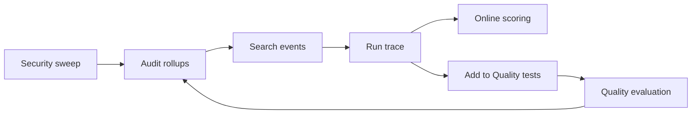

## What it does

Activity is the node's unified feed. It lists monitor alerts, finished tasks,
runs, approvals, meetings, and notes, newest first. It also includes an
**Observability** view for inspecting and evaluating agents.

## Observability workflow

The **Observability** view is a local-first observe-to-evaluate loop. It covers:

- live audit rollups and searchable model and tool events;
- correlated run traces;
- quality evaluation and bounded security probes;
- capturing a trace as a Quality test.

1. Open **Observability** and inspect request, error, latency, quality, token, and
   spend rollups. Choose **Last hour**, **Last 24 hours** (the default), **Last 7
   days**, or **All available**. The view refreshes every 15 seconds and supports
   manual refresh.
2. Search or filter events, then select one to inspect its correlated run trace.
   Raw prompts and responses stay in the conversation. Tool inputs appear as
   fingerprints in the trace view. If a trace cannot load, the selected event
   stays in place and **Retry trace** fetches its spans again.
3. Run **Quality evaluation** to replay the shared dataset, or run **Security
   sweep** to probe prompt injection, jailbreak, PII leakage, tool misuse, toxic
   output, injection variants, and bias/fairness handling.
4. Add a selected correlated trace to **Quality tests**. Ryu creates a baseline
   suite when needed, versions the capture, and deduplicates retries.
5. Use **Online scoring** on the selected trace to score a completed output
   without replaying its provider request. **Prune local audit** applies the
   configured retention policy.

The status badge reports the audit connection:

| Badge | Meaning |
| --- | --- |
| **Checking** | No audit response has arrived yet. |
| **Live** | The audit request returned a reachable response. |
| **Unavailable** | The audit request was rejected, malformed, or unreachable. |

### Online-scoring input limits

Online-scoring requests from extensions accept JSON output plus optional metadata,
variables, context, and assertions. Each JSON field is limited to:

- 32 nesting levels;
- 4,096 expanded values (a shared reference counts each time it appears in the
  serialized tree);
- one million serialized characters.

Invalid required output is rejected, and invalid optional JSON fields are
omitted. Cycles and non-JSON values such as BigInt cannot be scored. These
limits apply only to scoring requests; activity records and other host
responses keep their existing contracts.

### Model and policy path

Quality evaluation and security probes use the configured model and the normal
Gateway policy, budget, and audit path. The security campaign owns a fixed set of
probes and never executes a real tool from a probe.

For side-by-side prompts and models, assertions, custom evaluators, imports,
exports, and human review, continue with the [Agents guide](/docs/surfaces/desktop/user-guide/agents).
