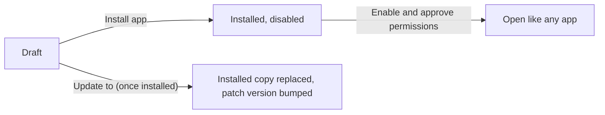

Build your own Ryu apps visually. App Studio uses the same drag-and-drop and chat
editor as [Sites](/docs/apps/sites), then installs the result as a Ryu app you can
open like any other.

## Build an app

1. Open **App Studio** and choose **New app**.
2. Give the app a name and description, and pick a template: **Blank**, **Checklist**,
   or **Notes**. Names cannot contain “Ryu” or “System”.
3. In **Design**, drag blocks from the palette onto the canvas, reorder them in
   **Layers**, and change text, styles, links, and alt text in the inspector. When a
   Ryu model is connected, describe a change in chat instead; chat produces the same
   undoable edits as dragging. Undo and redo work for both.
4. Use **Preview** to try the app, including its scripts, at desktop or mobile width.
   **Source** shows the app's single HTML document if you want to edit it directly.
5. In **Details**, choose the permissions the app may ask for.

Drafts save automatically in App Studio's own storage.

## Install and update

Choose **Install app**. Ryu installs it disabled. Enable it from your Ryu apps,
where you review and approve the permissions it asks for. It then opens like any
other app.

After you change the draft, choose **Update to** the next version to replace the
installed copy. Updates keep the same app identity and bump the patch version.
Deleting a draft does not remove an installed copy; remove that from your Ryu apps.

## What an App Studio app can do

An App Studio app is a single HTML page with inline styles and scripts. It runs in
the same sandbox as other Ryu apps: no network access, no background process, and
only these permissions, each of which you approve when enabling it:

| Permission | What it allows |
|---|---|
| Save its own data | Keep data in storage that only this app can read. |
| Show notifications | Show short messages in Ryu. |
| Use your model | Send prompts to your connected Ryu model. |
| Download files | Save files it creates to your computer when you ask. |

The **Checklist** and **Notes** templates save through the app's own storage once
installed and enabled. In **Preview** they say that saving starts after install
instead of pretending to save.

## Preview boundary

When App Studio runs outside Ryu, such as a standalone browser preview, drafts stay
in that browser and **Install app** is unavailable.
