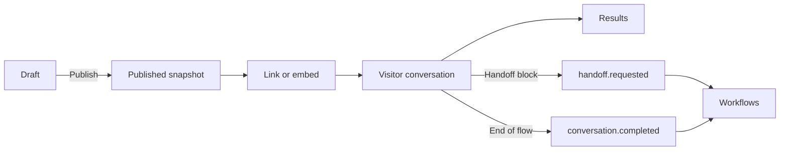

## What it does

Build conversational bots for support triage, lead capture, surveys, appointment requests, bug reports, and intake. Start from a preconfigured flow, edit it on a canvas, then publish a chat link or embed the bot on your own site. Bot Flows is a Ryu app and stores its bots, conversations, and results on the Ryu node running the app.

This page is part of the [Apps catalog](/docs/apps), [app manifest lifecycle](/docs/core/app-manifest-lifecycle), [Plugins vs Apps](/docs/extend/develop/extensions/plugins-vs-apps), and [App reuse](/docs/extend/develop/extensions/app-reuse-standard) documentation path.

## Templates

Every new bot starts from a template or from **Blank**. Each template is a complete flow that you can publish as-is or edit:

| Template | What it collects |
| --- | --- |
| Support triage | A topic and FAQ answers. If the answer helped, it asks for a satisfaction rating. If not, it collects an email and the issue, drafts an AI reply from your knowledge, and requests a support handoff. |
| Lead capture | Name, email, company, team size, budget, and timeline. It scores the lead, then either offers a booking link or resources and requests a sales handoff. It reads `utm_source` and `utm_campaign` when the link or embed provides them. |
| NPS survey | A 0–10 score with follow-up questions for detractors, passives, and promoters, plus an optional email. It accepts a `user_id` from the link. |
| Appointment request | Service, preferred date and time, contact details, and notes. The visitor reviews a summary, can go back and edit it, and then confirms, which requests an appointment handoff. |
| Product quiz | Three choice questions that score products. The visitor is then shown a recommendation with a link. |
| Bug report | Area, summary, steps, expected and actual results, severity, page URL, and email, then a bug handoff. It accepts `app_version` and `os` from the embed. |
| Onboarding | Name, role, and goal. The visitor gets tailored tips, then is offered a setup call (email and handoff) or a link to the docs. |
| Contact form | Name, email, topic, and message. It requests a handoff using the chosen topic. |
| AI FAQ | A question answered by AI from your knowledge. The visitor can ask another question or ask for a human. |

## Blocks

A flow is a set of groups on a canvas. Blocks run in order inside a group, and edges move the conversation to another group.

- **Bubbles** show content: text with variables and basic formatting, images, videos (YouTube, Vimeo, or a video file), and embedded pages.
- **Inputs** ask the visitor for something: text, number, email, phone, URL, date, rating (NPS, stars, or numbers), and single or multiple choice. Answers are validated on the node, and the visitor is asked again when an answer is not valid. An input can save its answer to a variable.
- **Logic** shapes the path: set a variable, branch on conditions (equals, contains, greater than, is set, and similar comparisons), A/B split, jump to another group, wait up to 30 seconds, or redirect to a link. Conditions are plain comparisons. Flows cannot run regular expressions or code.
- **Integrations** reach beyond the chat: **AI reply**, **HTTP request**, and **Handoff**.

A conversation ends when it reaches the last block of a group that has no outgoing edge. A bot's flow and settings, and separately its knowledge, are each saved as one request of at most 1 MiB. The app warns you and disables saving when a draft is larger.

## Publish, share, and embed

Publishing snapshots the draft you are looking at. If the bot changed elsewhere since you opened it, Bot Flows asks you to reload instead of publishing a version you have not seen.

Visitors chat with that snapshot until you publish again, so draft edits never change a conversation that is already running. Unpublishing closes the bot: its link shows the closed message, and existing results are kept.



The **Share** tab shows the bot's link and three embed snippets:

- **Standard** places the chat inline in an element on your page.
- **Popup** opens the chat in a dialog.
- **Bubble** adds a floating launcher button in a corner of your page.

Embedding works only on the HTTPS origins you list under **Allowed websites** on the Share tab. Other sites cannot frame the bot. Variables marked as hidden can be filled from the link or the embed, for example to pass a campaign or user ID. Visitors can never set any other variable.

<Callout type="warn">
Bot Flows is served through the Ryu node's generic app route. It does not provision a domain or a managed public edge, so visitors need network access to the node.
</Callout>

## Knowledge and AI replies

An **AI reply** block answers with the model configured on your Ryu node. You write its instructions and prompt, and it can draw on the bot's **Knowledge**, a list of articles you add in the app. Knowledge is stored with the bot so anonymous visitors can use it without access to your Spaces. A bot holds up to 50 articles of up to 20,000 characters each.

The bot owner pays for every AI reply, since it uses the node's model access. Visitors cannot choose the model or change the instructions.

Each bot caps AI replies per conversation (5 by default, up to 20) and per day (200 by default, up to 5,000). When a budget runs out or the model call fails, the bot shows a fallback message and the conversation continues.

## Hand off to Workflows

Bot Flows emits two app events that [Workflows](/docs/apps/workflows) can use as an event trigger:

| Event | When it fires |
| --- | --- |
| `@ryu/bot-flows#conversation.completed` | A visitor reaches the end of a published bot. It fires once per conversation. |
| `@ryu/bot-flows#handoff.requested` | A published bot runs a Handoff block. The payload includes the topic, a summary, the variables, and a transcript. |

Use them to create a ticket, add a CRM contact, or post a message in a channel. For example, this workflow trigger runs for every handoff, and `{{trigger.topic}}`, `{{trigger.summary}}`, and `{{trigger.variables.email}}` are available to its steps:

```json
{ "type": "event", "event": "@ryu/bot-flows#handoff.requested" }
```

Preview conversations from the builder never emit events.

## Results and privacy

The **Results** tab shows views, starts, and completions, a drop-off count for each input, each conversation's answers and transcript, and a CSV export. Spreadsheet formula prefixes are escaped in exported cells.

Each bot keeps up to 5,000 results, and the node keeps up to 20,000 across all bots. Once either limit is reached, the bot stops accepting new conversations. Only conversations in which the visitor answered at least once count toward these limits.

A conversation nobody answered is removed about a day after it started, once its session has expired. Starts and completions of such conversations therefore cover only about the last day.

Bots, conversations, and knowledge are stored with the app data on the active Ryu node. Visitors do not sign in. The hosted chat page and embed script load no third-party scripts, although image, video, and embed bubbles load their content from the URLs you set.

Visitor data leaves the node only through blocks you add:

- An **AI reply** sends its prompt and matching knowledge to your model provider.
- An **HTTP request** sends the data you template into it.
- A **Handoff** or a completed conversation passes its payload to workflows on your node.

HTTP request blocks run on the node. They call only public HTTPS addresses, do not follow redirects, and time out after at most 10 seconds. A failed request is logged on the result and the conversation continues.

{/* catalog:insert {"at":"end"} */}

The app contributes a Bot Flows Companion in the desktop Apps shelf and runs an out-of-process sidecar. See the [Bot Flows user guide](/docs/surfaces/desktop/user-guide/bot-flows) for the building workflow.
