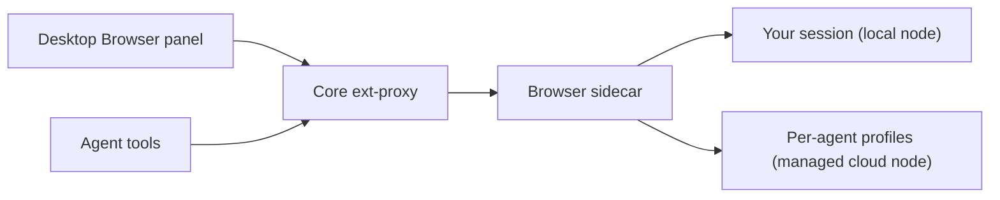
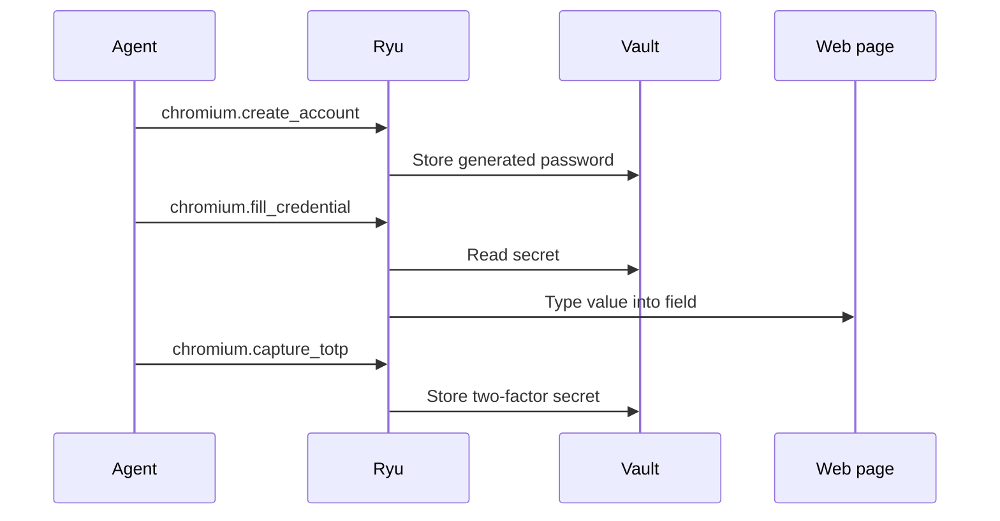

## What it does

Browser is a real Chromium browser (Electron) that Ryu agents and the desktop share. It provides the grant-gated `browser.control` capability.

- On a local node, agents can share one embedded session with you.
- On a managed cloud node, each Bot gets a hidden tab lane with its own persistent Chromium profile (see [Agent profiles](#agent-profiles)).

Core routes the desktop Browser panel and agent tools through its authenticated ext-proxy.

This page is part of the [Apps catalog](/docs/apps), [app manifest lifecycle](/docs/core/app-manifest-lifecycle), [Plugins vs Apps](/docs/extend/develop/extensions/plugins-vs-apps), [Marketplace](/docs/extend/develop/extensions/marketplace), [Gateway governance](/docs/gateway/governance) documentation path.

## Appearance bridge

The desktop Browser panel sends the current Desktop appearance to the browser chrome through the authenticated sidecar bridge. The shell follows the selected light or dark palette, contrast colors, interface and heading fonts, locale, and display time zone as they change.

History labels use that display time zone and locale. Appearance tokens are never injected into websites opened in browser tabs.

## Activity center

The browser toolbar includes an Activity center. It shows active and recently active
sessions started by Ryu:

- audio/video playback;
- microphone and camera capture;
- screen capture;
- browser control.

Selecting an activity for a visible tab brings that tab forward. Activity records are
ephemeral browser-chrome state. They are not written to browsing history or sent to an
agent, and a closed or navigated tab clears its activity.

### When an activity counts as active

- Media capture is reported only after a page receives a real `getUserMedia` or
  `getDisplayMedia` stream. A permission prompt by itself does not appear as active capture.
- Audio/video playback comes from Chromium's media lifecycle events. A tab with several media
  elements stays active until the page has no playing element left.
- Camera, microphone, and screen indicators stay active until the captured tracks actually end.
  This includes cloned tracks, capture in additional frames, and same-page or unsuccessful
  navigation.

A page cannot clear these indicators by sending an activity message or dispatching a synthetic
track event. Once capture stops, the activity briefly appears under **Recently active**.

## Browser window

The tab strip lets you select, open, and close tabs. The navigation controls go back, forward,
or reload the selected tab, and the address field accepts a URL or search. The Browser menu also
contains Find in page, zoom, the device toolbar, screenshot capture, cookie import, History,
Downloads, and Browser settings.

- **History** lists visited page titles, URLs, and visit times. Choose **Open** to bring a saved
  page into a visible browser tab, or **Clear history** to remove the list. Use the page's back
  control to return to the browser while keeping the active tab.
- **Downloads** on the toolbar shows recent download status and a shortcut to the download
  folder. Open the Downloads page from that popover or the Browser menu to review the list, open
  the folder, or clear its history.

### Desktop Browser dock

The Desktop dock opens a URL in the sidecar, refreshes its tab list, and lets you select or close
a tab. To annotate a page:

1. Choose **Annotate** to freeze the current preview, then click an element or drag an area.
   Hold **Shift** while clicking to add more targets.
2. Describe the change. When your browser supports speech recognition, **Dictate annotation**
   appends recognized words to the comment, and **Stop voice annotation** finishes dictating.
   Review the comment before saving it. You can always type the comment directly.
3. Optionally open **Adjust styling**, then choose **Add note**.
4. Choose **Ask Ryu to address notes** to open the assistant with the current page, its latest
   saved notes, and their style adjustments queued as context.

Press **⌘⇧D** on macOS or **Ctrl+Shift+D** on other platforms to toggle annotation mode.

Saved notes appear as overlays and in the tab's note list. Remove one note, or choose
**Clear notes** to remove all of them. **Cancel draft** discards an unsaved selection, comment,
and style adjustments. Notes remain with the open tab and are cleared when that tab navigates
or closes.

Failures keep your work so you can retry:

- If saving a note fails, the dock keeps the selection and comment so you can choose **Add note**
  again. After a successful save, the error clears and the note appears in the preview.
- Failed note deletions and clears keep the saved notes visible.
- While Ryu prepares assistant context, the **Ask Ryu to address notes**
  button stays disabled to prevent duplicate requests. If preparing context fails, the notes remain
  saved and you can choose it again.

## Chromium extensions

Open **Browser settings → Extensions → Load unpacked** to add a local Chrome or Chromium
extension folder. Ryu loads the extension into the visible browser session with local file access
disabled and remembers the folder for the next browser launch. Remove an extension from the same
list to unload it and forget its path.

Electron accepts unpacked extension folders, not `.crx` packages, and does not implement every
Chrome extension API. Only load extensions you trust. Extension code stays in the browser
profile and is not exposed through Ryu's browser-control tools.

## Agent profiles

On a managed cloud node, each agent browses in its own Chromium profile. Cookies, logins, and
site storage from one agent's session are never available to another agent or to your own
browser tabs.

Each agent signs in to sites separately. An agent stays signed in to a site across browser
restarts until it signs out or the site ends the session.

Each agent also keeps its own:

- **Browsing history.** Pages an agent visits are not added to your History or to another
  agent's.
- **Site permissions.** An agent's profile never prompts. Camera, microphone, location,
  notification, and clipboard requests are blocked unless that agent's own profile has the
  permission saved. Permissions you save in your browser never apply to an agent.
- **Downloads folder.** Files an agent downloads are saved in that agent's own folder, not your
  download location.

Your own browser's history, site permissions, and download settings are unchanged.

### Upgrading from earlier versions

| Upgrading from | What changes once |
| --- | --- |
| Before Browser 0.1.17 | Every agent on a managed cloud node shared one profile. Browser clears that shared profile's cookies and site storage, which signs agents out. Each agent signs in again in its own profile. |
| Before Browser 0.1.18 | Agents also shared one browsing history, site-permission list, and download list. Those entries can't be traced to a single agent, so updating deletes them and each agent starts empty. Files already in the old shared downloads folder stay where they are. |

## Agent accounts

Agents can sign up for and log into websites with their own accounts instead of yours. The
account's password, and any two-factor secret, live in the Ryu vault. The agent never sees,
types, or is told them.

1. **Sign up.** The agent calls `chromium.create_account` with the site and the username or
   email it will register with. Ryu generates a strong password and stores it. The agent then
   fills the sign-up form with `chromium.fill_credential`, naming the account and the form
   field (`username`, `email`, or `password`). Ryu types the value straight into the page.
2. **Two-factor setup.** When the site shows an authenticator setup page, the agent calls
   `chromium.capture_totp` on the QR code or the text setup key (sites usually reveal it behind
   a "can't scan?" link). Ryu reads the secret from the page and stores it.
3. **Log in.** The agent finds the account with `chromium.list_accounts`, fills the username,
   email, and password with `chromium.fill_credential`, and fills the current six-digit code
   with field `totp` when the site asks for it.

Ryu fills credentials only under these rules:

- The page is HTTPS on the account's own host. Subdomains do not match, since they can serve
  other people's content.
- Only the page's top-level document is filled, never an embedded frame.
- A password is typed only into a password field.
- Each agent sees and fills only the accounts it created. Listing accounts returns names and
  addresses, never passwords or two-factor secrets.

Reading a QR code needs Chromium's built-in barcode detection, which is not available on every
platform. The text setup key works everywhere.
