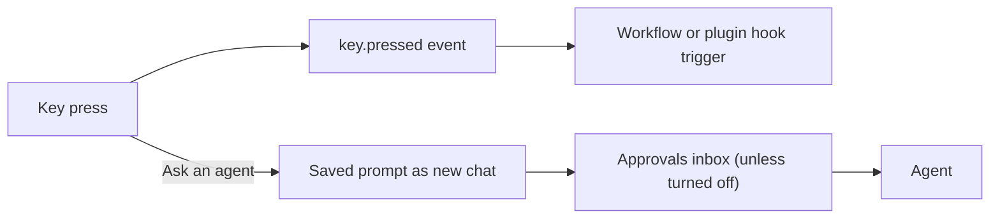

## What it does

Decks turns a USB control deck plugged into the computer that runs Ryu into a
set of Ryu keys. Open **Decks**, pick a key, and give it a label, a colour and
an action:

- **Raise the event only**: the press raises the `@ryu/decks#key.pressed` app
  event. Add an event trigger to a workflow (or a plugin hook) and filter on the
  deck's id and the key number to make that key do anything a workflow can do.
- **Ask an agent**: the press also sends a saved prompt to an agent as a new
  chat. Like every app-initiated message, it waits in the Approvals inbox unless
  you turned that off. A second press within a second and a half is ignored, so
  a double press does not send twice.

Every press raises the event, whatever the key's action is.

### Dials, strips, and wheels

On a deck with dials, pushing a dial raises `@ryu/decks#key.pressed` with `control`
set to `dial`. Turning a dial raises `@ryu/decks#dial.turned` with the number of
detents. A shuttle ring reports how far it moved. A tap on a touch strip or the
Touch Bar raises the press event with `control` set to `strip`.

| Deck | Dial controls |
| --- | --- |
| Stream Deck +, Corsair Galleon 100 SD, Loupedeck, Ajazz AKP03 and AKP05 | Dials |
| X-keys and Contour jog-shuttles | Jog and shuttle ring |
| Logitech MX Creative Dialpad | Roller and dial (turn only) |
| Xencelabs Quick Keys | Wheel |
| Cooler Master MasterHub | Knobs and 1xDial; faders and rollers (turn only) |
| 3Dconnexion 3D mouse | Puck (turn only) |
| Xbox, PlayStation, or GameSir controller | Sticks |
| DJI remote | Sticks and gimbal wheel (turn only) |
| Yamaha CC121MK2 | Encoders, jog wheel, and fader |
| TourBox | Knob, scroll wheel, and dial |
| Blackmagic panels | Jog wheel and T-bar (turn only) |

### Dial and deck lights

Some decks light their dials. Pick a colour for each under **Dial lights** in Decks,
or Off:

- Stream Deck Studio: two dial rings and knobs;
- Corsair Galleon 100 SD: two dial rings;
- Ajazz AKP05 / Mirabox N4: four knobs;
- Xencelabs Quick Keys: wheel ring;
- Mirabox Stream Dock XL: side lights (one colour for both);
- Cooler Master MasterHub: knob and fader lights.

The deck's brightness dims these lights too. On the Quick Keys, brightness sets only
the display, in four steps from off to full.

**Deck lights** controls whole-deck lighting:

- The Mirabox M18's 24 lights and the MasterHub base's light take one colour.
- On the DaVinci Resolve Replay Editor and the ATEM Micro Panel, it turns the T-bar's
  light strip on (any colour except black or near-black) or off.

On the iCON P1-Nano and the Behringer X-Touch One, a light you have not set is white.
The first choice reads **Default (white)**, and a black swatch turns the light off.

### Test a key

Use **Test** in the key editor to run a key without the deck. Recent presses,
and whether each one was sent, is waiting for approval or failed, show under
the deck.

## Supported decks

Decks works with USB stream decks and macropads, game controllers, keyboards,
USB MIDI controllers, and DAW control surfaces. Each family page lists the
supported models, what a key shows, and how the device maps to Ryu keys, dials,
and lights.

<Cards>
  <DocCard href="/docs/apps/decks-usb-panels" />
  <DocCard href="/docs/apps/decks-controllers-and-keyboards" />
  <DocCard href="/docs/apps/decks-novation" />
  <DocCard href="/docs/apps/decks-akai" />
  <DocCard href="/docs/apps/decks-midi-controllers" />
  <DocCard href="/docs/apps/decks-control-surfaces" />
</Cards>

## Close other deck software

Only one program can drive a deck at a time. While Ryu uses the deck, quit:

- the Stream Deck app, Ulanzi Studio, Work Louder Input, Loupedeck, or the Mirabox / Ajazz app;
- Razer Synapse, Logi Options+, or Mountain Base Camp;
- the Xencelabs driver, TourBox Console, Cooler Master's MasterHub software, or 3DxWare;
- Yamaha's ControlCenter, DJI Assistant, or serialosc.

Close the Vial app while Ryu uses a Vial keyboard. Turn off Windows Dynamic Lighting
(or OpenRGB on Linux) for a device whose lamps Ryu lights.

## Linux setup

On Linux, add the Decks udev rule once before you use a deck. The steps are in
[Decks Linux setup](/docs/apps/decks-linux).

## What stays on this computer

Layouts and brightness are stored on the Ryu node the deck is plugged into. The
list of recent presses is kept in memory only. Nothing leaves the node unless a
key asks an agent: that prompt goes to the agent like any other chat message.
