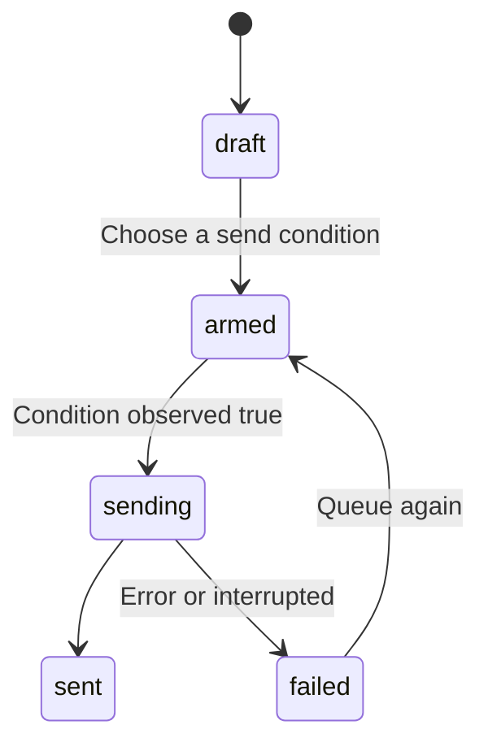

{/* catalog:description */}

Drafts is a durable outbox for messages you have not sent yet. Text you type into a composer and leave is kept as a draft instead of being lost with the tab.

Every draft lives in one node-wide store, not inside its chat. It survives closing the conversation, restarting the app, and moving to another project.

From the Drafts page you can write a message directly, edit a saved message, choose when it should send, or remove it. Editing keeps its existing conversation, agent, model, folder, source, and queue condition.

A draft can be armed behind one of three conditions:

- **when everything finishes** - work must be observed running and then return to idle.
- **when a slot frees** - fewer than the selected number of agent runs are active.
- **when a limit lifts** - the selected agent's fullest usage window falls below 90% used.

Each condition is checked against readings the app takes from this node. A draft whose condition
never becomes true stays a draft. Nothing is sent on a guess.

The page settings control whether unsent composer text is kept, whether sends queue when the node is busy, and how many concurrent runs are allowed. A failed create, edit, queue, delete, or settings write leaves the relevant values available to retry and shows the error beside the control.

### Deal as cards

Choose **Deal as cards** above the outbox to see your drafts as a fanned hand of cards.

1. Hover or focus to thumb through the hand.
2. Click cards onto the send pile. Click a pile card to take it back.
3. Press **Send**. The chosen cards are queued to send right away. The outbox sends one per
   dispatch, through the Approvals inbox when it is on.

A card that could not be queued returns to the pile with the reason, so **Send** again retries it.
Up to 12 of the newest drafts are dealt at a time from a face-down deck in the corner. The rest
wait in the deck and are dealt as sent cards leave the hand. The animation follows your
reduced-motion setting.

### Interrupted sends

If the app stops while a draft is sending, for example during a restart or an update, the draft is
marked as failed with "Send was interrupted; review and resend" instead of staying stuck in
sending. It is not sent again automatically, because the message may already have been delivered.
Check the conversation, then edit or queue the draft again if you still want to send it.

### Save from Chat

In Chat, **Save draft** keeps your message in the composer until the save succeeds. If saving fails,
an error appears below the composer and your text stays available to retry. You can keep editing
while a save is running; those newer edits stay in the composer. Choose a saved message from
**Drafts** to restore it into the composer for editing before sending.

## Data at rest

Drafts encrypts the text of every queued prompt, and the reason a send failed, with a key only this app receives from Ryu. Send conditions, states and times stay readable so the outbox can decide when to send.

Drafts saved by an earlier version are encrypted when the updated app starts. If the app is updated before Ryu itself, it keeps working unencrypted until Ryu delivers its key. Its health status says it is waiting for a Ryu update.
