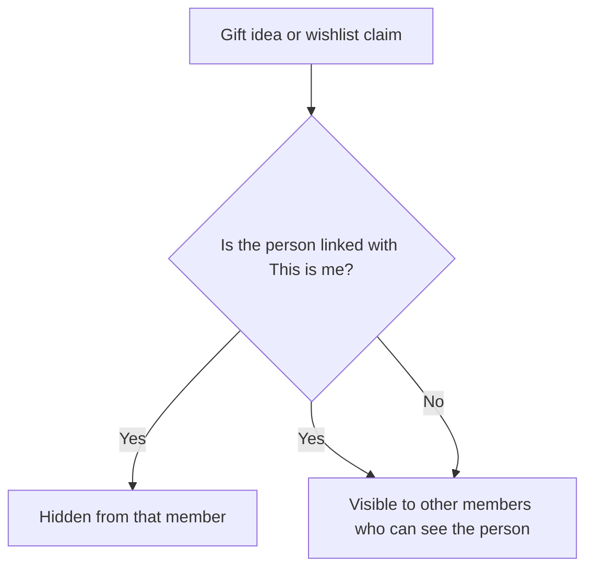

## What it does

Family is a shared hub for a household. It keeps important dates with
reminders, shared lists and chores, wishlists, and gift ideas in one place. The
Ryu node your family uses keeps the records, and nothing is bought on your
behalf.

<Callout type="warn">
Family is rolling out gradually, so it may not appear in your Store yet. Email reminders are not available.
</Callout>

## What you can keep

- **People and important dates.** Add the people you plan for, then their
  birthdays, anniversaries, and other dates. The year is optional. When it is
  set, the agenda shows the age or the number of years. A February 29 date
  falls on March 1 in years without one.
- **Shared lists.** Keep grocery, chores, to-do, packing, meal-plan, or custom
  lists. Items can have a quantity, an assignee, a due date, and a repeat
  schedule (daily, weekly, or monthly). Checking off a repeating item adds the
  next one.
- **Chore points.** Chores can carry points. Points are a simple tally per
  person, not money.
- **Preferences.** Note sizes, favorite things, and other details about a
  person. A detail marked sensitive stays private to that person and whoever
  added it, and only the person can share it with the family.
- **Wishlists.** Each person can keep a wishlist. Other members can claim an
  item so two people do not buy the same gift.
- **Gift ideas.** Save ideas, links, and budgets for an occasion, and mark them
  as bought or given.
- **Upcoming.** One agenda of the dates and due list items in the next 30, 60,
  or 90 days, with overdue items first.

Any row can be shared with the family or kept private. Only the person who
added a row can make it private. A private preference or wishlist item about a
linked person is also visible to that person.

## Surprises stay surprises

Gift ideas and wishlist claims are hidden from the person they are for. When a
person is linked to a member's account (**This is me** in People & dates), that
member:

- does not see gift ideas saved for them;
- does not see which items on their own wishlist someone has claimed;
- gets a birthday reminder that does not mention gifts.

Other members' reminders say only how many gift ideas are saved.

Linking with **This is me** does not give you anything other members wrote
about that person before you linked. A linked member also cannot delete their
own person; the member who added the person can.

Gift ideas for a person who is not linked to an account, such as a young child
or a grandparent, are visible to the members who can see that person.

## Reminders

Reminders arrive in your Ryu inbox and as push notifications. By default a
reminder goes out seven days before, one day before, and on the day. You can
change the lead times for each date.

In **Settings**, whoever manages the hub sets the family's time zone, the hour
reminders are sent, and the default lead times. Each member can mute their own
reminders.

## Family Planner agent

The Family Planner agent works from the same records. It can read upcoming
dates, update shared lists and chores, and suggest gift options as links with
price ranges within a budget, using family-visible preferences and wishlists.
Prices and availability may have changed since a search. It never buys,
reserves, or checks out anything.

The agent treats every conversation as one the whole family may see:

- It does not read or save gift ideas or claim wishlist items. Do that in the Family app.
- It never sees sensitive details, even ones a person has shared with the family.

Agent access is off until whoever manages the hub turns it on in **Settings**.

## Sharing with your family

Family works for one person on their own node, and for a family that shares a
node. On a shared family node, an organizer may need to give members access to
the app before they can view or edit it.

{/* catalog:insert {"after":["### Family Planner"]} */}

The bundled agent uses the `family` tools for dates, people, lists, chores, and
family-visible preferences and wishlists, and web search to suggest gifts as links
and price ranges within a budget. It never buys anything, and it leaves gift ideas
and wishlist claims to the Family app.

## Data at rest

The family hub encrypts names and relationships, date labels, list names and items, preferences, wishlist entries and gift ideas with a key only this app receives from Ryu. Dates' month and day, visibility and the family each record belongs to stay readable so reminders and sharing rules keep working.

Data saved by an earlier version is encrypted when the updated app starts. If the app is updated before Ryu itself, it keeps working unencrypted until Ryu delivers its key. Its health status says it is waiting for a Ryu update. The family agent tools reach encrypted data through the running app.

<Callout type="info">
Reminder notifications name the person and the occasion, and Ryu's notification inbox is not encrypted. Each delivered reminder keeps a readable copy of that name and date label.
</Callout>
