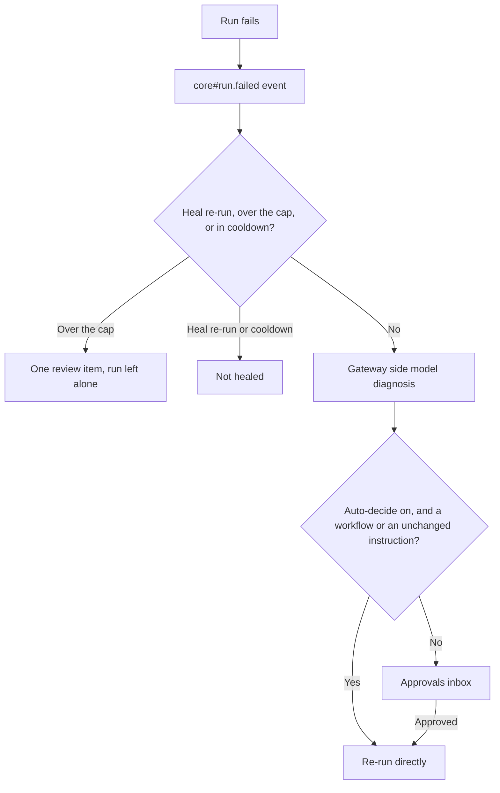

{/* catalog:insert {"before":["## Permissions"]} */}

## How it works

When a chat or agent run, a scheduled agent job, or a workflow run fails, Ryu raises the
[`core#run.failed`](/docs/extend/develop/sdk/plugin-sidecar-capabilities#sidecar-event-subscriptions) event.

Self-Healing receives it in its sidecar and decides whether the run should be healed. It never
heals a heal re-run, and it respects the attempt cap and cooldown. It then asks the Gateway side
model for a diagnosis and acts through Ryu:

- a proposed fix is queued in the Approvals inbox and runs only after you approve it;
- with auto-decide on, a failed workflow, or an agent run whose fix keeps your original
  instruction, is re-run directly (a rewritten instruction always waits for your approval);
- after the attempt cap, a single review item is queued and the run is left alone.

If Self-Healing is disabled, failed runs are not reported to it, and nothing about the failed
run changes.

{/* catalog:insert {"after":["## Permissions","**Grants:**"]} */}

| Grant | What it allows |
|---|---|
| `runs:failures` | Receive failed runs, including their instruction and error text. |
| `approvals:request` | Ask for your approval before a proposed fix runs. |
| `runs:rerun-agent` | Re-run a failed agent run. Ryu assigns the re-run id. |
| `workflows:runstate` | Re-run a failed workflow run. |
