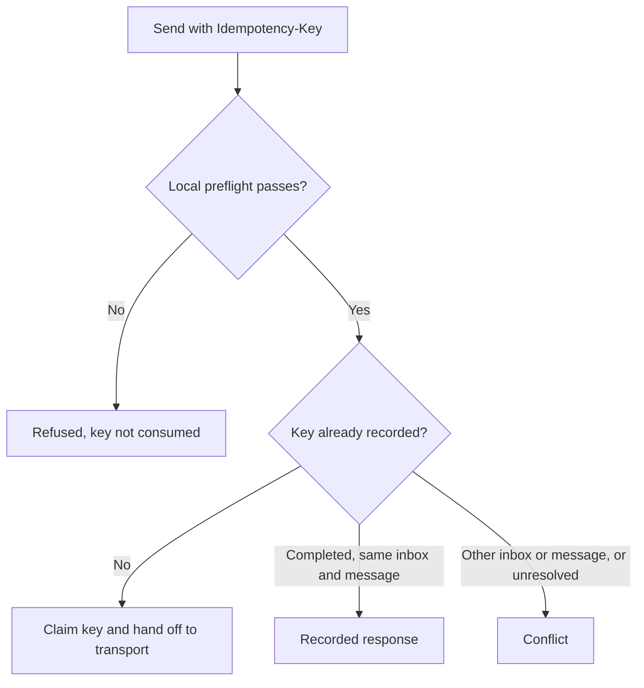

{/* catalog:insert {"before":["## Permissions"]} */}

Switching inboxes clears the current reading-pane message before displaying a message from the newly selected inbox.

The Messages view's **More message actions** menu marks the selected message as read or unread. The
Unread filter reflects the saved read state after the message list refreshes.

{/* catalog:insert {"at":"end"} */}

## Safe retries for sends

Mail send API callers can provide an `Idempotency-Key` header of 1 to 256 printable ASCII characters, with at least one non-space character. Sending without a key preserves the normal send behavior.

| Retry with the same key | Result |
| --- | --- |
| Completed send, same inbox and message | The recorded response, with no second transport handoff, even if the transport is later unconfigured. |
| Different inbox or message | Conflict. |
| Request still in progress, or transport outcome unresolved | Conflict. |

Local preflight refusals, such as an unconfigured transport or invalid recipient address, do not consume a retry key. Correct the configuration or input before retrying.

<Callout type="warn">
If a transport acknowledgement cannot be recorded, reconcile the existing request before sending again. Creating a new key can send another message.
</Callout>

Unresolved keys are retained across restarts rather than automatically retried. Older retry records that cannot establish an inbox-bound outcome require reconciliation.

These responses describe transport acknowledgement and local records, not confirmed delivery to a recipient’s inbox.

## Data at rest

Mail encrypts message and draft content on disk with a key only this app receives from Ryu:

- subjects, bodies, previews, and headers;
- sender and recipient addresses;
- draft attachments and attachment file names;
- event payloads and saved send responses.

Attachments and raw messages are stored as encrypted files. Inbox names and addresses, allow and block lists, labels, read state, and timestamps stay unencrypted so lists, threads, and filters keep working. Search still finds words in decrypted messages.

Mail saved by an earlier version is encrypted the first time the updated app starts, and older attachment files are encrypted in the background.

If the app is updated before Ryu itself, new mail stays unencrypted until Ryu delivers its key, and the app's health status says it is waiting for a Ryu update.

A self-hosted Mail service without Ryu uses the key you provide or creates its own key file in its data folder. Keep that file with the data.
