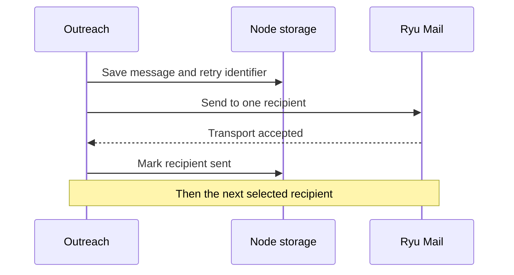

{/* catalog:insert {"before":["## Permissions"]} */}

## Create and review campaigns

Create a campaign with a name and one or more valid email addresses:

- Enter one address per line, or separate addresses with commas.
- Use `Name <person@example.com>` to label a recipient.
- Press Enter in the campaign name or audience field, or choose **Create campaign**.

Outreach keeps the form open and reports validation errors until every entered address is valid.

Use the campaign filters to move between drafts, ready campaigns, and send history. Open a saved campaign to review its subject, body, and selected recipients.

Choose an existing Ryu Mail inbox before sending. Outreach sends one explicitly selected recipient at a time through that inbox.

## How sending is recorded

Before it contacts Mail, Outreach saves the exact personalized message and a stable retry identifier on the node. If that save fails, nothing is sent.

Each accepted message is recorded before Outreach moves to the next selected recipient. If a later send fails, recipients already accepted stay marked sent, and the rest stay available to review and retry.

A sent mark means Mail's transport accepted the message. It does not confirm delivery to the recipient's inbox.

If Mail accepts a message but Outreach cannot save its status, the recipient needs reconciliation:

- Retry with the original inbox, subject, and personalized body. Outreach reuses the saved identifier, so Mail can replay its recorded result.
- Changing the draft or inbox does not bypass an unresolved send. Unresolved identifiers stay attached to their recipients across reloads.
- Mail may refuse reconciliation when its own result is uncertain. Resolve that result before you send again.

Sending through Mail and saving status in Outreach are separate steps, not one atomic transaction.
