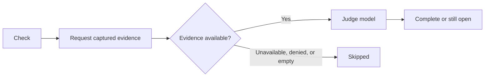

{/* catalog:insert {"before":["This page is part of the "]} */}

Saved notes, prompts, and clips can include a text preview. Select the preview to expand it, then use **Copy** to copy the full saved body. Kept captures are not checked by the task-completion detector.

{/* catalog:insert {"before":["## What it exposes"]} */}

## Check a task now

Choose **Check** on an open task to judge it now, using the active node's recent captured activity and history related to the task's completion condition. Desktop and mobile request that evidence through the authenticated node connection before invoking the judge.

Capture access is never granted by the task itself. If capture is unavailable, denied, or empty, the check stays skipped rather than guessing that the task is complete.

## Detection settings

Open the Quests **Tasks** settings tab to choose how completion is detected, which judge model and reasoning effort to use, and how often open tasks are checked.

### Check interval format

The default check interval is `2m`.

| Accepted | Example |
| --- | --- |
| Integer with a short unit | `30s`, `2m`, `1h` |
| Full unit names | `2 minutes` |
| Combined values | `1h 30m` |
| Milliseconds | `ms` or `millis` (not `milliseconds`) |

Units are case-sensitive. `m` is minutes and `M` is months, so `2H` is not a valid interval.

### Saving settings

An invalid interval shows a message beside the field and is not saved. Correct the value and leave the field to save it. If settings cannot be loaded, select **Retry**.

If a save fails because the node could not save it, timed out, or asked Ryu to slow down, your change stays visible and **Retry save** resends it. The other settings controls remain disabled until the save succeeds.

If the node refuses the value itself, for example an interval too large for it to store, the node's reason appears below the settings and the field is marked invalid. Every control stays editable and the refused value is not sent again.

Correct the field and leave it to save, or select **Discard change** to restore the value the node holds. Saving another setting keeps the reason on screen until the field is corrected.

## Data at rest

Quests encrypts your tasks, captures, the completion judge's evidence and reasoning, and the scratchpad on disk with a key only this app receives from Ryu. Ids, timestamps, and item kinds stay unencrypted so the board can sort and filter.

Data saved by an earlier version is encrypted the first time the updated app starts. If the app is updated before Ryu itself, it keeps working unencrypted until Ryu delivers its key. Its health status says it is waiting for a Ryu update.

Run without Ryu, the app creates its own key file in its data folder. Keep that file with the data.

{/* catalog:insert {"at":"end"} */}

## Related

<Cards>
  <DocCard href="/docs/core/quests" />
</Cards>
