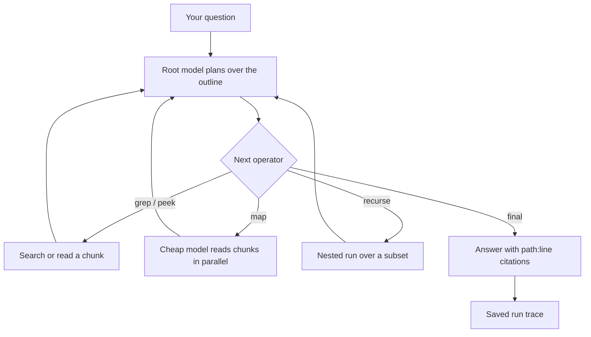

## What it does

Recursive Language Model answers questions about document collections that are too large to fit in a model's context. A root model plans over an outline of the documents and reaches the text through search and recursive model calls, then answers with `path:line` citations and a replayable trace.

Use it when a document collection needs several search or analysis steps. Before you rely on an answer, check the selected model, document access, run budgets, citations, and trace. A larger input does not guarantee the same accuracy: retrieval and model choices can miss or misread relevant material.

## How a run works

The root model never reads the documents directly. Each step, it picks one operator and sees only that operator's short result.

| Operator | What it does | Extra model calls |
|---|---|---|
| `outline` | Shows the chunk ids, sources, line spans and headings | No |
| `grep` | Regex search across the whole collection | No |
| `peek` | Reads one chunk, or a window inside it | No |
| `map` | Asks a cheap model the same question about each named chunk and folds the answers | Yes |
| `recurse` | Runs a nested query over a sub-collection built from named chunks | Yes |
| `note` | Writes to the planner's scratchpad so findings survive later steps | No |
| `final` | Answers and stops | No |

Each run has hard budgets: 14 steps, 400 model calls, a recursion depth of 2 and 600 seconds by default. A run that hits a budget ends with a `budget_exhausted` status and returns what it had, instead of a quietly shortened answer.

<Callout type="warn">
The app does not encrypt what it stores yet. Each context keeps the full text of the documents you load (or an agent sends), and each run keeps its question and step-by-step trace, in the app's data folder. Delete contexts and runs you no longer need.
</Callout>

Loading files and sending excerpts to a model are separate data-sharing decisions. Review the app permissions and the configured provider. Keeping data on local storage does not by itself make a task offline: a cloud model still receives the excerpts it reads.

See [app lifecycle](/docs/core/app-manifest-lifecycle), [plugin isolation](/docs/security/plugin-isolation), and [local-model setup](/docs/learn/cookbook/chat-with-a-local-model).
