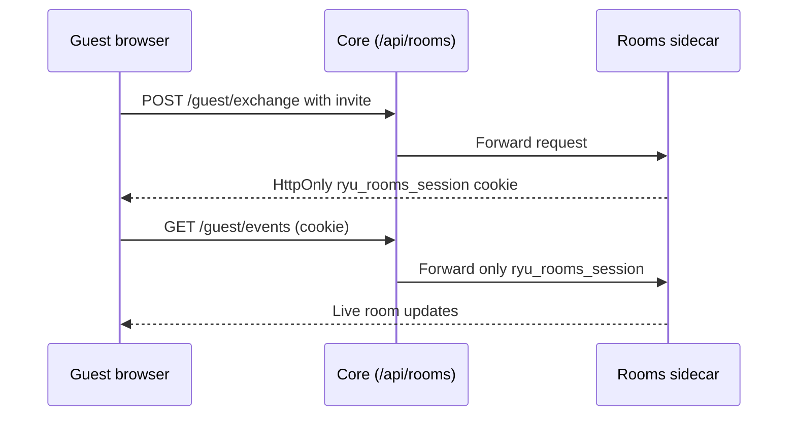

{/* catalog:insert {"before":["## What it exposes"]} */}

## Guest access

A guest opens the invite link, and the guest page exchanges the invite for a
session. Guest routes under `/api/rooms/guest` are public; every other Rooms
route needs your Rooms permissions.

- Core forwards only the app-owned `ryu_rooms_session` cookie to the sidecar.
  Core authentication cookies and undeclared browser cookies are never forwarded
  to an app sidecar.
- Revoking or rotating an invite removes existing guest sessions, including open
  live event streams.
- Expired sessions also stop receiving room updates.
- To reconnect, a guest must exchange a current invite. Keeping a browser tab open
  does not preserve access after removal.

## Data at rest

Rooms encrypts room messages, the streamed answer, run errors and participant names with a key only this app receives from Ryu.

- Rooms saved by an earlier version are encrypted when the updated app starts.
- If the app is updated before Ryu itself, it keeps working unencrypted until Ryu delivers its key. Its health status says it is waiting for a Ryu update.
