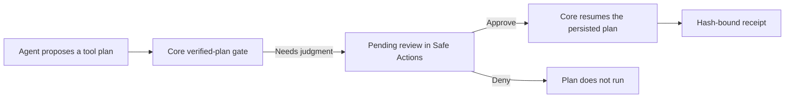

{/* catalog:insert {"before":["## What it exposes"]} */}

## How a review flows

The Companion never runs a tool itself. Approving a plan is the human review, and Core resumes the plan it persisted.

## Who can review

Every call the Companion makes needs two things at once:

- the app's approved `safe-actions:manage` grant;
- your own role in the organization that owns the node.

| Node | Read plans, findings and receipts | Change a policy or contract, approve or deny a plan |
|---|---|---|
| Organization node | Viewer or higher | Admin |
| Node not bound to an organization (for example your own machine) | Its operator | Its operator |

Approvals, denials and contract attestations are recorded under your signed-in identity, never a name the app supplies. The grant alone never makes an app a reviewer.
