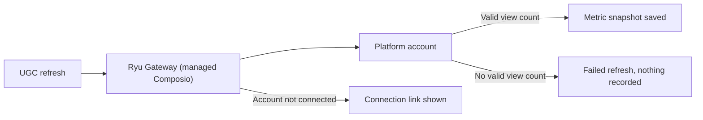

{/* catalog:insert {"before":["## Permissions"]} */}

## Metric refresh

Automated metric refresh uses the node's managed Composio provider. Configure its credential in **Gateway → Keys**; UGC does not store a separate Composio key.

- If a platform account is not connected, the refresh reports that account and offers the connection link returned by Composio.
- A refresh whose response has no valid view count is reported as failed and records nothing, so it never lowers a payout.
- You can always record metric snapshots by hand, for example when a platform keeps returning incomplete data.

## Submission links

UGC refreshes YouTube, TikTok, Instagram, X and LinkedIn automatically. A submission labelled with one of these platforms must link to that platform's own site.

- A link on any other site is refused for that label. Record it under another label, such as `other`, and enter its metrics by hand.
- Each post can be submitted once per campaign, whatever label it is sent under.
- Different spellings of one post count as the same post. Examples are a `youtu.be` link and a `youtube.com/watch` link to one video, or a link that differs only by a percent-encoded character or a doubled slash.

## Data at rest

The creator roster (names, contact emails, platform handles, payout handles and notes) is encrypted with a key only this app receives from Ryu. The roster is searched after it is decrypted. Campaigns, submitted post links, view counts and payout amounts are not encrypted.

- Creators saved by an earlier version are encrypted when the updated app starts.
- If the app is updated before Ryu itself, it keeps working unencrypted until Ryu delivers its key. Its health status says it is waiting for a Ryu update.
