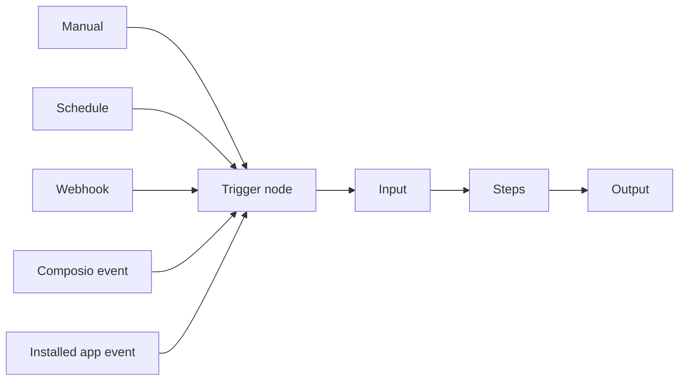

{/* catalog:insert {"before":["## What it exposes"]} */}

## Build and save a workflow

1. In the Workflows companion, choose **Add** to open the searchable node palette.
2. Add steps such as Input, Transform, and Output.
3. Connect each step's output handle to the next step's input handle.
4. Configure input and output keys and any step-specific fields.
5. Save. Ryu stores the workflow name, description, node settings, connections, and triggers on the active Core node.

Reopen a saved workflow from the Workflows list to continue editing it.

Editing details:

- Renaming a node keeps its incoming and outgoing connections attached.
- When a catalog item is available, skill, tool, and plugin pickers show its display name while the workflow keeps the selected identifier.
- Changing a plugin clears its previous runnable selection. Choose a runnable from the newly selected plugin before saving.

### When a save or reload fails

- **Save fails.** The canvas stays open and keeps your unsaved graph, trigger settings, and node positions so you can correct the problem or retry.
- **Reload.** For an existing workflow, **Reload latest workflow** fetches the latest saved definition after you confirm **Discard edits and reload**. This discards your unsaved edits; **Keep editing** leaves them intact. If reloading fails, your draft stays available and you can retry. Review or edit the loaded workflow before saving again.
- **Save succeeds but other views are not notified.** The companion reports **Workflow saved** with that notification error. The workflow is already saved, so refresh the other view to see the latest definition. Save again only after making further edits.

### Code steps

The **Code** step runs or checks a Lean 4, Bend, or BAML program.

- Choose the language and **Run** or **Check**, then edit the source. The source is used exactly as written.
- **Program input** (Lean and Bend) and the BAML **Arguments** accept variables such as `{{input}}`.
- Switching language replaces an unedited starter program with the new language's starter, and keeps a program you edited.

See [Code steps](/docs/core/workflow-code-and-scripts#code-steps-lean-bend-and-baml) for where programs run and which toolchains they need.

To write part of a workflow as JavaScript, add a **Script** node from the Core group. Its script calls sub-agents with `agent()`, `parallel()`, and `pipeline()`, reads the node input as `args`, and returns the node output. See [Workflow scripts](/docs/core/workflow-code-and-scripts#workflow-scripts).

## Configure a trigger

The pinned **Trigger** node sits before the workflow steps. Select it to choose when the workflow runs.

- **Schedule.** Supports interval presets and custom cron expressions.
- **Webhook.** Shows its signing secret and, after the workflow is saved, the URL to call.
- **Composio.** Can also bind an existing Connect trigger to the saved workflow.

## Run and resume

Save the workflow before selecting **Run**. Enter values for its Input nodes, then choose **Run** for a normal execution or **Dry run** for a read-only preview.

- A **Pause for review** node suspends the run. It keeps the entered response available if resuming fails, so you can retry without starting over.
- When a step reaches a provider rate, usage, or session limit, the run shows **Paused by a provider limit** with the time it continues. The run picks up from that step on its own when the limit resets.
- Runs interrupted by a crash or restart continue the next time Ryu starts.

See [Automatic resume](/docs/core/workflow-execution#automatic-resume) for the run states.

## Version history

Select **Save version** to save the current canvas and then snapshot its persisted definition. If that save is refused or fails, your edits stay on the canvas and no new version is created.

If another editor saves between your save and its snapshot, the snapshot is refused. Your successful save stays in history, no named version is created, and your canvas stays available. Choose **Reload latest workflow**, review the latest definition, and retry **Save version**.

Open **History** to compare a snapshot with the current draft or restore that saved definition. Restoring updates the canvas and the saved workflow.

## Record a desktop task

Select **Record a task**, describe what you are about to do, and start recording. When you stop, the captured actions become editable workflow nodes between Input and Output. Review and save the resulting graph before running it.
