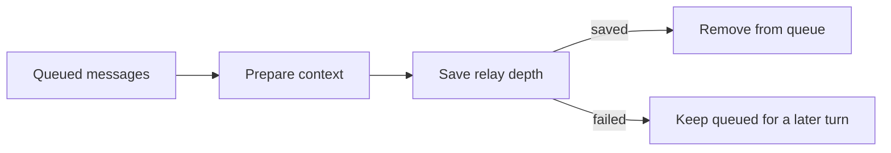

{/* catalog:insert {"before":["## Engine requirement"]} */}

## In the transcript

When an agent messages other agents, the desktop chat shows one **Messaged** line for the whole
fan-out instead of a bubble per message. The line shows the recipients' avatars and a count, such
as **Messaged 7 agents**, or the recipient's name when there is only one.

- Select the line to list the recipients with the latest message to each.
- Pick a recipient to open that exchange as a read-only conversation headed **Sender ⇄ Recipient**.
  Choose **Close chat** to return.
- A message that Switchboard refused (for example, at the hop limit) is marked **Not delivered** in
  the list, in the conversation, and as a count on the line itself.

## Queue recovery

The delivery hook removes queued messages only after it prepares their context and saves the
conversation's relay depth. If that save fails, the messages stay queued for a later turn. If
another write changes the inbox while delivery or invalid-inbox cleanup runs, the newer messages
are kept.

This is local queue handling. It does not guarantee that the other agent completed the work.
