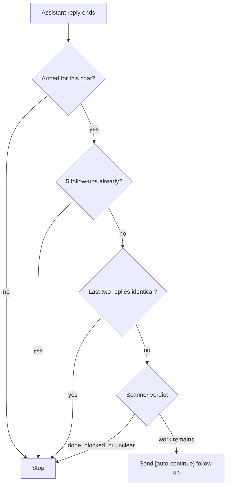

{/* catalog:insert {"before":["This page is part of the "]} */}

Auto Continue is off for every chat until you arm it. Type `/auto-continue on` (or `start`) to arm
it for the current chat and `/auto-continue off` (or `stop`) to stop it. Any other argument shows
the supported commands and leaves the switch unchanged.

After each assistant reply in an armed chat, a read-only scanner agent checks the reply and the
workspace. It decides whether another turn can finish concrete remaining work. Only that verdict
sends a follow-up, and each injected follow-up starts with `[auto-continue]`.

The loop stops on its own when any of these is true:

- It has sent 5 follow-ups in a row since your last message. Send a message to let it continue.
- The last two non-empty assistant replies are identical.
- The scanner reports that the work is done, blocked on you, or gives no clear verdict.

<Callout type="warn">
  Auto Continue spends model tokens while you are not watching. Arm it only for chats where
  unattended follow-up turns are acceptable.
</Callout>
