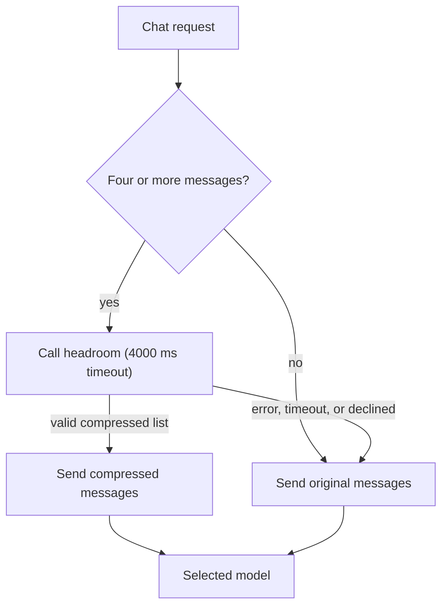

## What it does

Headroom compresses chat messages before the Gateway sends them to the selected model. It uses the
[headroom](https://github.com/chopratejas/headroom) engine, applies to streaming and non-streaming
chat requests, and keeps the model name and other request options unchanged.

<Callout type="warn">
  Headroom is experimental and not installed by default. Ryu does not bundle the headroom engine,
  and compression covers only the Gateway's OpenAI-compatible chat path. Token savings and answer
  quality depend on the workload, so measure both on representative requests. Setup, coverage,
  and configuration are documented in [Context Compression](/docs/gateway/compression).
</Callout>

## Requirements

Install the headroom proxy so the `headroom` command is on `PATH`, or point `RYU_HEADROOM_BIN` at
it. When the plugin is enabled, Core starts `headroom proxy --host 127.0.0.1 --port 8787` and
configures the Gateway's compression policy, and disabling it clears that configuration.

## Request behavior

- Conversations with fewer than four messages pass through without calling the compression
  service.
- Each compression call has a 4000 ms timeout.
- Token savings are recorded only when a valid compressed message list is applied.

On a desktop or self-hosted Gateway, compression fails open.
The Gateway sends the original messages and the model request continues when the compression service:

- is unavailable or times out
- returns an error status
- returns unreadable JSON or malformed messages
- declines to compress

Ryu's hosted Gateway behaves differently; see [Context Compression](/docs/gateway/compression).

See [Gateway governance](/docs/gateway/governance), [plugin runtime](/docs/extend/develop/extensions/plugin-runtime), and [plugin manifests](/docs/extend/develop/extensions/plugin-json-manifest) for the execution and configuration boundaries.
