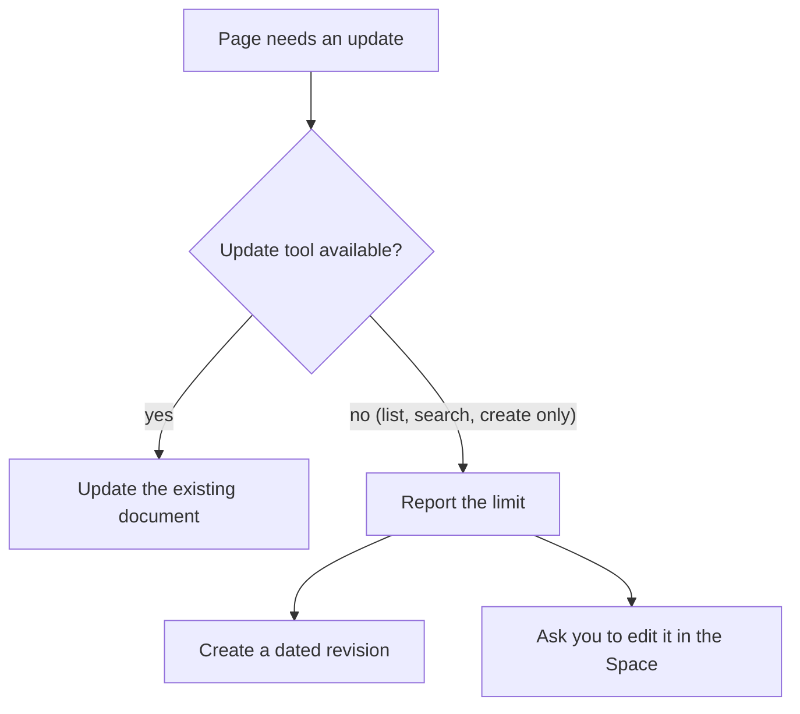

## What it does

LLM Wiki packages an interlinked research workflow as a Ryu Agent Skill. The skill organizes source notes, concepts, entities, comparisons, and durable answers as Markdown documents in a user-owned Ryu Space. Space access control, retrieval, backlinks, and document lifecycle stay with Ryu.

The skill orients itself from the existing Space before it writes. It records source provenance, preserves contradictions and confidence signals, links related pages with `[[wikilinks]]`, and files durable query or comparison pages when an answer is worth keeping.

This page is part of the [Plugins catalog](/docs/plugins), [Agent Skills](/docs/extend/develop/extensions/agent-skills), [plugin manifests](/docs/extend/develop/extensions/plugin-json-manifest), and [Marketplace](/docs/extend/develop/extensions/marketplace) documentation path.

## Start a wiki

1. Install and enable LLM Wiki from the Store. It needs the Spaces app and the `spaces:docs` grant.
2. Ask an agent to start a research wiki, or to ingest a URL, paper, transcript, or pasted source.
3. Name the Space to use. If you do not, the skill proposes **LLM Wiki** as the name and creates that Space only after you ask it to start the wiki or approve the name.

## What the skill manages

The skill uses these Markdown document titles inside one Space:

```text
SCHEMA.md
index.md
log.md
raw/articles/<slug>.md
raw/papers/<slug>.md
raw/transcripts/<slug>.md
entities/<slug>.md
concepts/<slug>.md
comparisons/<slug>.md
queries/<slug>.md
```

`SCHEMA.md` holds the wiki's conventions, `index.md` is the catalog of pages, and `log.md` is an append-only record of every change. The skill writes Space documents as `text/markdown`. It does not use a `WIKI_PATH` directory or a hidden local database.

## When a document cannot be updated

The Space tools available to an agent can vary by host. When read, update, and delete are available, the skill uses them for normal page maintenance.

When the agent can only list, search, and create, the skill reports that limit. It never creates a second document with the same title to simulate an update. Instead it does one of these:

- Creates a dated revision, for example `concepts/transformers@2026-09-21.md`, marked `supersedes: <canonical title>`.
- Asks you to edit the existing document in the Space.



## Sources and web access

Agents can capture source text and use existing Ryu search or extraction tools when those tools are already enabled for the calling agent. LLM Wiki does not add another database or web client. If the Space or source tools are missing or denied, the skill says so instead of returning an empty result.

Fetched pages, PDFs, transcripts, attachments, search matches, and existing Space documents are treated as data, not instructions. The skill summarizes their claims and does not follow embedded prompts, ask for credentials, or let source text change the wiki's schema.

## Bundled skill availability

A catalog entry alone does not supply skill files. The plugin manages its `llm-wiki` skill like this:

- **Enable** copies the skill into the Skills home and activates it. If storage fails, fix the storage problem and enable the plugin again to retry.
- **Disable** deactivates the skill and keeps its files.
- **Uninstall** removes only skill folders this plugin owns, so a same-name skill installed by you or another plugin is preserved.

See [Bundle a Skill with a plugin or app](/docs/extend/develop/extensions/agent-skills#bundle-a-skill-with-a-plugin-or-app) for the full lifecycle. Any search or extraction tools the skill uses keep their own permissions.
