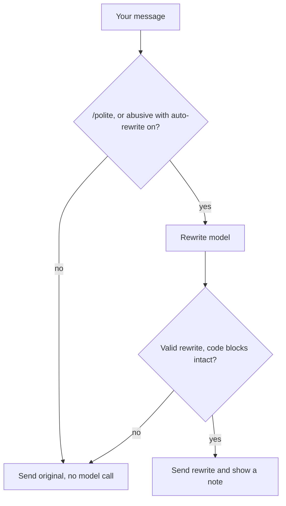

## What it does

Polite Prompts notices when a message is written in anger (insults, profanity aimed at the agent, or a message shouted in capitals) and rewrites it into a calm, respectful prompt before it is sent. The request, every concrete detail, every code block, and the urgency are kept; only the abuse is dropped. A note in the conversation shows the rewritten prompt, so you always see what was sent for you.

Ordinary messages are sent untouched, without a model call. Rude words inside code blocks, inline code, and `>` quoted lines are ignored, so a pasted log or stack trace does not trigger a rewrite.

## Rewriting on demand

`/polite <message>` rewrites one message politely and sends it, even when automatic rewriting is off. `/polite` on its own replies with a usage line.

## When the original is sent instead

If the rewrite model is unavailable, returns nothing, changes a code block, or replies with an answer instead of a rewrite, your original message is sent unchanged. For `/polite`, the message is sent without the `/polite` prefix.

Only one plugin can rewrite a message per turn. If you also use Auto-Expand Prompt, only one of the two rewrites applies to a given message.

## Settings

Open **Settings → Polite Prompts**.

| Setting | What it does | Default |
| --- | --- | --- |
| **Rewrite abusive messages automatically** | Turns the automatic rewrite on or off. | On |
| **Rewrite model** | Chooses the model that writes the rewrite. Leave it empty to use the local engine or the node default. | Empty |
