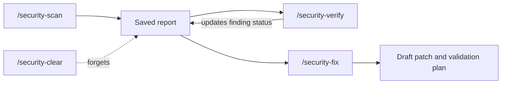

## What it does

Security Scanner runs a multi-agent security review of your code. It maps the architecture, looks for vulnerabilities, has independent agents try to disprove each finding, reviews diffs, and drafts fixes. It never changes files. The slash commands are listed under [UI it contributes](/docs/plugins/security-scanner#ui-it-contributes).

## Clearing a report

`/security-clear` confirms clearing the conversation report only after storage accepts the deletion. If deletion fails, it reports the failure and you can retry. A failed clear does not confirm that the report is gone.

Scan, verification, and patch-proposal results are saved for follow-up commands. If saving is refused, the current result remains visible with a state warning, but `/security-verify` and `/security-fix` cannot rely on it.

Fix the storage problem and run the original command again. Retrying is safe.

## Bundled skill availability

The plugin bundles three skills: `security-scan`, `security-diff-scan`, and `security-fix`. A catalog entry alone does not supply skill files.

- **Enable** copies them into the Skills home and activates them. If storage fails, fix the storage problem and enable the plugin again to retry.
- **Disable** deactivates them and keeps the files.
- **Uninstall** removes only skill folders this plugin owns, so a same-name skill installed by you or another plugin is preserved.

See [Bundle a Skill with a plugin or app](/docs/extend/develop/extensions/agent-skills#bundle-a-skill-with-a-plugin-or-app) for the full lifecycle. The workflow still needs the connected tools it uses and their permissions.
