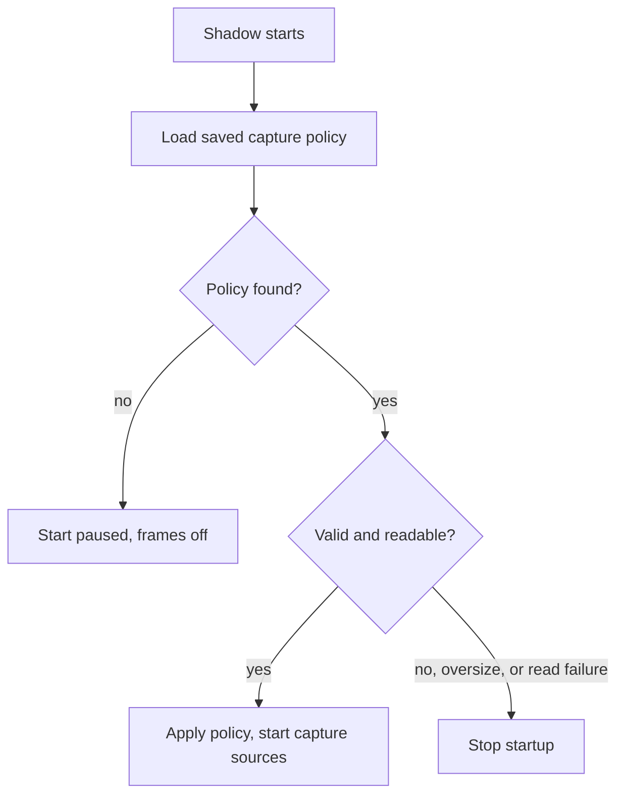
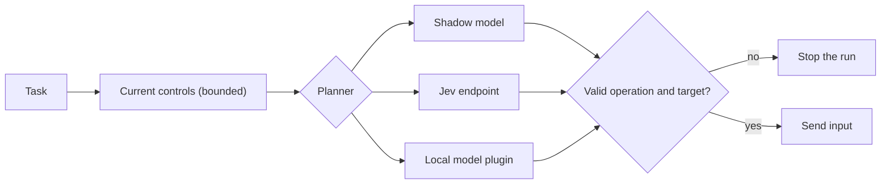

{/* catalog:insert {"before":["## What it exposes"]} */}

## Capture settings

Capture settings control what Shadow records on this device. Change them in Shadow or Island
settings.

### App allowlist and screen text

Shadow applies its app allowlist to both screenshots and screen text recognition. Apps outside the
allowlist do not contribute captured screen text. When an allowlist is set and Shadow cannot
identify the foreground app, it skips screen text recognition for that capture tick.

### Capture settings status

Capture controls select the preferences to save on this device and apply to Shadow. While a change
is pending, Shadow and Island settings show **Applying capture settings**. A checked pause
preference alone does not confirm that capture has stopped.

| Message | Meaning |
| --- | --- |
| **Capture settings could not be applied** | Shadow refused the change or could not be reached. |
| **Could not save capture preferences** | Local preferences could not be saved. A change Shadow accepted may still be active for the current session. |
| **Could not read saved capture preferences** | Saved preferences could not be read, or contain invalid values. Capture is left unchanged. |

Use **Retry capture settings** to save and apply the same selected preferences again. You do not
need to toggle pause off first. Retry reads saved preferences again before applying them, so an
unknown saved pause state is never replaced by a default unpause. Retry does not repair invalid
saved data, so correct it first. Missing preferences use the first-install defaults.

### History retention

**Keep history** sets how long Shadow keeps captured history, from 1 to 3650 days. Press Enter or
leave the field to apply the value. A number outside that range is limited to it, and an empty
field keeps the current window. The field then shows the resulting number of days. A successful
save reports the stored duration and survives reopening Shadow.

Retention saves as one complete policy. If storage cannot save a retention change,
`POST /capture/control` returns HTTP 500 and keeps the previous policy. Pause, screen-frame
capture, and app-allowlist changes in that same request are not applied either. Retry once
storage is available.

Shadow enforces **Keep history** when it starts, every hour, and right after a retention change is
saved. It deletes everything captured before the window:

- Timeline activity, including app, window, site, and passive-source history.
- The raw event logs that hold typed input and clipboard events, and the activity summaries and
  suggestions Shadow builds from them.
- Screen frames and video, audio recordings, recognized screen text, and transcripts.
- Their full-text and visual search entries.

Index and database entries are removed before their files, so an interrupted sweep finishes on the
next run.

An event-log hour or recording is judged by when it was last written. One that straddles the start
of the window stays on disk until its last capture ages out, but its events no longer appear in
Timeline or search. Saved clips, meeting summaries, learned procedures, and memory are not affected
by this setting.

### Capture settings across restarts

Shadow stores its accepted pause, screen-frame, and app-allowlist policy in its local timeline
database, separately from Desktop's selected preferences. It loads and validates that policy
before starting capture sources. A refused save keeps the previously accepted policy, and
restarting Shadow restores that policy rather than a rejected Desktop draft.

On a new installation, or an upgrade without an accepted capture policy, Shadow starts paused with
screen-frame capture disabled. Open Shadow settings and apply your capture preferences. Desktop
sends the complete selection. Saving retention alone does not enable capture.

A standalone API client must send all three fields, `paused`, `frames`, and `app_allowlist`, in its
first `POST /capture/control`. An incomplete first update returns HTTP 409 with code
`capture_policy_uninitialized` and changes nothing. Later updates can omit unchanged capture
fields.

Accepted capture changes and any retention change in the same request commit together before they
become active. A storage refusal returns HTTP 500 and keeps the previous complete policy. The saved
policy is limited to 2 MiB.

Invalid or unsupported saved policies, oversize records, and database read failures stop Shadow
startup instead of enabling capture.

<Callout type="warn">
  For a startup storage error, stop Shadow, keep the database, fix the reported storage problem,
  and restart it. Retrying inside the same running process is not supported.

  Do not delete the database to get past the error: a missing policy means you must apply the full
  capture preferences again.

  An older Shadow binary does not enforce the saved policy. Pause capture before downgrading, and
  do not assume a downgrade keeps capture paused at startup.
</Callout>

## Device access

| Platform | What Shadow needs |
| --- | --- |
| macOS | Screen Recording for screen capture. Accessibility for automation and app context. Input Monitoring for global input observation. |
| Windows | No matching permission prompts for native screen capture and UI Automation. Automating elevated windows can still need extra privileges. |
| Linux | An X11 session for native capture and global automation. Input learning needs read access to input devices. |

On macOS, review each permission under **Settings → Privacy → Device permissions**, then restart
Ryu and retry. A standalone sidecar can be attributed to the terminal or host app that launched it,
so check that app in System Settings.

<Callout type="warn">
  Wayland portal capture is not supported by these native backends. On Linux, run an X11 session.
</Callout>

## Desktop Companion consent

The standalone Companion restores your locally saved consent when it opens. Context read,
proactive suggestions, and Ghost desktop actions are separate choices, and each starts disabled.
The header shows whether context reading is disabled, active, or paused. Pausing stops the
Companion's context and suggestion reads. Resume from its Settings tab.

Use the app allowlist in Companion Settings to limit capture to named apps. Settings survive
reopening the overlay. When Shadow is unavailable, the Companion shows that state and keeps its
settings available.

The overlay grows to fit Settings, answers, and desktop-action controls, and shrinks when less is
visible. It keeps your dragged position while the content fits the display's usable area. Near an
edge, it moves only as far as needed to keep the controls on screen. Long answers and panels scroll
on smaller displays.

Ghost actions always need a confirmation. Focus App and Click Element need a nonblank target,
including when confirmed with Enter. Escape or Cancel dismisses the confirmation. Changing the
selected node clears the staged action and previous result while agents load for the new node. If
loading fails, use Retry before running an action.

{/* catalog:insert {"before":["## Permissions"]} */}

The `shadow.computer_use` result includes these fields:

| Field | Values |
| --- | --- |
| `planner` | `native` for Shadow's text model, `jev` for Jev, or `local` for a selected model plugin such as Needle 3 or FunctionGemma. The legacy `laya` value stays valid for saved Laya endpoint configurations. |
| `status` | `completed`, `blocked`, or `step_limit` |
| `steps` | The steps the run took |
| `message` | A human-readable summary |

Check `status` before you treat a result as a finished task. A blocked or step-limited result is
not completion.

## Computer-use planners

Choose a planner in **Settings → Plugins → Shadow → Computer use**.

| Planner | How it decides | Where data goes |
| --- | --- | --- |
| **Shadow model** | Shadow's configured text model picks from indexed action choices. | Shadow's text-model route |
| **Jev Ultrafast** | Jev's choice-based planner at the HTTPS endpoint you configure. See the [Jev Ultrafast project](https://github.com/browser-use/jev-ultrafast). | The task, active app and window title, visible accessibility control labels, editable field values, and recent action outcomes go to that endpoint |
| **Local model plugin** | A model contributed by an enabled local planner plugin. | Stays on this node once the model bundle and runtime are installed |

Jev's API key is stored in the node's encrypted plugin-secret store and is never returned to the
desktop. Use Jev only when sending that accessibility context is acceptable for the current app.

### Local model plugins

The **Local model** menu lists options contributed by enabled planner plugins, named by model and
plugin. The list is plugin-driven, not fixed in Shadow. Install and enable a model plugin before
you select it. Each plugin page covers its download size, setup, and caveats:

- [Laya](/docs/plugins/laya) - a general typed-decision model with four profiles.
- [Needle 3](/docs/plugins/needle3) - a small Apache-2.0 tool-calling model.
- [FunctionGemma](/docs/plugins/functiongemma) - gated on Hugging Face and needs a saved Hugging
  Face token before you enable it.

<Callout type="warn">
  FunctionGemma is experimental for desktop actions. Its base checkpoint is not fine-tuned for
  Shadow.
</Callout>

If the saved model is no longer offered by an enabled plugin, the menu shows it as
**Unavailable model** and you cannot save until you choose an available one. Core checks the
selection again on save, so a plugin disabled after the menu loaded is refused and the saved
planner stays unchanged.

These planners select actions. They do not write prose, so when a task needs text entry, Shadow's
configured text model supplies the field value.

### How planner settings are saved

The authenticated local Core service saves computer-use settings in Shadow's shared data directory.
Jev credentials stay in Core's encrypted plugin-secret store, not in the settings file.

- **Shadow stopped** - saving does not start screen or audio capture. The selected planner applies
  the next time Shadow starts.
- **Shadow running** - Core applies the new settings immediately and reports whether that worked.

The maximum step count is an integer from 1 through 20.

Desktop loads Core's saved computer-use policy before it enables policy saves. It reads Jev
credential metadata before it enables key writes. The two reads are independent:

- If either read fails, an error and a **Retry** action reload that state. Unavailable data is
  never treated as default settings or an unset credential.
- A rejected save keeps the draft for another attempt.
- Repeated clicks while a save is pending do not send another write.

### Safety checks

All planners work on a bounded set of current controls. Returned operation and target IDs are
validated before any input is sent, and a failed or stale decision stops the run. The current app
must be allowed by Shadow's app allowlist, and capture must not be paused.

