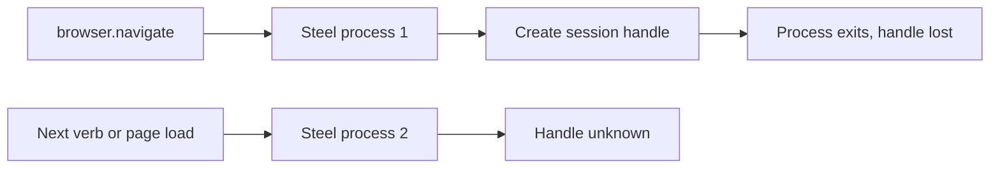

## What it does

Steel connects [Steel](https://steel.dev) cloud browsers to Ryu through Steel's official MCP server.

<Callout type="warn">
  Steel is a preview. It is hidden from the Store, and it does not work as Ryu's Browser layer yet.
  Do not select it in the Browser provider picker.
</Callout>

## Why it is not usable as the Browser layer yet

Ryu starts a fresh Steel server process for every tool call. The session handle that Steel creates for `browser.navigate` exists only inside the process that created it, so no later call can use it.

That includes the page load `browser.navigate` makes right after it creates the session, and every other verb such as `browser.snapshot` and `browser.click`. Steel stays hidden from the Store while that is the case.

Steel's stateless tools that take a URL directly, such as `steel.steel_scrape`, finish within one call, so this limit does not affect them.

## Declared Browser layer mapping

The plugin declares how the standard `browser.*` verbs map onto Steel, with each Steel session as one Ryu tab. These bindings do not work yet, for the reason above:

| Ryu verb | Steel behavior |
| --- | --- |
| `browser.navigate` | Starts a new Steel session, opens the URL, and returns the session as the tab id |
| `browser.snapshot` | Returns the accessibility tree with `@eN` element references |
| `browser.click`, `browser.hover` | Act on an `@eN` reference |
| `browser.type` | Overwrites the field. Requires `replace: true`. `submit` presses Enter |
| `browser.scroll` | Scrolls up or down by a pixel distance (600 px by default) |
| `browser.screenshot` | Captures the session's current page |

Limits of the mapping:

- Every `browser.navigate` starts a new Steel Cloud session. It shares no cookies or sign-in state with earlier sessions. Steel bills the session until it is released or reaches its inactivity timeout.
- Steel's typing always replaces a field's value, and its scrolling is vertical only. An append request or a left or right scroll returns an error instead of doing something different.
- `browser.tabs` is not bound, because Steel sessions are separate browsers, not tabs.

## Requirements

- [Node.js](https://nodejs.org) on `PATH`. The first launch downloads and builds the pinned Steel server, which takes about a minute.
- A [Steel API key](https://app.steel.dev/settings/api-keys) stored in the [Secret Vault](/docs/security/secret-vault) as `STEEL_API_KEY`.
- The reserved `mcp:server` permission. An operator must allow it for this plugin in the [Gateway grant policy](/docs/gateway/governance) before the plugin can be enabled.
