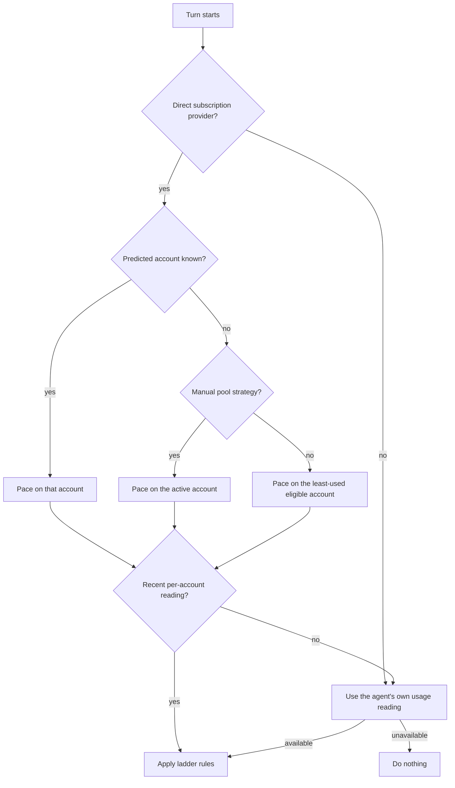

## What it does

Usage Pacer keeps subscription agents usable for the whole rolling usage window. It steps down to cheaper models as usage climbs, then spends leftover quota on stronger models or ACP fast mode as a reset approaches. It never changes an agent's saved model.

<Callout type="warn">
  Usage Pacer does nothing until you turn on **Automatically pace and escalate models**. The
  toggle is off by default, and it applies only to agents with readable subscription usage windows.
</Callout>

## Settings

| Setting | What it does | Default |
| --- | --- | --- |
| **Automatically pace and escalate models** | Turns pacing on or off. | Off |
| **Pacing mode** | **Even burn** compares usage with the pace left in the window and adds pressure when you are behind. **Usage thresholds only** switches only when a ladder threshold is crossed. | Even burn |
| **Agent and global ladders** | JSON rules, described below. | A sample `global` and `acp:claude` ladder |

## Ladder rules

- `ladder` steps down from the `from` model when the used percentage reaches the step's `at`
  value. In even-burn mode, any deficit beyond `pace_deficit` (default 15) is added to the used
  percentage.
- `upgrade_ladder` steps up when a window has at most `remaining` percent left, or resets within
  `within_minutes`. A step can set `model`, `effort`, or ACP options under `acp_config`, such as
  `"acp_config": { "fast_mode": "true" }`.
- `windows` picks the `weekly` window, the `session` window, or `both`.

Rules are looked up from most to least specific, and the first match wins:

1. `providers`, keyed by subscription provider id.
2. `agents`, keyed by agent id.
3. `global`.

```json
{
  "global": {
    "windows": "weekly",
    "ladder": [{ "from": "opus", "at": 50, "model": "sonnet" }]
  },
  "providers": {
    "claude-pro-max": {
      "windows": "both",
      "ladder": [{ "from": "opus", "at": 70, "model": "sonnet" }],
      "upgrade_ladder": [{ "from": "sonnet", "remaining": 20, "model": "opus" }]
    }
  }
}
```

## Pool-aware pacing

When the Ryu agent talks straight to a subscription provider with several saved accounts, Usage Pacer
paces against the account the turn is expected to spend:

1. The account Ryu predicts for this conversation, when it knows one.
2. Otherwise, with the **Manual** pool strategy, the active account.
3. Otherwise (round robin, quota first, fill first, or reset first), the least-used eligible account.
   A pool can move the turn away from a nearly empty account, so one drained login does not
   downgrade every turn. Accounts that need a fresh login or are excluded from the pool are skipped.



Usage Pacer only reads usage Ryu has already cached, so it never delays a turn. It falls back to
the agent's own usage reading when:

- no account has a recent reading yet
- the provider reading is refused (it is available to the node owner and admins only)
- the provider has no per-account usage

If the agent reading is unavailable too, Usage Pacer does nothing. It never sees account names and
never chooses which account a turn uses.

Per-account usage covers Claude Pro/Max, ChatGPT, OpenAI Codex, and GitHub Copilot. ChatGPT plan,
Kiro, Kimi, Radius, Ant Ling, and CLI logins report no per-account usage, so pacing for them uses the
agent reading.
