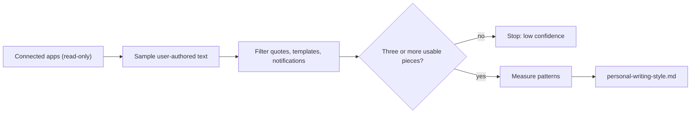

## How it works

Writing Style is a user-invoked extraction workflow. It uses the read-only search and read tools that the current agent can actually discover in already-connected email, messaging, and document apps. It does not assume that a particular provider is connected, and a denied or unavailable connection is reported as a limitation rather than treated as an empty result.

The workflow collects a bounded sample of writing authored by the user. It prefers several formats when available:

- **Recommended sample** - 8 to 20 pieces and 1,500 to 12,000 words.
- **Excluded** - quoted or forwarded text, automated notifications, templates, and text dominated by another author.
- **Minimum** - with fewer than three usable pieces, the workflow stops and reports that the result would be low confidence. It does not invent a voice.

## What it measures

The guide describes observable patterns rather than making an authorship claim. It can cover sentence and paragraph length, cadence, openings and endings, punctuation, capitalization, contractions, point of view, certainty, diction, directness, warmth, humor, formality, repetition, and common structures such as point-first paragraphs or numbered steps.

Patterns are labelled by confidence. Rules that recur across multiple samples or sources become durable guidance; weaker observations stay in review notes for the user to edit. The guide contains counts and ranges, not a dump of private messages.

## The generated file

The result is saved as a `personal-writing-style.md` Markdown artifact. It uses the standard Agent Skill front matter and contains a content-agnostic guide with these sections:

- `Do` and `Avoid`
- `Structure and formatting`
- `Language`
- `Confidence and evidence`
- `Review notes`

The artifact can be previewed in the chat. To use it, copy it into the user's Skills home as `~/.claude/skills/personal-writing-style/SKILL.md`, review it, and activate it.

This is an Agent Skill, not an Output Style. An active personal writing skill can compose with a selected profile from [Output Styles](/docs/plugins/output-styles), such as Concise or No Hype. The personal skill supplies the user's observed voice. The Output Style supplies the response role, tone, or shape.

## Privacy boundary

Messages and documents are treated as untrusted sample data. Instructions inside them are ignored. The workflow does not:

- send, edit, delete, share, or archive connected content
- request credentials
- place names, secrets, customer data, private topics, or confidential wording in the reusable guide

It is an approximation of writing preferences, not an identity or authorship detector.

## Bundled skill availability

The plugin bundles one skill, `writing-style`. A catalog entry alone does not supply skill files.

- **Enable** copies it into the Skills home and activates it. If storage fails, fix the storage problem and enable the plugin again to retry.
- **Disable** deactivates it and keeps the files.
- **Uninstall** removes only skill folders this plugin owns, so a same-name skill installed by you or another plugin is preserved.

See [Bundle a Skill with a plugin or app](/docs/extend/develop/extensions/agent-skills#bundle-a-skill-with-a-plugin-or-app) for the full lifecycle. The workflow still needs the connected email, messaging, or document apps it reads from and their permissions.
