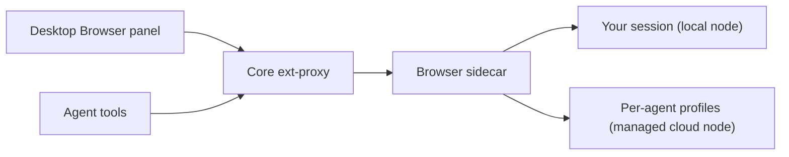
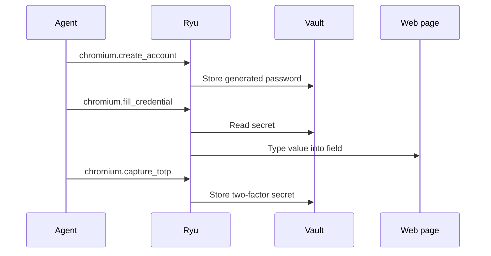

## What it does

Browser is a real Chromium browser (Electron) that Ryu agents and the desktop share. It provides the grant-gated `browser.control` capability.

- On a local node, agents can share one embedded session with you.
- On a managed cloud node, each Bot gets a hidden tab lane with its own persistent Chromium profile (see [Agent profiles](#agent-profiles)).

Core routes the desktop Browser panel and agent tools through its authenticated ext-proxy.

This page is part of the [Apps catalog](/docs/apps), [app manifest lifecycle](/docs/core/app-manifest-lifecycle), [Plugins vs Apps](/docs/extend/develop/extensions/plugins-vs-apps), [Marketplace](/docs/extend/develop/extensions/marketplace), [Gateway governance](/docs/gateway/governance) documentation path.

## Appearance bridge

The desktop Browser panel sends the current Desktop appearance to the browser chrome through the authenticated sidecar bridge. The shell follows the selected light or dark palette, contrast colors, interface and heading fonts, locale, and display time zone as they change.

History labels use that display time zone and locale. Appearance tokens are never injected into websites opened in browser tabs.

## Activity center

The browser toolbar includes an Activity center. It shows active and recently active
sessions started by Ryu:

- audio/video playback;
- microphone and camera capture;
- screen capture;
- browser control.

Selecting an activity for a visible tab brings that tab forward. Activity records are
ephemeral browser-chrome state. They are not written to browsing history or sent to an
agent, and a closed or navigated tab clears its activity.

### When an activity counts as active

- Media capture is reported only after a page receives a real `getUserMedia` or
  `getDisplayMedia` stream. A permission prompt by itself does not appear as active capture.
- Audio/video playback comes from Chromium's media lifecycle events. A tab with several media
  elements stays active until the page has no playing element left.
- Camera, microphone, and screen indicators stay active until the captured tracks actually end.
  This includes cloned tracks, capture in additional frames, and same-page or unsuccessful
  navigation.

A page cannot clear these indicators by sending an activity message or dispatching a synthetic
track event. Once capture stops, the activity briefly appears under **Recently active**.

## Browser window

The tab strip lets you select, open, and close tabs. The navigation controls go back, forward,
or reload the selected tab, and the address field accepts a URL or search. The Browser menu also
contains Find in page, zoom, the device toolbar, screenshot capture, cookie import, History,
Downloads, and Browser settings.

- **History** lists visited page titles, URLs, and visit times. Choose **Open** to bring a saved
  page into a visible browser tab, or **Clear history** to remove the list. Use the page's back
  control to return to the browser while keeping the active tab.
- **Downloads** on the toolbar shows recent download status and a shortcut to the download
  folder. Open the Downloads page from that popover or the Browser menu to review the list, open
  the folder, or clear its history.

### Desktop Browser dock

The Desktop dock opens a URL in the sidecar, refreshes its tab list, and lets you select or close
a tab. To annotate a page:

1. Choose **Annotate** to freeze the current preview, then click an element or drag an area.
   Hold **Shift** while clicking to add more targets.
2. Describe the change. When your browser supports speech recognition, **Dictate annotation**
   appends recognized words to the comment, and **Stop voice annotation** finishes dictating.
   Review the comment before saving it. You can always type the comment directly.
3. Optionally open **Adjust styling**, then choose **Add note**.
4. Choose **Ask Ryu to address notes** to open the assistant with the current page, its latest
   saved notes, and their style adjustments queued as context.

Press **⌘⇧D** on macOS or **Ctrl+Shift+D** on other platforms to toggle annotation mode.

Saved notes appear as overlays and in the tab's note list. Remove one note, or choose
**Clear notes** to remove all of them. **Cancel draft** discards an unsaved selection, comment,
and style adjustments. Notes remain with the open tab and are cleared when that tab navigates
or closes.

Failures keep your work so you can retry:

- If saving a note fails, the dock keeps the selection and comment so you can choose **Add note**
  again. After a successful save, the error clears and the note appears in the preview.
- Failed note deletions and clears keep the saved notes visible.
- While Ryu prepares assistant context, the **Ask Ryu to address notes**
  button stays disabled to prevent duplicate requests. If preparing context fails, the notes remain
  saved and you can choose it again.

## Chromium extensions

Open **Browser settings → Extensions → Load unpacked** to add a local Chrome or Chromium
extension folder. Ryu loads the extension into the visible browser session with local file access
disabled and remembers the folder for the next browser launch. Remove an extension from the same
list to unload it and forget its path.

Electron accepts unpacked extension folders, not `.crx` packages, and does not implement every
Chrome extension API. Only load extensions you trust. Extension code stays in the browser
profile and is not exposed through Ryu's browser-control tools.

## Agent profiles

On a managed cloud node, each agent browses in its own Chromium profile. Cookies, logins, and
site storage from one agent's session are never available to another agent or to your own
browser tabs.

Each agent signs in to sites separately. An agent stays signed in to a site across browser
restarts until it signs out or the site ends the session.

Each agent also keeps its own:

- **Browsing history.** Pages an agent visits are not added to your History or to another
  agent's.
- **Site permissions.** An agent's profile never prompts. Camera, microphone, location,
  notification, and clipboard requests are blocked unless that agent's own profile has the
  permission saved. Permissions you save in your browser never apply to an agent.
- **Downloads folder.** Files an agent downloads are saved in that agent's own folder, not your
  download location.

Your own browser's history, site permissions, and download settings are unchanged.

### Upgrading from earlier versions

| Upgrading from | What changes once |
| --- | --- |
| Before Browser 0.1.17 | Every agent on a managed cloud node shared one profile. Browser clears that shared profile's cookies and site storage, which signs agents out. Each agent signs in again in its own profile. |
| Before Browser 0.1.18 | Agents also shared one browsing history, site-permission list, and download list. Those entries can't be traced to a single agent, so updating deletes them and each agent starts empty. Files already in the old shared downloads folder stay where they are. |

## Agent accounts

Agents can sign up for and log into websites with their own accounts instead of yours. The
account's password, and any two-factor secret, live in the Ryu vault. The agent never sees,
types, or is told them.

1. **Sign up.** The agent calls `chromium.create_account` with the site and the username or
   email it will register with. Ryu generates a strong password and stores it. The agent then
   fills the sign-up form with `chromium.fill_credential`, naming the account and the form
   field (`username`, `email`, or `password`). Ryu types the value straight into the page.
2. **Two-factor setup.** When the site shows an authenticator setup page, the agent calls
   `chromium.capture_totp` on the QR code or the text setup key (sites usually reveal it behind
   a "can't scan?" link). Ryu reads the secret from the page and stores it.
3. **Log in.** The agent finds the account with `chromium.list_accounts`, fills the username,
   email, and password with `chromium.fill_credential`, and fills the current six-digit code
   with field `totp` when the site asks for it.

Ryu fills credentials only under these rules:

- The page is HTTPS on the account's own host. Subdomains do not match, since they can serve
  other people's content.
- Only the page's top-level document is filled, never an embedded frame.
- A password is typed only into a password field.
- Each agent sees and fills only the accounts it created. Listing accounts returns names and
  addresses, never passwords or two-factor secrets.

Reading a QR code needs Chromium's built-in barcode detection, which is not available on every
platform. The text setup key works everywhere.

## What it exposes

### Tools

### `chromium.list_tabs` - List Browser Tabs

List the tabs currently open in the local Chromium browser sidecar. Returns `{tabs:[{id,url,title}]}`; the `id` is what every other browser tool takes. When the sidecar is not running the tool reports itself unavailable.

Backend: HTTP · Method: GET

_No parameters_ (empty schema).
### `chromium.open_tab` - Open Browser Tab

Open a NEW tab in the local Chromium browser at `url` and return `{tab:{id,url,title}}`. Use the returned `id` with the other browser tools. To move an EXISTING tab, use chromium.navigate_tab instead.

Backend: HTTP · Method: POST

| Parameter | Type | Required | Description |
|---|---|---|---|
| `url` | string | yes | URL to load in the new tab (the sidecar defaults to about:blank when omitted). |

### `chromium.tab_detail` - Browser Tab Detail

Fetch one tab's current `{tab:{id,url,title}}` by tab id. 404s once the tab has been closed.

Backend: HTTP · Method: GET

| Parameter | Type | Required | Description |
|---|---|---|---|
| `id` | string | yes | Tab id, as returned by chromium.list_tabs or chromium.open_tab. |

### `chromium.navigate_tab` - Navigate Browser Tab

Navigate an EXISTING tab to `url` and return `{tab:{id,url,title}}`. Requires a tab id from chromium.list_tabs or chromium.open_tab; 404s once the tab has been closed.

Backend: HTTP · Method: POST

| Parameter | Type | Required | Description |
|---|---|---|---|
| `id` | string | yes | Tab id to navigate. |
| `url` | string | yes | URL to load in that tab. |

### `chromium.screenshot_tab` - Screenshot Browser Tab

Capture a PNG screenshot of one tab. Returns `{image,encoding:"base64",mime:"image/png"}`. Requires a tab id from chromium.list_tabs or chromium.open_tab.

Backend: HTTP · Method: POST

| Parameter | Type | Required | Description |
|---|---|---|---|
| `id` | string | yes | Tab id to capture. |

### `chromium.tab_title` - Browser Tab Title

Read one tab's current document title as `{title}`. Cheaper than a screenshot for confirming a navigation landed.

Backend: HTTP · Method: GET

| Parameter | Type | Required | Description |
|---|---|---|---|
| `id` | string | yes | Tab id whose title to read. |

### `chromium.snapshot_tab` - Snapshot Browser Tab

Read one tab's accessibility tree. Returns `{tab,snapshot_id,elements:[{ref,role,name,value,depth,props}],truncated}`, where each `ref` (`@e1`, `@e2`, …) is the handle chromium.click and chromium.type take. Refs are minted fresh by every snapshot and are dropped when the tab navigates, so snapshot again after any action that changes the page. Content inside cross-origin iframes is not included.

Backend: HTTP · Method: POST

| Parameter | Type | Required | Description |
|---|---|---|---|
| `id` | string | yes | Tab id to snapshot, as returned by chromium.list_tabs or chromium.open_tab. |

### `chromium.click` - Click Browser Element

Click the element a chromium.snapshot_tab `ref` names, using a real mouse event at the element's centre. Returns `{ok,tab,x,y}`. A ref the current snapshot does not know, or whose element is hidden or gone, is a 400 telling you to snapshot again - it never falls back to another element.

Backend: HTTP · Method: POST

| Parameter | Type | Required | Description |
|---|---|---|---|
| `ref` | string | yes | Element reference from a prior chromium.snapshot_tab, e.g. "@e3". |
| `tab_id` | string | no | Tab to act on. Omit for the tab the browser is currently showing (a snapshot focuses the tab it reads). |

### `chromium.type` - Type Into Browser Element

Focus the element a chromium.snapshot_tab `ref` names and insert `text` at its caret, optionally pressing Enter. Text is APPENDED by default - set `replace` to overwrite a field that already has a value. A `ref` that is focusable but cannot accept text (a link, a read-only or disabled input, a checkbox) is a 400 rather than a silent no-op. Returns `{ok,tab}`.

Backend: HTTP · Method: POST

| Parameter | Type | Required | Description |
|---|---|---|---|
| `ref` | string | yes | Element reference from a prior chromium.snapshot_tab, e.g. "@e3". |
| `text` | string | yes | Text to insert at the element's caret. |
| `replace` | boolean | no | Overwrite the field's current value instead of appending to it. Use `replace` with an empty `text` to clear a field. |
| `submit` | boolean | no | Press Enter after typing (a real key event, so form/search handlers fire). |
| `tab_id` | string | no | Tab to act on. Omit for the tab the browser is currently showing. |

### `chromium.scroll` - Scroll Browser Tab

Scroll a tab's viewport with a real wheel event dispatched at its centre. `amount` is a distance in CSS pixels; omitted it travels 80% of the viewport. Returns `{ok,tab,x,y}`. Snapshot again afterwards - scrolling changes what is laid out.

Backend: HTTP · Method: POST

| Parameter | Type | Required | Description |
|---|---|---|---|
| `direction` | string (one of: up, down, left, right) | yes | Direction to scroll the page in. |
| `amount` | integer | no | Scroll distance in CSS pixels. Defaults to 80% of the viewport. |
| `tab_id` | string | no | Tab to act on. Omit for the tab the browser is currently showing. |

### `chromium.close_tab` - Close Browser Tab

Close one tab and return `{ok:true}`. 404s when the tab is already gone.

Backend: HTTP · Method: DELETE

| Parameter | Type | Required | Description |
|---|---|---|---|
| `id` | string | yes | Tab id to close. |

### `chromium.context` - Get Browser Context

Return a live page context bundle: URL/title, viewport, accessibility snapshot, saved annotations, a bounded list of page-declared WebMCP tools, and a PNG screenshot. Optionally pass CSS-pixel selection rectangles to retrieve DOM identity (tag, selector, XPath, attributes, computed styles, component hint, and text) for the pointed elements.

Backend: HTTP · Method: POST

| Parameter | Type | Required | Description |
|---|---|---|---|
| `id` | string | yes | Tab id. |
| `include_screenshot` | boolean | no | Set false for a text-only context refresh. |
| `selections` | array | no |  |

### `chromium.list_webmcp_tools` - List WebMCP Tools

List the structured WebMCP tools currently exposed in one browser tab. Each tool includes its tool_id, name, description, JSON input schema, origin, and read-only, consequential-action, debugging, or untrusted-output hints. Call this before chromium.execute_webmcp_tool.

Backend: HTTP · Method: GET

| Parameter | Type | Required | Description |
|---|---|---|---|
| `id` | string | yes | Tab id. |

### `chromium.execute_webmcp_tool` - Execute WebMCP Tool

Execute one WebMCP tool exposed in a browser tab. Use the exact tool_name, tool_id, and arguments from chromium.list_webmcp_tools; tool_id distinguishes same-name tools from different frames. This runs page JavaScript visibly in the user's signed-in tab and can cause external effects, so follow normal browser confirmation policy.

Backend: HTTP · Method: POST

| Parameter | Type | Required | Description |
|---|---|---|---|
| `id` | string | yes | Tab id. |
| `tool_name` | string | yes | Exact WebMCP name returned by the list operation. |
| `tool_id` | string | no | Exact tool_id returned by the list operation; required when a name appears more than once. |
| `arguments` | object | no | JSON object matching the tool's input_schema. |

### `chromium.annotate` - Annotate Browser

Attach a durable visual comment to a browser tab. Use kind `element` for one pointed element, `elements` for a relationship between multiple pointed elements, or `area` for a drawn region. The sidecar captures the target DOM context at annotation time.

Backend: HTTP · Method: POST

| Parameter | Type | Required | Description |
|---|---|---|---|
| `id` | string | yes |  |
| `kind` | string (one of: area, element, elements) | yes |  |
| `rect` | object | yes |  |
| `selections` | array | no |  |
| `comment` | string | yes | Specific change request. |
| `style` | object | no | Optional safe style feedback such as font_size, color, letter_spacing, padding, or margin. |

### `chromium.clear_annotations` - Clear Browser Annotations

Clear all saved visual annotations from one browser tab.

Backend: HTTP · Method: DELETE

| Parameter | Type | Required | Description |
|---|---|---|---|
| `id` | string | yes |  |

### `chromium.hover` - Hover Browser Element

Move the real pointer over a snapshot element without clicking it, useful for menus and hover states.

Backend: HTTP · Method: POST

| Parameter | Type | Required | Description |
|---|---|---|---|
| `ref` | string | yes |  |
| `tab_id` | string | no |  |

### `chromium.click_at` - Click Browser Coordinate

Click a CSS-pixel viewport coordinate for canvas and custom controls when no accessibility ref exists.

Backend: HTTP · Method: POST

| Parameter | Type | Required | Description |
|---|---|---|---|
| `x` | number | yes |  |
| `y` | number | yes |  |
| `button` | string (one of: left, middle, right) | no |  |
| `count` | integer | no |  |
| `tab_id` | string | no |  |

### `chromium.key` - Press Browser Keys

Press a browser key or chord at the current focus, such as ["cmd", "l"] or ["Escape"].

Backend: HTTP · Method: POST

| Parameter | Type | Required | Description |
|---|---|---|---|
| `keys` | array | yes |  |
| `tab_id` | string | no |  |

### `chromium.drag` - Drag Browser Pointer

Drag the real browser pointer between two CSS-pixel viewport coordinates.

Backend: HTTP · Method: POST

| Parameter | Type | Required | Description |
|---|---|---|---|
| `from` | object | yes |  |
| `to` | object | yes |  |
| `tab_id` | string | no |  |

### `chromium.create_account` - Create Agent Account

Create YOUR OWN website account record in the Ryu vault BEFORE you fill a sign-up form. Ryu generates a strong password and stores it; you never see it and must never ask the user for one or try to read it from the page. Pass the site's URL and the username and/or email you will register with. Returns `{account:{id,site,host,username,email,label,has_password,has_totp,...}}` with no secrets. Then fill the sign-up form with chromium.fill_credential (fields `username`, `email`, `password`) using `account.id`, and submit it. If the site then offers two-factor setup, use chromium.capture_totp.

Backend: HTTP · Method: POST

| Parameter | Type | Required | Description |
|---|---|---|---|
| `site` | string | yes | The site's https URL, e.g. "https://github.com". Credentials only fill on this exact host (www. is ignored); a sign-in page on another host needs its own account. |
| `username` | string | no | Username you will register with, if the site uses one. |
| `email` | string | no | Email address you will register with, if the site asks for one. |
| `password_length` | integer | no | Length of the generated password. Omit for the default; lower it only when the site rejects long passwords. |
| `label` | string | no | Optional note to tell several accounts on the same site apart. |

### `chromium.list_accounts` - List Agent Accounts

List the website accounts you created with chromium.create_account, optionally only those for one site. Use it before logging in to find the account `id` to pass to chromium.fill_credential, and before signing up to avoid creating a duplicate. Returns `{accounts:[{id,site,host,username,email,label,has_password,has_totp,...}]}` - metadata only; passwords and 2FA secrets are never returned. `has_totp` tells you whether a login will need chromium.fill_credential with field `totp`.

Backend: HTTP · Method: GET

| Parameter | Type | Required | Description |
|---|---|---|---|
| `site` | string | no | Optional site URL or host (e.g. "github.com") to filter by. |

### `chromium.fill_credential` - Fill Agent Credential

Type one field of your vault account into the input a chromium.snapshot_tab `ref` names, replacing what is there - WITHOUT you ever seeing the value. Use it for sign-up and login forms instead of chromium.type: field `username` or `email` for the identifier, `password` for the password, and `totp` for the current 6-digit two-factor code (only after chromium.capture_totp enrolled it). Never ask the user for the password and never try to read it back from the page. Ryu refuses when the page is not https, its host is not the account's site, the input is inside an iframe, or (for `password`) the input is not a password field. Returns `{ok,tab,account,field,filled}`; set `submit` to press Enter afterwards.

Backend: HTTP · Method: POST

| Parameter | Type | Required | Description |
|---|---|---|---|
| `account` | string | yes | Account id from chromium.create_account or chromium.list_accounts, e.g. "github.com--a1b2c3d4". |
| `field` | string (one of: username, email, password, totp) | yes | Which credential to fill. `totp` fills the current two-factor code. |
| `ref` | string | yes | Element reference of the input from a prior chromium.snapshot_tab, e.g. "@e3". |
| `submit` | boolean | no | Press Enter after filling (a real key event, so the form submits). |
| `tab_id` | string | no | Tab to act on. Omit for the tab the browser is currently showing. |

### `chromium.capture_totp` - Capture Two-Factor Setup

When a site shows a two-factor (authenticator app) setup page for your account, enroll it in the vault: point `ref` at the QR code image, or at the text setup key (a "can't scan?" or "enter this key manually" link usually reveals it). Ryu reads the secret straight from the page and stores it; you never see it. Then complete the site's verification step with chromium.fill_credential field `totp`, and use the same at every later login. Returns `{ok,tab,account,enrolled}`. A 400 means no setup key was found under `ref`.

Backend: HTTP · Method: POST

| Parameter | Type | Required | Description |
|---|---|---|---|
| `account` | string | yes | Account id from chromium.create_account or chromium.list_accounts. |
| `ref` | string | yes | Element reference of the QR code image or the text setup key, from a prior chromium.snapshot_tab. |
| `tab_id` | string | no | Tab to act on. Omit for the tab the browser is currently showing. |

### Capabilities

- **Browser session** - capability `browser.session`
  - Grant: `browser:control`
  - Target: local-machine
- **Browser** - capability `browser.control`
  - Grant: `browser:control`
  - Target: local-machine
  - Verbs:
    - `browser.tabs` -> `chromium.list_tabs`
    - `browser.navigate` -> `chromium.open_tab`
    - `browser.screenshot` -> `chromium.screenshot_tab`
    - `browser.snapshot` -> `chromium.snapshot_tab`
    - `browser.click` -> `chromium.click`
    - `browser.type` -> `chromium.type`
    - `browser.scroll` -> `chromium.scroll`
    - `browser.context` -> `chromium.context`
    - `browser.annotate` -> `chromium.annotate`
    - `browser.clear_annotations` -> `chromium.clear_annotations`
    - `browser.hover` -> `chromium.hover`
    - `browser.click_at` -> `chromium.click_at`
    - `browser.key` -> `chromium.key`
    - `browser.drag` -> `chromium.drag`

## Permissions

**Grants:** `browser:control`, `tool:http-egress:127.0.0.1`, `vault:fill`

| Level | Description | Implies |
|---|---|---|
| **Can view** | Read the browser's open tabs, their titles, screenshots, and accessibility snapshots. |  |
| **Can control** | Open, navigate, and close tabs and drive pages with synthetic clicks, typing, and scrolling, using whatever the browser is already signed in to. | `browser.view` |

## UI it contributes

### Desktop shell

This app contributes the declared desktop shell surfaces below; the host owns navigation, focus, authentication, and theme behavior.

### Dock panels

- **Browser** (placement: both)

## Engine requirement

Requires Ryu >=0.1.0.

## Sidecar

Runs an out-of-process sidecar: `browser`.
