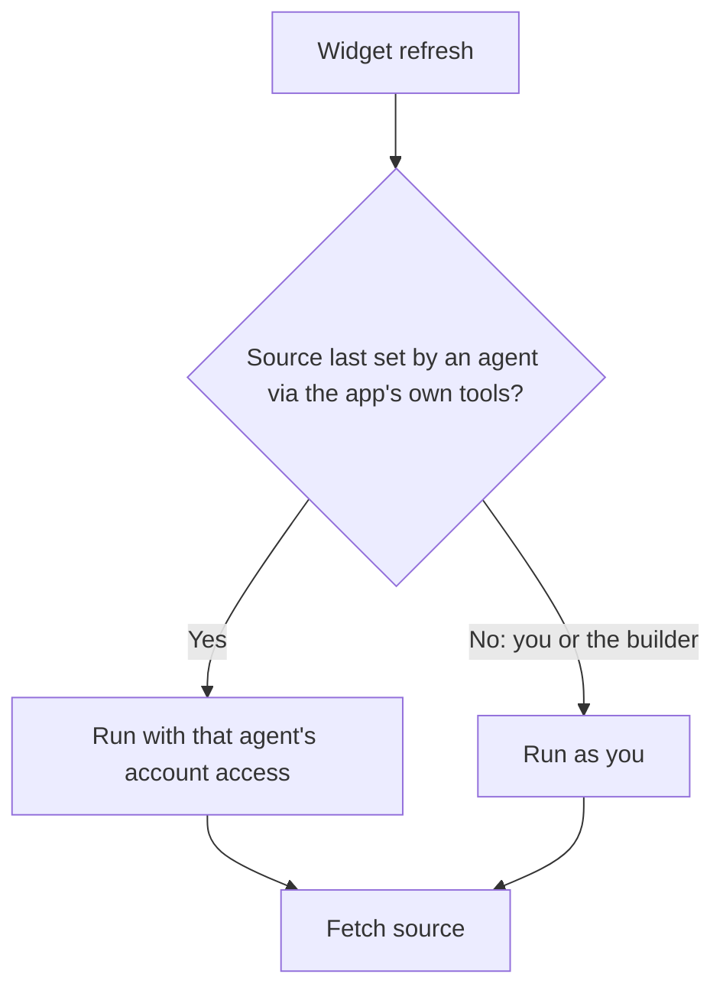

## What it does

The Dashboards app powers Home, the desktop's live, customizable dashboard for data from your Ryu node. Add stat, chart (line, bar, area, or pie), table, list, text (Markdown), or map widgets fed by Composio actions, HTTPS endpoints, or inline data.

This page is part of the [Apps catalog](/docs/apps), [app manifest lifecycle](/docs/core/app-manifest-lifecycle), [Plugins vs Apps](/docs/extend/develop/extensions/plugins-vs-apps), [Marketplace](/docs/extend/develop/extensions/marketplace), [Gateway governance](/docs/gateway/governance) documentation path. In the same category, compare [Chat Broadcast](/docs/apps/chat-broadcast), [Harbor](/docs/apps/crm), [Decks](/docs/apps/decks), [Drafts](/docs/apps/drafts).

## What it exposes

### Capabilities

- **Dashboard lookup** - capability `dashboards.get`
  - Grant: `dashboards:view`
- **Dashboard creation** - capability `dashboards.create`
  - Grant: `dashboards:edit`
- **Dashboard rename** - capability `dashboards.rename`
  - Grant: `dashboards:edit`
- **Dashboard widget upsert** - capability `dashboards.upsertWidget`
  - Grant: `dashboards:edit`
- **Dashboard widget removal** - capability `dashboards.deleteWidget`
  - Grant: `dashboards:edit`
- **Dashboard change stream** - capability `dashboards.changes`
  - Grant: `dashboards:view`
- **Device dashboard binding** - capability `dashboards.ensureDeviceDashboard`
  - Grant: `dashboards:edit`
- **Device dashboard manifest** - capability `dashboards.deviceManifest`
  - Grant: `dashboards:view`
- **Device dashboard image** - capability `dashboards.deviceImage`
  - Grant: `dashboards:view`
- **Device dashboard config** - capability `dashboards.deviceConfig`
  - Grant: `dashboards:view`
- **Device dashboard update** - capability `dashboards.setDevice`
  - Grant: `dashboards:edit`
- **Device dashboard unbind** - capability `dashboards.unbindDevice`
  - Grant: `dashboards:edit`
- **Device dashboard bindings** - capability `dashboards.deviceBindings`
  - Grant: `dashboards:view`

The dashboard builder and hardware device displays reach dashboards only through these capabilities, so any enabled app that provides them can serve both.

When no enabled app provides them:

- the builder's tools return an error naming the missing capability;
- paired hardware devices stay paired and connected, but their dashboard display requests return an error;
- live re-poll nudges pause until a provider is enabled again, with no restart needed.

## Permissions

**Grants:** `tools.invoke`, `app:realtime`

| Level | Description | Implies |
|---|---|---|
| **Can view** | Open dashboards and the live data their widgets pull from connected actions, web endpoints, and inline content. |  |
| **Can edit** | Create dashboards and add, configure, or remove their widgets. | `dashboards.view` |

## Use Home

- On a new node, Home creates a starter board with a welcome note, plus any built-in presets whose data source the node supports. You can remove any of those widgets or add your own.
- Use the dashboard selector in the title bar to switch boards, create a board, rename the current board, or delete it. Deleting asks for confirmation and opens another remaining board. The only board cannot be deleted.
- Choose **Grid** for a compact tiled layout or **Canvas** for a freeform board. The selected view is saved per dashboard. In Canvas, pan and zoom the board, fit all widgets, use the minimap, and drag or resize cards; their positions and sizes are saved. New widgets are placed near the viewport center in a free area.
- Choose **Add widget** for a built-in preset or **Custom widget** to select a widget kind, data source, refresh interval, and display configuration. Cancel, Escape, or the dialog's corner close button dismisses without creating a widget.
- The source picker, the **Add widget** presets, and the assistant builder all follow the connected node’s catalog. HTTPS sources use a guarded fetch that refuses private addresses, redirects, and oversized responses.
- Choose **Build a work view** to open the **Ask Ryu** assistant docked beside the board as this dashboard's builder. Describe what you want to see and it adds and arranges widgets. On an empty board, **Build a work view for me** sends a starter request; you can also add widgets yourself. Closing the assistant leaves build mode. Home has no separate chat pane.
- Open a widget's actions to refresh it or remove it. If Home cannot load a board, use **Try again** after restoring the connection.

### Widget sources

Creating or editing a widget accepts only the sources the catalog lists, and only plain Composio action identifiers. An invalid source is refused without replacing the widget's last saved source.

These sources are not available and cannot be saved:

| Source | Why |
| --- | --- |
| Built-in Core metrics (system status, connected clients, open quests) | The Dashboards app has no supported way to read that node data. |
| Website monitor results and workflow outputs | The Dashboards app has no supported way to read that node data. |
| Agents | Widget refreshes cannot run an agent on your behalf. |

A widget that already uses one stays on the board and shows a message that its source is not available instead of data. Edit its source or remove it.

### Whose access a widget uses

A widget an agent adds or changes through the Dashboards app's own tools keeps running for that agent. Each time it refreshes, including when you refresh it, Ryu applies that agent's [account access](/docs/surfaces/desktop/user-guide/agent-account-access#choose-which-accounts-an-agent-can-use). A Composio action must use an account the agent may use.

- Changing the title or layout keeps the agent as the runner.
- Choosing a new source makes the widget yours.
- Widgets the dashboard builder adds or changes run as yours, whichever agent built them.

## UI it contributes

### Desktop shell

This app contributes the declared desktop shell surfaces below; the host owns navigation, focus, authentication, and theme behavior.

### Hook events

- **Dashboard widget broke** - A widget's data source stopped resolving - the endpoint errored, the Composio action failed, or the source kind is not available on this node. Fires on the TRANSITION into failure, which includes a brand-new widget whose very first resolve fails; a widget that then STAYS broken re-tries every interval but does not re-fire, so this is safe to hang an alert on. `source_type` is the wire tag of the resolver that broke (`core_endpoint` / `monitor` / `workflow` / `composio` / `http` / `agent`). Note that expensive sources are only refreshed while someone is watching the dashboard, so their failures surface when the board is opened rather than in the background.
- **Dashboard widget recovered** - A widget that had been failing resolved cleanly again - the counterpart transition to `widget.failed`, so an escalation raised on that one can be cleared by this one. Fires only on the crossing back to healthy; a widget that was never failing does not emit it on every refresh.

### Sidebar buttons

- **Home**

## Engine requirement

Requires Ryu >=0.1.0.

## Sidecar

Runs an out-of-process sidecar: `ryu-dashboards`.
