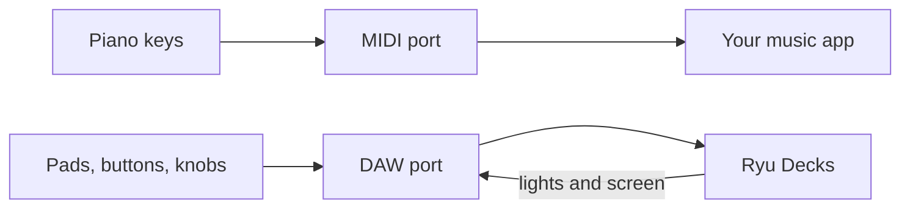

This page lists the decks in this family that Decks supports and how each one maps to Ryu keys, dials, and lights. To give keys labels, colours, and actions, start with [Decks](/docs/apps/decks). Before Ryu opens a deck, [close other deck software](/docs/apps/decks#close-other-deck-software), and on Linux add the [udev rules](/docs/apps/decks-linux).

## Supported models

| Maker | Models | Keys | What a key shows |
| --- | --- | --- | --- |
| Akai Professional | APC mini MK2 (over USB MIDI) | 81 | Its colour, as the pad's light; the scene and track buttons only on or off |
| Akai Professional | APC40 MKII (over USB MIDI) | 120 | The nearest of its 128 colours, as the pad's or scene button's light; the other buttons only on or off |
| Akai Professional | APC40 (MK1), APC20 (over USB MIDI) | 112 / 88 | The nearest of green, red or amber, as the pad's light; the other buttons only on or off |
| Akai Professional | APC mini (MK1) (over USB MIDI) | 81 | The nearest of green, red or yellow, as the pad's light; the scene and track buttons only on or off |
| Akai Professional | APC Key 25 (MK1) (over USB MIDI) | 57 | The nearest of green, red or amber, as the pad's light; the scene and track buttons only on or off |
| Akai Professional | APC Key 25 MK2 (over USB MIDI) | 57 | The nearest of its 128 colours, as the pad's light; the scene and track buttons only on or off |
| Akai Professional | MIDImix (over USB MIDI) | 27 | The button's light, only on or off; SOLO has none |
| Akai Professional | LPD8, original (over USB MIDI) | 8 | The pad's light, only on or off, on PROG 1 in PAD mode |
| Akai Professional | Fire (over USB MIDI) | 84 | Any colour, as the pad's light; the buttons the nearest of their own colours, dim or bright. The OLED shows the info key in one colour |
| Akai Professional | MPK mini IV, MPK mini Plus II (over USB MIDI, DAW port) | 25 | The nearest of its palette colours, as the pad's light, at one of six brightness levels; -, +, Tap Tempo, Undo, Loop, Play, Record and Overdub only on or off; Shift has none. The knobs and main encoder are dials |
| Akai Professional | MPK mini Plus, first generation (over USB MIDI) | 5 | The transport button's light, only on or off; the pads, knobs and keybed are not used |
| Ableton | Push, 1st gen (over USB MIDI) | 127 | The nearest of its colours, as the pad's or lower-row button's light; the upper row and scene buttons red, amber, yellow or green; the other buttons one colour, dim or full. The display shows only "Ryu" |
| Ableton | Push 2 (over USB MIDI) | 128 | The nearest of its colours, as the pad's or coloured button's light; the other buttons white at a level. The display stays dark |
| M-Audio | Oxygen Pro 25, Oxygen Pro 49, Oxygen Pro 61, Hammer 88 Pro (over USB MIDI, DAW port) | 48 | The nearest of its 64 palette colours, as the pad's light, dimmed by the brightness; the track buttons only on or off; the transport, bank, scene, Shift and mode buttons have none. The knobs, faders, master fader and main encoder are dials |
| M-Audio | Oxygen Pro Mini (over USB MIDI, DAW port) | 34 | The nearest of its 64 palette colours, as the pad's light, dimmed by the brightness; the track buttons only on or off; the other buttons have none. The knobs and main encoder are dials |

<Callout type="warn">
None of the controllers on this page has been tested on the physical device yet. Decks drivers
are tested against recorded message formats, so treat a model as supported once it has been
checked on a real device.
</Callout>

## Before Ryu opens a controller

On Linux, Ryu reaches every controller on this page through ALSA, like the
[Novation Launchpads](/docs/apps/decks-novation).

Close the music apps that use the controller's port first. On Windows only one app can hold a
MIDI port. Elsewhere an app sharing it draws over Ryu's lights. Unless the table says otherwise,
the lights go off when Ryu lets go.

| Model | Port and mode Ryu uses | Close first | When Ryu lets go |
| --- | --- | --- | --- |
| APC mini MK2 | The Control port; pads kept in session mode | Ableton Live | Lights off |
| APC mini (MK1), APC Key 25s, MIDImix, LPD8 | Its MIDI port | Ableton Live | Lights off |
| APC40 MKII, APC40, APC20 | Switched to its Ableton Live mode on connect | Ableton Live (on the MKII, a sharing app also changes its mode) | Lights off |
| Fire | Its MIDI port | FL Studio (a sharing app also draws over the screen) | Lights and screen off |
| MPK mini IV, MPK mini Plus II | The DAW port, never the MIDI port | Ableton Live, Bitwig Studio | Lights off; screen and pads handed back |
| MPK mini Plus (first generation) | Its MIDI port | Ableton Live, Bitwig Studio | Lights off |
| Push (1st gen) | The User port; mode never changed | Leave the User port off in Live's MIDI settings | Lights off; display cleared |
| Push 2 | The User port, in User mode | Leave the User port off in Live's MIDI settings | Lights off; back to Live mode |
| Oxygen Pro, Hammer 88 Pro | The DAW port, in DAW mode | Other apps using the DAW port | Lights off; the deck takes its LEDs back |

On the MPK mini IV, MPK mini Plus II, Oxygen Pro and Hammer 88 Pro, Ryu uses only the DAW port,
so the piano keys stay with your music software.

Faders and absolute knobs turn their dial by how far they moved, from where they were first
touched.

## Akai APC

### APC mini MK2

| Keys | Control |
| --- | --- |
| 1 to 64 | The pads, row by row from the top left |
| 65 to 72 | The scene buttons down the right (Clip Stop to Stop All Clips) |
| 73 to 80 | The track buttons along the bottom (Volume to Right) |
| 81 | Shift |

- **Lights.** The pads glow in their key's colour. The scene buttons (green) and track buttons
  (red) are only on or off, and Shift has no light. Brightness dims the colours Ryu sends.
- **Dials.** The eight faders are dials 1 to 8 and the master fader dial 9.
- Ryu switches the pads back to session mode if you pick note or drum mode with Shift.

### APC mini (MK1)

The keys are placed as on the MK2. Each pad glows green, red or yellow, whichever is nearest to
its key's colour (white and greys show yellow, blue and purple green). The scene buttons and the
red track buttons are only on or off, and Shift has no light. There is no brightness setting.
As on the MK2, the eight faders are dials 1 to 8 and the master fader dial 9.

### APC40 MKII

| Keys | Control |
| --- | --- |
| 1 to 40 | The clip pads, row by row from the top left |
| 41 to 45 | The scene buttons down their right |
| 46 to 54 | The eight clip stop buttons and Stop All Clips |
| 55 to 63 | The eight track select buttons and Master |
| 64 to 71, 72 to 79, 80 to 87 | Mute, solo and arm |
| 88 to 95 | The A/B crossfade buttons |
| 96 to 103, then 111 | The eight device buttons, then Bank |
| 104 to 110 | Pan, Sends, User, Metronome, Play, Record and Session |
| 112 to 120 | The bank arrows, Shift, Tap Tempo, Nudge and the foot pedal |

- **Lights.** The pads and scene buttons glow in the nearest of the deck's 128 colours. The other
  buttons are only on or off, except the crossfade buttons, which show A, or B for a blue key.
  Stop All Clips, the arrows, Shift, Tap Tempo, Nudge and the pedal have no light. There is no
  brightness setting.
- **Dials.** Dials 1 to 8 are the track knobs, 9 to 16 the device knobs, 17 Tempo, 18 Cue, 19 to
  26 the channel faders, 27 the master fader and 28 the crossfader.

### APC40 (MK1) and APC20

Keys 1 to 40 are the clip pads, row by row from the top left, and keys 41 to 45 the scene launch
buttons down their right. Each pad glows green, red or amber, the nearest to its key's colour.

| APC40 keys | Control |
| --- | --- |
| 46 to 54 | The eight clip stop buttons and Stop All Clips |
| 55 to 63 | The eight track select buttons and Master |
| 64 to 71, 72 to 79, 80 to 87 | Activator, solo and arm |
| 88 to 95 | The eight device buttons |
| 96 to 102 | Pan, Send A, B and C, Play, Stop and Record |
| 103 to 112 | The arrows, Shift, Tap Tempo, Nudge and the two footswitches |

APC40 dials 1 to 8 are the track knobs, 9 to 16 the device knobs, 17 Cue, 18 to 25 the channel
faders, 26 the master fader and 27 the crossfader. The knob rings stay off.

| APC20 keys | Control |
| --- | --- |
| 46 to 53 | Clip stop |
| 54 to 61 | Track select |
| 62 | Master |
| 63 to 70, 71 to 78, 79 to 86 | Activator, solo and arm |
| 87, 88 | Shift and the foot pedal |

APC20 dials 1 to 8 are the channel faders, in any slider mode, 9 the master fader and 10 Cue.

On both, the scene launch and clip stop buttons are green and only on or off, like every other
lit button. Stop All Clips, the arrows, Shift, Tap Tempo, Nudge and the pedals have no light,
and there is no brightness setting.

### APC Key 25 and APC Key 25 MK2

| Keys | Control |
| --- | --- |
| 1 to 40 | The clip pads, row by row from the top left |
| 41 to 45 | The scene buttons down their right (Clip Stop, Solo, Rec Arm or Mute, Mute or Rec Arm, Select) |
| 46 to 53 | The track buttons below them (Up, Down, Left, Right, Volume, Pan, Send, Device) |
| 54 to 57 | Stop All Clips, Play, Record and Shift, which have no light |

- **Lights.** On the first APC Key 25 each pad glows green, red or amber, the nearest to its
  key's colour, and there is no brightness setting. On the MK2 the pads glow in the nearest of
  the deck's 128 colours, and brightness shows them at full or half. The scene buttons (green)
  and track buttons (red) are only on or off.
- **Dials.** Dials 1 to 8 are the knobs.
- **Piano keys.** They are not keys in Ryu. The MK2's come through a separate port Ryu leaves
  alone, and the first APC Key 25's on another MIDI channel, which Ryu ignores.

## Other Akai controllers

### MIDImix

- **Keys.** Keys 1 to 8 are the Mute buttons and key 9 Bank Left. Keys 10 to 17 are the Mute
  buttons pressed while SOLO is held (Solo 1 to 8) and key 18 Bank Right. Keys 19 to 26 are the
  Rec Arm buttons and key 27 SOLO.
- **Lights.** Each button's light has one colour and is only on or off: any colour except black
  or near-black turns it on. SOLO has no light. The Solo keys' lights are meant to show on the
  Mute buttons while SOLO is held, which is not confirmed on hardware. There is no brightness
  setting.
- **Dials.** Dials 1 to 8 are the top knobs, 9 to 16 the middle knobs, 17 to 24 the bottom knobs,
  25 to 32 the channel faders and 33 the master fader. Pressing Send All after connecting seeds
  every dial without turning any.

### LPD8 (original)

The LPD8 MK2 is not supported. Keys 1 to 4 are PAD5 to PAD8 (the top row) and keys 5 to 8 are
PAD1 to PAD4.

- **Setup.** Keep the deck on PROG 1 with its factory settings and the pads in PAD mode. In CC or
  PROG CHNG mode the pads send nothing Ryu reads, and a reprogrammed PROG 1 may not match. The
  PROG and mode buttons are not keys.
- **Lights.** Each pad's light has one colour and is only on or off: any colour except black or
  near-black turns it on. The deck forgets the lights when you switch program or mode, so Ryu
  sends them again a few times a second. There is no brightness setting.
- **Dials.** Knobs K1 to K8 are dials 1 to 8.

### Fire

- **Keys.** Keys 1 to 64 are the pads, row by row from the top left. Keys 65 to 84 are the
  buttons: Mute/Solo 1 to 4 (left of the pad rows), Pattern Up and Down, Browser, Grid Left and
  Right, the knob-mode (Bank) button, Step, Note, Drum, Perform, Shift, Alt, Pattern/Song, Play,
  Stop and Rec.
- **Pad lights.** The pads take any colour.
- **Button lights.** Each button only shows its own fixed colours, dim or bright, the nearest to
  the key's colour. Pattern, Browser and Grid are red, Mute/Solo green, Alt and Stop orange,
  Pattern/Song and Play green or orange, and the others red or orange. Bank has no light.
- **Screen.** The OLED is the info screen, in one colour: bright parts of the face light up. Ryu
  writes it again every couple of seconds so it does not go to sleep.
- **Brightness.** The deck has no brightness command, so Ryu scales the pads, dims the buttons
  and at 0% blanks the screen.
- **Dials.** Volume, Pan, Filter and Resonance are dials 1 to 4 and the Select encoder is dial 5.
  Pushing it presses dial 5, and touching a knob does nothing.

### MPK mini IV and MPK mini Plus II

When Ryu connects, the screen shows "Ryu", the model and "Connected". The pads stop sending notes
to the MIDI port until Ryu lets go.

- **Keys.** Keys 1 to 8 are the eight pads in one bank (top row, then bottom row) and keys 9 to
  16 the same pads in the other bank; the deck's own bank buttons switch between them. Keys 17
  to 25 are Shift, which has no light, -, +, Tap Tempo, Undo, Loop, Play, Record and Overdub.
- **Lights.** Each pad shows the nearest colour on the deck's palette, and each button's light is
  only on or off. The brightness setting picks one of the deck's six levels, and 0% turns every
  light off.
- **Dials.** The eight knobs are dials 1 to 8, top row first, and the main encoder dial 9
  (pushing it presses that dial), with no light.
- While the deck is in its plugin mode, Ryu ignores it. Back in DAW mode every light is sent
  again.

### MPK mini Plus (first generation)

Ryu uses only the five transport buttons. Keys 1 to 5 are Rewind, Fast Forward, Stop, Play and
Record (assumed to be their order left to right).

- Each button's light is only on or off, and Ryu sends every light again a few times a second.
  There is no brightness setting.
- The pads, knobs and keybed send whatever the deck's program says, so Ryu leaves them to your
  other MIDI software.

## Ableton Push

### Push (1st gen)

Keys 1 to 64 are the pads, row by row from the top left, and keys 65 to 127 the buttons around
them. The User button is never a key, since with Live running it takes the Push back.

- **Lights.** The pads and the lower row of buttons under the display glow in the nearest of the
  Push's colours. The upper row and the scene buttons glow red, amber, yellow or green, and the
  other buttons one colour, dim or full. There is no brightness setting.
- **Dials.** The Tempo and Swing encoders are dials 1 and 2, the eight track encoders dials 3 to
  10, Master dial 11 and the touch strip dial 12. Touching an encoder does nothing.
- **Display.** It shows only "Ryu".

Ryu uses the User port so Ableton Live can keep its Live port. On Windows only one app can hold
the User port.

### Push 2

Keys 1 to 64 are the pads, row by row from the top left, and keys 65 to 128 the buttons around
them. The User button is never a key.

- **Lights.** The pads and the coloured buttons (the two rows above and below the display, the
  scene buttons, Mute, Solo, Stop Clip, Automate, Record and Play) glow in the nearest of the
  Push 2's colours. The other buttons are white and only brighter or dimmer.
- **Brightness.** It sets the Push 2's own light level. On USB power alone, without its power
  supply, the Push 2 keeps its lights dim whatever the setting.
- **Dials.** As on the first Push: Tempo and Swing are dials 1 and 2, the track encoders 3 to 10,
  Master 11 and the touch strip 12. Touching an encoder does nothing.
- **Display.** It stays dark.

Ryu uses the User port so Ableton Live can keep its Live port. Pressing the User button hands the
Push 2 back to Live, and Ryu ignores it until User mode is picked again.

## M-Audio Oxygen Pro and Hammer 88 Pro

On an Oxygen Pro 25, 49, 61 or Mini or a Hammer 88 Pro, Ryu uses the deck's third MIDI port, the
DAW port (`Mackie/HUI` on macOS, `MIDIIN3` and `MIDIOUT3` on Windows). It never uses the
keybed's port, so your music software keeps the keys. Ryu puts the deck in DAW mode.

- **Pads.** The pads (16, or 8 on the Mini) come first, top row first. They light in the nearest
  of the deck's 64 palette colours.
- **Track buttons.** They follow, with lights that are only on or off. They latch on the deck, so
  each press reaches Ryu as one tap.
- **Other buttons.** The transport, Back, bank, Preset, DAW, Scene (not on the Mini), Shift and
  mode buttons fill the remaining rows in a logical order and have no light Ryu sets.
- **Dials.** The knobs, the faders (Oxygen Pro 49 and 61 and Hammer 88 Pro), the master fader
  (not on the Mini) and the main encoder are dials. A knob's or fader's first move only tells
  Ryu where it is, and the encoder also presses.
- **Brightness.** The deck has no brightness command, so Ryu dims the pad colours.
