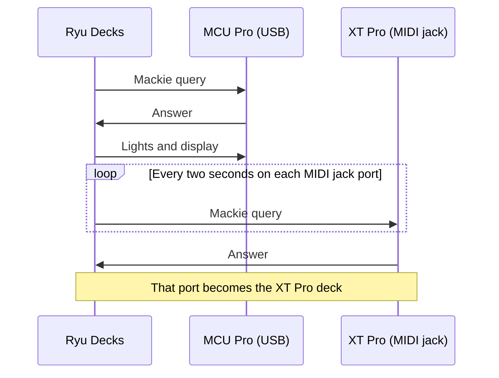

This page lists the decks in this family that Decks supports and how each one maps to Ryu keys, dials, and lights. To give keys labels, colours, and actions, start with [Decks](/docs/apps/decks). Before Ryu opens a deck, [close other deck software](/docs/apps/decks#close-other-deck-software), and on Linux add the [udev rules](/docs/apps/decks-linux).

## Supported models

| Maker | Models | Keys | What a key shows |
| --- | --- | --- | --- |
| Behringer | X-Touch Mini (over USB MIDI) | 18 | The button's light, only on or off. Each encoder's ring lights in full for its dial colour |
| Behringer | BCR2000, BCF2000 (over USB MIDI) | 20 | The button's light, only on or off. The encoders and faders work as dials |
| Behringer | X-Touch One (over USB MIDI) | 36 | The button's light, only on or off. The deck light colours the display's backlight |
| PreSonus | ATOM (over USB MIDI) | 36 | The pad's light, dimmed by the brightness; the buttons' lights only on or off |
| PreSonus | ATOM SQ (over USB MIDI) | 63 | The light of a pad, Bank A to H, Play, Plus or Minus, dimmed by the brightness; the other buttons' lights only on or off. The display shows the six display buttons' labels |
| PreSonus | FaderPort, the original single-fader deck (over USB MIDI) | 26 | The button's light, only on or off |
| PreSonus | FaderPort 2 (over USB MIDI) | 28 | Some buttons' lights take the key's colour; the others are only on or off |
| PreSonus | FaderPort 8 and FaderPort 16 (over USB MIDI) | 74 or 106 | The Select buttons and some others take the key's colour; the other lights are only on or off |
| iCON Pro Audio | Platform M+ and Platform M (over USB MIDI, Mackie Control mode) | 54 | Buttons' lights are only on or off; no display. The knobs, jog wheel and faders are dials |
| iCON Pro Audio | Platform X+ extender (over USB MIDI, Mackie Control mode) | 48 | Select, Mute, Solo and Rec lights are only on or off; knob pushes and fader touches are keys with no light; no display. The knobs and faders are dials. Each unit is its own deck |
| iCON Pro Audio | QCon Pro X and QCon Pro XS1 extender (over USB MIDI, Mackie Control mode) | 113 or 48 | Buttons' lights are only on or off; the display shows each strip's Select and V-Pot push labels. The knobs, jog wheel and faders are dials |
| iCON Pro Audio | QCon Pro G2 and QCon EX G2 extender (over USB MIDI, Mackie Control mode) | 111 or 48 | Buttons' lights are only on or off, and each V-Pot ring's centre dot is on or off; the display shows each strip's Select and V-Pot push labels. Keys carry Mackie function names, which differ from many printed legends. The knobs, jog wheel and faders are dials |
| iCON Pro Audio | P1-Nano (over USB MIDI, Mackie Control mode) | 113 | Buttons' lights are only on or off; the display shows each strip's Select and V-Pot push labels, and each V-Pot's dial light colours the backlight of the scribble strip above it. Keys carry Mackie function names. The knobs, jog wheel and fader are dials; the fader is read only. The P1-M and P1-X are not supported |
| Zoom | R16 and R24 recorders (over USB MIDI, audio interface mode, Mackie Control) | 24 | The track status keys' lights are only on or off, and may not show. The faders and jog dial are dials |
| Mackie | MCU Pro and the XT Pro extender chained to it (over the MCU Pro's USB MIDI, Mackie Control mode) | 113 or 48 | Buttons' lights are only on or off, and each V-Pot's LED ring is its dial's light; the display shows Ryu. Keys carry Mackie function names. The V-Pots, jog wheel and faders are dials. The MCU Pro's three MIDI jack ports always show as extra decks that stay idle until an XT Pro there answers; on a Mac they show as MCU Pro decks and a chained XT Pro uses the MCU Pro's key layout. A stand-alone XT Pro on USB is not found |

<Callout type="warn">
None of the surfaces on this page has been tested on the physical device yet. Decks drivers
are tested against recorded message formats, so treat a model as supported once it has been
checked on a real device.
</Callout>

## Before Ryu opens a surface

Close the music apps that use the surface's MIDI port first. On Windows only one app can hold
it. Elsewhere an app sharing it draws over Ryu's lights, and on some surfaces changes its mode.

On Linux, Ryu reaches every surface on this page through ALSA, like the
[Novation Launchpads](/docs/apps/decks-novation). No USB id is known for the iCON Platform M+, M
and X+ or the QCon Pro X, XS1, Pro G2 and EX G2, so add their `sound` line as
[Decks Linux Setup](/docs/apps/decks-linux) shows if your desktop does not already allow sound
devices.

| Model | Mode to set before Ryu opens it | Close first | When Ryu lets go |
| --- | --- | --- | --- |
| X-Touch Mini | None: Ryu switches it to MC (Mackie Control) mode | Other music apps | Lights off; back to Standard mode |
| X-Touch One | MIDI CC mode, in the deck's setup | Other music apps | Lights and displays off |
| BCR2000, BCF2000 | None: Ryu writes its own preset (see below) | Other music apps | Your saved presets are untouched |
| ATOM, ATOM SQ | None: Ryu switches it to native mode | Ableton Live, Studio One | Lights off; it leaves native mode |
| FaderPort (original) | None: Ryu switches it to native mode | Studio One, Ardour | Lights off |
| FaderPort 2, 8, 16 | Power up in native (Studio One) mode | Studio One, Ardour | Lights off |
| iCON Platform M+, M, X+ | Power up in Mackie Control mode | Other music apps | Lights off |
| iCON QCon Pro X, XS1, Pro G2, EX G2 | Mackie Control (MCU) mode | Other music apps | Lights off; displays blanked |
| iCON P1-Nano | Mackie Control (MCU) mode | Other music apps | Lights off; display blanked; backlights white |
| Mackie MCU Pro | Boot in Mackie Control (or Logic Control) mode | Other music apps | Lights off; display blanked |
| Zoom R16, R24 | Audio interface mode with a Mackie Control surface | Other music apps | Status-key lights off |

A Mackie Control surface left in HUI or another DAW emulation cannot be read. For the iCON
Platform M+ and M and the QCon Pro X and XS1, Ryu says so in its log.

## Mackie Control surfaces

The iCON, Mackie and Zoom surfaces speak the Mackie Control protocol. They share these rules:

- Ryu never moves the motor faders.
- There is no brightness setting, and button lights are only on or off.
- Keys often carry Mackie function names, which can differ from the legends printed on the
  surface. Press a button to find its key.

### iCON Platform M+ and Platform M

The Platform M is assumed to match the M+. Power it up in Mackie Control mode, chosen on the deck
as it starts: in the other mode Ryu cannot read the knobs.

| Keys | Control |
| --- | --- |
| Columns 1 to 8 | The channel strips, top down: Select, Mute, Solo, Rec and touching the fader |
| Column 9 | Mixer, Read, Write, Cycle and touching the master fader |
| Bottom row | Channel left and right, Bank left and right, Rewind, Forward, Stop, Play and Record |

- The fader touches have no light. Zoom and Lock send nothing to Ryu.
- Dials 1 to 8 are the knobs (pressing one presses its dial), dial 9 the jog wheel and dials 10
  to 18 the faders, master last.
- There is no display.

### iCON Platform X+ extender

Each X+ is its own deck, found by its port name (Platform X+1, Platform X+2 and so on). In its
other modes it sends other messages.

- **Keys.** Each column is a channel strip, top down: pushing the knob, Select, Mute, Solo, Rec
  and touching the fader. Only Select, Mute, Solo and Rec have lights.
- **Dials.** Dials 1 to 8 are the knobs and dials 9 to 16 the faders.
- There is no display.

### iCON QCon Pro X and QCon Pro XS1

Each unit is its own deck with its own MIDI port. In HUI or another DAW mode their buttons send
other notes.

- **Keys.** The top rows are each strip's Rec, Solo, Mute, Select and V-Pot push. On the Pro X
  the global buttons follow in Mackie note order (Track to User B) with their Mackie names,
  because where each sits on the deck is not known, then the fader touches. On the XS1 the last
  row is the fader touches.
- **Lights.** Rec, Solo, Mute, Select and the Pro X's Track to Scrub lights are only on or off.
- **Display.** It shows each strip's Select label over its V-Pot push label, six characters each.
- **Dials.** Dials 1 to 8 are the V-Pots. On the Pro X dial 9 is the jog wheel and dials 10 to 18
  the faders, master last. On the XS1 dials 9 to 16 are the faders.
- Whether a fader moves back when you let go of it is not known.

### iCON QCon Pro G2 and QCon EX G2

They work like the Pro X and XS1, each as its own deck.

- **Keys.** On the Pro G2 the global buttons follow the strip rows in Mackie note order (Track to
  Scrub) and the fader touches come last. On the EX G2 the last row is the fader touches. The
  legends printed on the G2 differ on many buttons, and the references Ryu read disagree on
  them.
- **Dials.** Dials 1 to 8 are the V-Pots, and each V-Pot ring lights its centre dot while the
  dial's light is on. On the Pro G2 dial 9 is the jog wheel and dials 10 to 18 the faders,
  master last. On the EX G2 dials 9 to 16 are the faders.

### iCON P1-Nano

The P1-M and the P1-X extender are not supported, because their MIDI port names are not known.

- **Keys.** The top rows are each strip's Rec, Solo, Mute, Select and V-Pot push. The global
  buttons follow in Mackie note order (Track to User B) under their Mackie function names, then
  the fader touches. Which of them the P1-Nano has is not known; one it lacks never fires. Its
  D-5 touchscreen is not read.
- **Display.** It shows each strip's Select label over its V-Pot push label.
- **Dials.** Dials 1 to 8 are the V-Pots. A V-Pot's dial light colours the backlight of the
  scribble strip above it (white with no colour set, off for black). Dial 9 is the jog wheel and
  dial 10 the fader, without a light.
- **Fader.** It is read only: moving it turns its dial on whichever strip it is set to.

### Mackie MCU Pro and XT Pro

Ryu writes nothing until the MCU Pro answers its query. On Windows and Linux, the MCU Pro also
takes over its lights and display as soon as it sends a button, V-Pot or fader message.

- **Extra decks.** The MCU Pro's three MIDI jack ports always show as XT Pro decks (on a Mac, as
  more MCU Pro decks), even with nothing chained. Each sends only the Mackie query until an XT
  Pro chained there answers, and that XT Pro becomes that deck. On a Mac a chained XT Pro uses
  the MCU Pro's key layout. A stand-alone XT Pro on USB is not found.
- **Keys.** Each strip's Rec, Solo, Mute, Select and V-Pot push, the global buttons under their
  Mackie function names, and the fader touches.
- **Dials.** The V-Pots, the jog wheel and the faders. Each V-Pot's LED ring lights as its dial
  light.
- **Display.** It shows Ryu, and the timecode digits are blanked.

### Zoom R16 and R24

The R16 and R24 look the same to Ryu. To use one as a control deck:

1. On the recorder, choose USB, then AUDIO I/F, then EXECUTE.
2. Set its control surface to Mackie Control.

In storage mode it has no MIDI port.

- **Status keys.** The top row is the eight track status keys. The recorder's MASTER status key
  chooses whether they arm, solo or mute, and each presses the same key either way. Only the
  status keys may light, on or off, and that is not confirmed.
- **Other keys.** Below are AUTO PUNCH I/O, A-B REPEAT, `MARKER |<<`, `MARKER >>|` and MARK (F1 to
  F5) and the 1-8Tr and 9-16Tr bank keys, then the transport and cursor keys.
- **Dials.** Dials 1 to 8 are the track faders, dial 9 the master fader and dial 10 the jog dial.
  The faders have no motor, so the first move of each only sets where it is.
- There is no display.

## Behringer

### X-Touch Mini

Ryu switches the deck to MC mode, so Layer A and Layer B no longer switch layers while Ryu drives
it.

- **Keys.** Keys 1 to 8 are the top row of buttons and keys 9 to 16 the bottom row, left to
  right. Layer A and Layer B are keys 17 and 18.
- **Lights.** Each button's light has one colour and is only on or off: any colour except black
  or near-black turns it on. There is no brightness setting.
- **Dials.** The eight encoders are dials 1 to 8, and pushing one presses its dial. Its ring
  lights in full for any dial colour except black. The fader is dial 9 and has no light; it
  turns its dial by how far it moved, from where it was first touched.

### X-Touch One

In its Mackie Control mode Ryu cannot read it, so select MIDI CC mode first.

- **Keys.** Keys 1 to 35 are its buttons in the order the deck numbers them, from Segment Solo,
  BPM and Master to the Up, Left, Enter, Right and Down keys. Their places in Decks are not where
  they sit on the deck. Key 36 is touching the fader and has no light.
- **Lights.** Each button's light has one colour and is only on or off: any colour except black
  or near-black turns it on. There is no brightness setting.
- **Dials.** The encoder, the jog wheel and the fader are dials 1 to 3 with no light. The fader
  turns its dial by how far it moved, from where it was first touched.
- **Display.** The deck light colours the display's backlight in the nearest of its eight colours
  (white when none is set; black turns the display off). The display shows Ryu's name.

### BCR2000 and BCF2000

When it connects, Ryu writes its own preset into the deck's edit buffer, which takes a few
seconds. It is never stored, so your saved presets are untouched. Choosing one on the deck brings
it back, and Ryu's keys and dials stop matching until the deck reconnects.

- **Keys.** Keys 1 to 16 are the two rows of buttons and keys 17 to 20 the four buttons at the
  lower right (top left, top right, bottom left, bottom right).
- **Lights.** Each button's light has one colour and is only on or off: any colour except black
  or near-black turns it on. There is no brightness setting.
- **Dials.** Dials 1 to 8 are the top push encoders, whichever of the four encoder groups is
  selected, and pushing one presses its dial. On the BCR2000, dials 9 to 32 are the three rows of
  encoders below, row by row from the top (an order not yet confirmed). On the BCF2000, dials 9
  to 16 are the motor faders, which Ryu never moves, each turning its dial a step for every two
  units it moves.
- **Encoder rings.** Encoders are put back to the middle of their range after each turn, and
  their rings show only that.
- Both models report the same USB id, so Ryu tells them apart by their MIDI port name.

## PreSonus

The ATOM and ATOM SQ have no brightness command, so Ryu dims the colours itself, and 0% turns
every light off. On every PreSonus surface, button lights that are only on or off turn on for any
colour except black or near-black.

### ATOM

- **Keys.** Keys 1 to 16 are the pads, row by row from the top left. Keys 17 to 36 are the
  buttons, listed four to a row below the pads rather than where they sit on the deck: Shift,
  Zoom, Note Repeat, Full Level, Bank, Preset, Show/Hide, Nudge, Editor, Set Loop, Setup, Up,
  Down, Left, Right, Select, Click, Record, Play and Stop. Shift and Zoom are plain keys.
- **Lights.** Each pad's light takes the key's colour. The buttons' lights are only on or off.
- **Dials.** The four knobs are dials 1 to 4, with no light.

### ATOM SQ

- **Keys.** Keys 1 to 16 are the upper row of pads and keys 17 to 32 the lower row, left to
  right. Keys 33 to 63 are the buttons, listed on the last two rows rather than where they sit on
  the deck: Bank A to H, the six buttons under the display, Shift, Song, Instrument, Editor,
  User, Display Left and Right, Up, Down, Left, Right, Click, Record, Play, Stop, Plus and Minus.
- **Lights.** The pads, Bank A to H, Play, Plus and Minus take the key's colour. The other
  buttons' lights are only on or off.
- **Display.** It shows Ryu and, above each of the six display buttons, that key's label.
- **Dials.** The eight knobs are dials 1 to 8, the display knob dial 9 and the touch strip dial
  10, with no light.

### FaderPort (original)

Ryu asks the deck who it is when it connects and then switches it to its native mode.

- **Keys.** Keys 1 to 24 are its buttons in the order the deck numbers them, from User to Off, so
  their places on the page are not where they sit on the deck. Each light is only on or off. Key
  25 is the footswitch and key 26 touching the fader, with no light.
- **Dials.** The encoder is dial 1 and the fader dial 2. Moving the fader turns its dial by how
  far it moved, and Ryu never moves it.
- There is no brightness setting.

### FaderPort 2, FaderPort 8 and FaderPort 16

In its Mackie Control or HUI mode Ryu cannot read it, so power the deck up in native mode first.

- **FaderPort 8 and 16 keys.** The first four rows of keys are each channel's Select, Mute and
  Solo buttons and touching its fader, left to right. The other buttons follow, from Arm to the
  footswitch, rather than where they sit on the deck.
- **FaderPort 2 keys.** Its 28 keys are its buttons in a fixed order, from Arm to Record, then the
  footswitch and the fader touch.
- **Lights.** Select, Bypass, Link and some others take the key's colour. The other lights are
  only on or off, and the encoder pushes, footswitch and fader touches have none.
- **Dials.** The encoders are the first dials and the faders the dials after them. Ryu never
  moves the faders.
- On the FaderPort 8 and 16, Ryu clears the scribble strips. There is no brightness setting.
