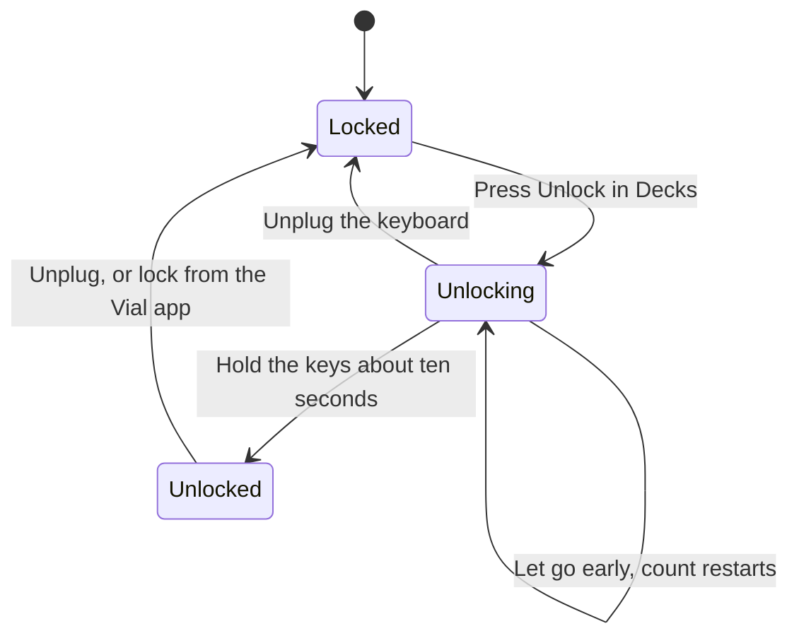

This page lists the decks in this family that Decks supports and how each one maps to Ryu keys, dials, and lights. To give keys labels, colours, and actions, start with [Decks](/docs/apps/decks). Before Ryu opens a deck, [close other deck software](/docs/apps/decks#close-other-deck-software), and on Linux add the [udev rules](/docs/apps/decks-linux).

## Supported models

| Maker | Models | Keys | What a key shows |
| --- | --- | --- | --- |
| Griffin | PowerMate (USB) | None | Its blue base light, as the deck light. The knob works as a dial: push it to press, turn it to turn |
| 3Dconnexion | SpaceNavigator (and for Notebooks), SpaceExplorer, SpacePilot, SpacePilot PRO, SpaceMouse Pro, Compact, Wireless, Pro Wireless (cable, receiver or Bluetooth), Enterprise and USB, Universal Receiver | 0 to 22 | Nothing: it has no screens. The puck works as six dials, and the LED (where there is one) is the deck light |
| Yamaha | CC121MK2 (CC1) | 29 | The 12 keys behind its screen: its label on its colour. Fifteen of the 17 buttons light in the nearest of ten colours. Its six encoders and the motorised fader work as dials |
| PrehKeyTec | Programmable POS keyboards: MCI 30, 60, 84, 96 and 128, the POS sections of the MCI 128 Alpha, 3000 and 3100, and MSI 60 | 8 to 128 | Nothing: it has no screens or lights. Each key works once it is programmed as a POSKey in PrehKeyTec's own tool |
| Microsoft | Xbox Wireless Controller (Series X\|S), Xbox One S Controller, Xbox Elite Wireless Controller Series 2 | 24 | Nothing: it has no screens or lights. Its buttons, triggers and stick directions are keys, and the sticks work as four dials |
| Sony | DualShock 4, DualSense, DualSense Edge, PlayStation Access Controller, over a USB cable | 24, 25, 29 or 11 | Nothing on the keys: it has no screens. The light bar (the Access controller's light) is the deck light. Its buttons, triggers and stick directions are keys, and the sticks work as dials |
| Sony | Buzz! buzzers (four handsets, wired or wireless) | 20 | Nothing on the keys: they have no screens. Each handset is a row: its red Buzz! dome, then blue, orange, green and yellow. A dome's light is on or off from its key colour |
| GameSir | Cyclone 2, by cable or its 2.4 GHz dongle | 27 | Nothing on the keys: it has no screens. One colour replaces the controller's light animation as the deck light. Its buttons, back buttons, triggers and stick directions are keys, and the sticks work as dials |
| SteelSeries | Apex Pro, Apex 7, Apex Pro TKL, Apex 7 TKL, Apex 5, Apex Pro Gen 3, Apex Pro TKL Wireless Gen 3 (by cable or its 2.4 GHz dongle) | 1 (the OLED) | The OLED above the keys shows the key's face in one colour, as the info screen. Every key still types; Ryu reads no keys and sets no lights |
| DJI | RC-N1 drone remote (RC231) | 10 | Nothing: it has no screens or lights. Its stick and gimbal-wheel directions are keys, and they work as five dials; its buttons are not read |
| monome | grid 64 and 128 (2011 and later, including 2022 and later grids), arc 2 and arc 4, the 2007 to 2010 64 and 128, the 40h and the arduinome | 64 to 128 (arcs have none) | Its colour, as the key's light: one colour at sixteen levels on grids from 2011, on or off on older ones. An arc's encoders work as dials, and each ring lights whole as its dial light. 16 x 16 grids are not supported |
| QMK / Vial | Any QMK keyboard or macropad running Vial firmware, whatever its maker | Read from the keyboard | Its colour, as the light under the key, on boards with VialRGB; other LEDs are the deck light. Keys work after you unlock the keyboard in Decks |
| Dynamic Lighting | Any keyboard, mouse, light strip or DIY board with Windows Dynamic Lighting (HID LampArray) lights, whatever its maker | Read from the device, up to 255 | Its colour, as the light of one lamp; lamps past the first 255 share the deck light. Keys are lights only: pressing them does nothing in Ryu |
| Wooting | One, Two, Two Lekker Edition, Two HE, 60HE, 60HE+, 60HE V2 and 80HE, and the One and Two on their first firmware | 126 (Two family), 102 (One, 80HE) or 84 (60HE family) | Its colour, as the light under the key; brightness dims them. Keys press at the keyboard's own actuation point and still type as usual |
| Apple | MacBook Pro Touch Bar, on macOS | 8 | Its label on its colour, after you tap Ryu in the Control Strip |

<Callout type="warn">
Decks drivers are tested against recorded report formats, not against physical hardware in CI.
These models have not been tested on hardware yet: the Griffin PowerMate, 3Dconnexion mice,
Yamaha CC121MK2, Xbox controllers, Sony controllers and Buzz! buzzers, GameSir Cyclone 2,
SteelSeries Apex keyboards and Vial keyboards. The notes below say where other models are only
partly checked.
</Callout>

## 3D mice and knobs

### 3Dconnexion 3D mice

A 3D mouse's buttons are keys, named as printed (Menu, Fit, Esc and so on).

- **Puck.** The puck is six dials. Dials 1 to 3 slide it right, toward you and down, and dials
  4 to 6 tilt and twist it. Pushing further turns a dial by more steps, and letting the puck go
  turns it back.
- **LED.** On the models with an LED, any colour under **Deck lights** turns it on and Off turns
  it off.
- **Limits.** The SpacePilot PRO's and SpaceMouse Enterprise's screens are not drawn, and the
  Enterprise offers 22 of its 31 keys. The CadMouse, Keyboard Pro, Numpad Pro and Universal
  Receiver 2 are not supported.

Quit 3DxWare (or stop spacenavd on Linux) if Ryu cannot open the mouse.

### Griffin PowerMate

The knob is dial 1. Pushing it presses the dial, and turning it turns the dial, about 94 steps a
full turn. Only the USB PowerMate works, not the later Bluetooth one.

- **Light.** The deck light sets how bright the blue base light glows. It is always blue, so
  only how bright the colour is matters, and brightness dims it.
- The light stays steady while Ryu has the knob, keeps its slow pulse while the computer
  sleeps, and goes dark when Ryu lets go.

### Yamaha CC121MK2

Quit Yamaha's ControlCenter first.

- **Screen keys.** Keys 1 to 12 are the keys behind its screen, in rows of four.
- **Buttons.** The buttons below are named by their printed numbers (Button 1, Button 2,
  Button 15 to Button 29). All but 1 and 2 have a light that shows the nearest of ten colours
  (blue, orange, yellow, purple, sky blue, pink, red, green, yellow-green and white) at full
  strength. Black turns it off.
- **Dials.** Dials 1 to 6 are RC1 to RC6, with RC6 the jog wheel, and pushing one presses it.
- **Fader.** The fader is dial 7. Touching it presses the dial, and moving it turns the dial.
  Ryu asks its motor to hold it where you leave it.
- Brightness dims the screen and the lights.

## Game controllers and remotes

Unless a section says otherwise, a trigger or stick direction counts as pressed past half way,
and a little play around the centre is ignored. Holding a stick off centre keeps turning its dial, faster the
further you push.

### Xbox controllers

| Keys | Control |
| --- | --- |
| 1 to 8 | A, B, X, Y, LB, RB, LT and RT |
| 9 to 16 | The d-pad (Up, Down, Left, Right), View, Menu, Xbox and Share |
| 17 to 24 | Each stick's four directions (LS up to RS right) |

Dials 1 and 2 are the left stick across and up, and 3 and 4 the right stick. Clicking a stick
presses dial 1 or 3.

- **Connection.** Over a USB cable it works on a Mac. On Linux, Ryu sees the controller over
  Bluetooth only, and that layout is not yet checked on hardware. On Windows over USB it is not
  recognised yet.
- **Not used.** Share works over Bluetooth only. The Elite's back paddles, rumble and the Xbox
  button's light are not used.
- On a Mac, Ryu asks to hold the controller to itself, so games stop reacting to it while Ryu
  has it.

### PlayStation controllers

On a DualShock 4, DualSense or DualSense Edge:

| Keys | Control |
| --- | --- |
| 1 to 8 | Cross, Circle, Square, Triangle, L1, R1, L2 and R2 |
| 9 to 16 | The d-pad (Up, Down, Left, Right), Create (Share on the DualShock 4), Options, PS and the touchpad click |
| 17 to 24 | Each stick's four directions |
| 25 | Mute (DualSense and Edge) |
| 26 to 29 | The Edge's two Fn buttons and two back paddles |

Triggers, sticks and dials work as on an Xbox controller.

On the PlayStation Access Controller, keys 1 to 8 are its eight buttons, then Center, PS and
Profile. Ryu reads the buttons as pressed, whatever the active profile maps them to. Its stick
is dials 1 (across) and 2 (up), and clicking it presses dial 1. Pressing Profile still switches
the controller's profile.

- **Light.** The deck light colours the light bar (the Access controller's light), and
  brightness dims it. It goes dark when Ryu lets go. Steam Input may also set the light bar.
- **Side effects.** Setting a deck light turns the DualSense's player lights and mute light off,
  so the mute light no longer shows whether the microphone is muted. It also turns the Access
  controller's player indicator off.
- **Connection.** Connect the controller with a USB cable. Ryu does not use it over Bluetooth,
  and rumble is not used.
- On a Mac, Ryu asks to hold the controller to itself, so games stop reacting to it while Ryu
  has it. On Linux, games still see it.

### Sony Buzz! buzzers

Each handset is one row of five keys, from the top of the handset down: the red Buzz! dome, then
blue, orange, green and yellow. Keys 1, 6, 11 and 16 are the four domes.

- A dome lights when its key has a colour, and goes dark when the key has none or a very dark
  one. It is only on or off, and the coloured buttons have no light.
- A wireless handset that is switched off simply never presses anything, so all four rows
  always show.
- The domes go dark when Ryu lets go.

### GameSir Cyclone 2

| Keys | Control |
| --- | --- |
| 1 to 8 | A, B, X, Y, LB, RB, LT and RT |
| 9 to 16 | The d-pad (Up, Down, Left, Right), View, Menu, Home and Capture |
| 17 to 19 | The back buttons L4, R4 and M |
| 20 to 27 | Each stick's four directions |

Sticks and dials work as on an Xbox controller, and the triggers count as pressed when the
controller says so. Ryu reads the buttons as pressed, whatever GameSir Connect remaps them to.

The deck light replaces the light animation the controller is playing with one colour, and
brightness dims it. With no deck light set, Ryu leaves the lights alone. The column of LEDs
between the sticks keeps showing the game profile number.

<Callout type="warn">
The controller saves the deck light in its own light settings. Ryu keeps a copy of the
animation and puts it back when you clear the deck light or Ryu lets go. That copy is kept only
while Ryu has the controller open.

If the controller is unplugged, its dongle loses it, or Ryu
stops before it can put the animation back, the controller keeps the single colour. The next
time Ryu opens it, that colour is what it keeps and restores, and only GameSir Connect can bring
the original animation back.
</Callout>

If you switch animations on the controller (M and the left stick), Ryu puts the old one back and
colours the new one. Connect the controller with a cable or its 2.4 GHz dongle; Ryu does not
use it over Bluetooth. Rumble is not used, and on Linux games still see the controller.

### DJI RC-N1 remote

| Keys | Control |
| --- | --- |
| 1 to 4 | The left stick's up, down, left and right |
| 5 to 8 | The right stick's up, down, left and right |
| 9 and 10 | The gimbal wheel up and down |

Dials 1 and 2 are the left stick across and up, 3 and 4 the right stick, and 5 the wheel.

- The remote's buttons (return to home, the shutter, Fn, C1, C2 and the flight-mode switch) are
  not read.
- So far only the left stick has been checked on a real remote.
- Switch the remote on and connect its bottom USB-C port with a data cable. Then quit DJI
  Assistant and any simulator using it.

## Grids

### monome

On a monome grid, the keys are numbered row by row from the top left. Each key's light has one
colour:

- on grids from 2011 it glows at one of sixteen levels, brighter for a brighter key colour;
- on the older 64, 128 and 40h it is on for any colour but black or near-black.

On a monome arc, each encoder is a dial, turning 64 steps a turn on 2012 and later arcs (16 on
the 2011 arc). Only the 2011 arc's encoders push. Each ring lights whole under **Dial lights**,
brighter for a brighter colour. Brightness sets the grid's or rings' intensity.

Ryu finds a monome by its USB serial number, the way monome's own serialosc does. Quit serialosc
(and anything using the grid or arc through it) first; Ryu picks the device up once serialosc
lets go. 16 x 16 grids (the 256, grid zero and the older 256s and kits) have more keys than Ryu
can number, so they are not supported.

## Keyboards

### PrehKeyTec POS keyboards

Ryu cannot program a PrehKeyTec keyboard, so set it up first in PrehKeyTec's own tool
(WinProgrammer or MapMyKey):

1. Give every key you want in Ryu its own POSKey macro, POSKey001 to POSKey128.
2. Turn on the OPOS/JavaPOS POSKey HID output.

Keys left as ordinary keys never reach Ryu. Ryu listens only to that POSKey channel and leaves
the keyboard's normal typing alone. Each key is named by its POSKey number, and POSKey 1 is the
bottom-left key, counting left to right and then upwards.

When the keyboard is plugged in, Ryu asks it which model it is, so the right layout appears. One
that does not answer is shown as an MCI 84 or MCI 128, by its USB id. There are no screens,
lights or brightness to set.

The MCI 30, 60, 84 and 128 have been tried on hardware by others. The MCI 96 has only answered
which model it is. The MCI 128 Alpha, 3000 and 3100 POS sections and the MSI 60 follow their
published layouts only.

### QMK keyboards and macropads on Vial

Any keyboard or macropad running Vial firmware shows up in Decks under its own name. Its keys
are laid out as in its Vial layout and named by their switch-matrix position (Row 1 col 3 and so
on).

- Keyboards on stock QMK or VIA firmware without Vial are not supported.
- A keyboard whose switch matrix is too large for Vial to report is listed with that reason
  instead of its keys.
- Ryu learns a keyboard's layout from the keyboard. After Ryu restarts, it is listed again once
  it is plugged in, and its saved keys are kept.

Vial keeps a keyboard's keys locked from other programs until you unlock it on the keyboard
itself. Decks says when it is locked and which keys unlock it.

To unlock, press **Unlock**, then hold those keys together for about ten seconds until the bar
fills. Letting go starts the count again. Once started, an unlock ends only when the keys have
been held long enough or the keyboard is unplugged, and while it runs the keyboard ignores its
lights.

Each key still types what its keymap says when you press it; Ryu cannot stop that. Map the keys
you use in Decks to nothing (`KC_NO`) or to F13 to F24 in the Vial app. Ryu never changes the
keymap. Knobs and small screens on the keyboard are not reachable this way.

On a keyboard built with VialRGB, the colour of a key lights the LED under it, and **Deck
lights** colours the rest (underglow and indicators). While any light is set, Ryu drives them
and **Brightness** dims them. When none is set, or Ryu lets go of the keyboard, its own lighting
effect comes back. Nothing is saved to the keyboard, and its lighting timeout and sleep still
turn the lights off.

### Wooting keyboards

On a Wooting keyboard every key is a deck key. Ryu reads the keyboard's analog channel alongside
your computer, and lights each key in its colour.

- **Typing.** Because Ryu only reads alongside, a key you bind in Decks still types as usual, so
  bind keys you rarely type with.
- **Actuation.** A key presses at the actuation point you set in Wootility. On firmware that
  only sends the older analog report (the One and Two on their first firmware among them), Ryu
  presses it at 40% of the travel and releases it under 25%.
- **Lights.** **Brightness** dims the lights, and when Ryu lets go the keyboard returns to its
  own lighting. Quit Wootility and other RGB tools first, or they and Ryu take turns at the
  lights.
- **Layout.** Decks shows the keyboard's whole switch matrix, six rows by 21, 17 or 14 columns,
  so a few keys are cells with no switch that never press (one of the six rows is empty on a
  60HE). On the 21-column Two family each key is named after its legend.

Ryu has been checked only against Wooting's published SDKs, not on hardware yet.

### SteelSeries Apex keyboards with an OLED

Ryu draws only the small screen. It is the deck's info screen, with one key's label and action.
Bright parts of the face light up and dark parts stay off.

- The keyboard types as usual. Ryu reads none of its keys, leaves the key lights alone, and has
  no brightness setting.
- Run the screen's action from Decks with Test.
- Quit SteelSeries GG first, or it may draw over the screen.
- The Apex Pro TKL Wireless Gen 3 is a different deck by cable and through its 2.4 GHz dongle,
  each with its own layout.
- The screen goes dark when Ryu lets go.

### Dynamic Lighting devices (HID LampArray)

Keyboards, mice, light strips and DIY boards that support Windows Dynamic Lighting describe their
lights in a standard way, so Decks can light them whoever made them.

- Each one shows up under its own name with one key per lamp, placed where the device says the
  lamp sits and named after the key it lights (or Lamp 1, Lamp 2 and so on).
- Devices with more than 255 lamps have the rest as one deck light.
- Ryu learns the lamps from the device. After Ryu restarts, it is listed again once it is
  plugged in, and its saved keys are kept.

These keys are lights only. Pressing them does nothing in Ryu, and a keyboard's keys keep typing
as usual, so run a key's action with **Test** or from a workflow. Each lamp glows in its key's
colour, lamps with a fixed colour only get brighter or dimmer, and **Brightness** dims them all.

On Windows, turn off **Use Dynamic Lighting on my devices** in Settings for the device first;
otherwise Windows and Ryu take turns at its lights. When Ryu lets go, the device's own lighting
comes back. Ryu has been checked only against the standard and published examples, not on
hardware yet.

### MacBook Pro Touch Bar

On a MacBook Pro with a Touch Bar, Decks lists the Touch Bar as a deck with eight keys.

1. Save a key. A **Ryu** button appears in the Touch Bar's Control Strip (the part on the
   right).
2. Tap it to show your keys across the Touch Bar.
3. Tap a key. It works like a press on any other deck.

The close button on the left brings the usual Touch Bar back. An app that replaces the whole
Touch Bar, such as MTMR or Pock, can cover Ryu's keys while it is showing. The Touch Bar is not
supported on Linux.

<Callout type="warn">
The Touch Bar support has not yet been run on a Mac. It may need adjusting before it works.
</Callout>
