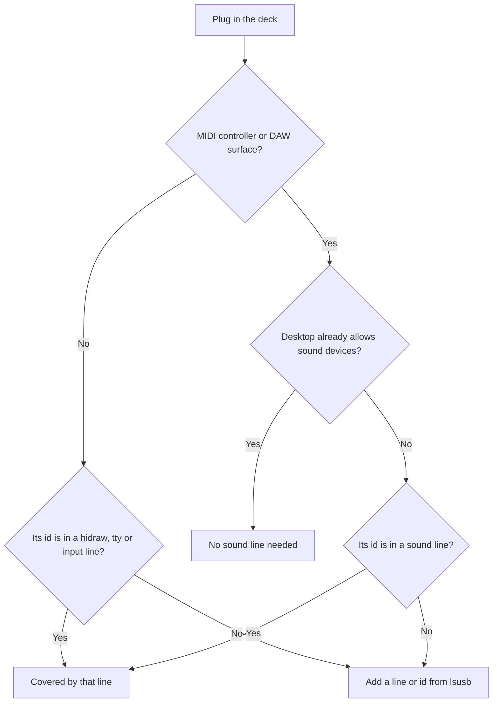

This page is for people who run [Decks](/docs/apps/decks) on a Linux computer. Do the setup
once: install the ALSA library, then add the udev rule.

## Install the ALSA library

The Decks app needs the `libasound2` (or `alsa-lib`) package to start on Linux. This applies
to every deck, not only MIDI ones: without the library the Decks sidecar does not start at
all. Most desktops already have it. With the library but no ALSA sequencer, Decks still starts
and finds no MIDI decks.

## Add the udev rule

Linux lets only root open a deck until a udev rule allows it.

1. Run the command below once.
2. Unplug the deck and plug it in again.

The Loupedeck, Razer, TourBox, Yamaha, DJI and monome lines also stop ModemManager from
probing those decks.

```sh
sudo tee /etc/udev/rules.d/70-ryu-decks.rules <<'EOF'
SUBSYSTEM=="hidraw", ATTRS{idVendor}=="0fd9", TAG+="uaccess"
SUBSYSTEM=="hidraw", ATTRS{idVendor}=="1b1c", ATTRS{idProduct}=="2b18", TAG+="uaccess"
SUBSYSTEM=="hidraw", ATTRS{idVendor}=="2207", ATTRS{idProduct}=="0019", TAG+="uaccess"
SUBSYSTEM=="hidraw", ATTRS{idVendor}=="303a", ATTRS{idProduct}=="8297|8298|8360", TAG+="uaccess"
SUBSYSTEM=="tty", ATTRS{idVendor}=="2ec2", TAG+="uaccess", ENV{ID_MM_DEVICE_IGNORE}="1"
SUBSYSTEM=="tty", ATTRS{idVendor}=="1532", ATTRS{idProduct}=="0d06|0d09", TAG+="uaccess", ENV{ID_MM_DEVICE_IGNORE}="1"
SUBSYSTEM=="tty", ATTRS{idVendor}=="c251", ATTRS{idProduct}=="2005", TAG+="uaccess", ENV{ID_MM_DEVICE_IGNORE}="1"
SUBSYSTEM=="tty", ATTRS{idVendor}=="2e3c", ATTRS{idProduct}=="5740", TAG+="uaccess", ENV{ID_MM_DEVICE_IGNORE}="1"
SUBSYSTEM=="tty", ATTRS{idVendor}=="cafe", ATTRS{idProduct}=="4001", TAG+="uaccess", ENV{ID_MM_DEVICE_IGNORE}="1"
SUBSYSTEM=="usb", ATTR{idVendor}=="0499", ATTR{idProduct}=="140f", ENV{ID_MM_DEVICE_IGNORE}="1"
SUBSYSTEM=="tty", ATTRS{idVendor}=="0499", ATTRS{idProduct}=="140f", GROUP="dialout", MODE="0660", TAG+="uaccess", ENV{ID_MM_DEVICE_IGNORE}="1", ENV{ID_MM_PORT_IGNORE}="1"
SUBSYSTEM=="tty", ATTRS{idVendor}=="2ca3", ATTRS{idProduct}=="1020", TAG+="uaccess", ENV{ID_MM_DEVICE_IGNORE}="1"
SUBSYSTEM=="tty", ATTRS{serial}=="m[0-9]*|M[0-9]*|a40h[-_][0-9]*", TAG+="uaccess", ENV{ID_MM_DEVICE_IGNORE}="1"
SUBSYSTEM=="tty", ATTRS{manufacturer}=="monome", ATTRS{product}=="grid", TAG+="uaccess", ENV{ID_MM_DEVICE_IGNORE}="1"
SUBSYSTEM=="hidraw", ATTRS{idVendor}=="0300", ATTRS{idProduct}=="1001|1002|1003|1010|1020|3002|3003|3004|3006|3007|3010|3011|3013|3014", TAG+="uaccess"
SUBSYSTEM=="hidraw", ATTRS{idVendor}=="5548", ATTRS{idProduct}=="1000|1001|1004|1008|1020|1021|1023|1031|1038|6670|6672|6674", TAG+="uaccess"
SUBSYSTEM=="hidraw", ATTRS{idVendor}=="6602", ATTRS{idProduct}=="1000|1001|1002", TAG+="uaccess"
SUBSYSTEM=="hidraw", ATTRS{idVendor}=="6603", ATTRS{idProduct}=="1000|1002|1003|1005|1006|1007|1009|1012|1014", TAG+="uaccess"
SUBSYSTEM=="hidraw", ATTRS{idVendor}=="0b00", ATTRS{idProduct}=="1000|1001|1003|1005", TAG+="uaccess"
SUBSYSTEM=="hidraw", ATTRS{idVendor}=="1500", ATTRS{idProduct}=="3001|3002|3003|3005|3007", TAG+="uaccess"
SUBSYSTEM=="hidraw", ATTRS{idVendor}=="0200|0400|0500|0600|0a00|0c00", ATTRS{idProduct}=="1000|1001|2000|3000|3001", TAG+="uaccess"
SUBSYSTEM=="hidraw", ATTRS{idVendor}=="ffff", ATTRS{idProduct}=="1f40|1f41", TAG+="uaccess"
SUBSYSTEM=="hidraw", ATTRS{idVendor}=="05f3", TAG+="uaccess"
SUBSYSTEM=="hidraw", ATTRS{idVendor}=="0b33", ATTRS{idProduct}=="0010|0020|0030", TAG+="uaccess"
SUBSYSTEM=="hidraw", ATTRS{idVendor}=="046d", ATTRS{idProduct}=="c354|c21c|c222|c225|c227|c22b|c22d|c22e", TAG+="uaccess"
SUBSYSTEM=="hidraw", ATTRS{idVendor}=="046d", ATTRS{idProduct}=="c33e|c33f|c32b|c335|c33c|c339", TAG+="uaccess"
SUBSYSTEM=="hidraw", KERNELS=="*:046D:BC00.*", TAG+="uaccess"
SUBSYSTEM=="hidraw", ATTRS{idVendor}=="3282", ATTRS{idProduct}=="0009", TAG+="uaccess"
SUBSYSTEM=="hidraw", ATTRS{idVendor}=="28bd", ATTRS{idProduct}=="5202|5203", TAG+="uaccess"
SUBSYSTEM=="hidraw", ATTRS{idVendor}=="1edb", ATTRS{idProduct}=="da0e|da11|bef0", TAG+="uaccess"
SUBSYSTEM=="hidraw", ATTRS{idVendor}=="0203", ATTRS{idProduct}=="10[4-7]?", TAG+="uaccess"
SUBSYSTEM=="hidraw", ATTRS{idVendor}=="32ac", ATTRS{idProduct}=="0013", TAG+="uaccess"
SUBSYSTEM=="hidraw", ATTRS{idVendor}=="239a", ATTRS{idProduct}=="8108", TAG+="uaccess"
SUBSYSTEM=="hidraw", ATTRS{idVendor}=="cafe", ATTRS{idProduct}=="2043", TAG+="uaccess"
SUBSYSTEM=="hidraw", ATTRS{idVendor}=="17cc", ATTRS{idProduct}=="1120|1140|1200|1340|1350|1360|1410|1500", TAG+="uaccess"
SUBSYSTEM=="hidraw", ATTRS{idVendor}=="2516", ATTRS{idProduct}=="01f6|01fe|0200|0202|0204|0206", TAG+="uaccess"
SUBSYSTEM=="hidraw", ATTRS{idVendor}=="046d", ATTRS{idProduct}=="c625|c626|c627|c628|c629|c62b", TAG+="uaccess"
SUBSYSTEM=="hidraw", ATTRS{idVendor}=="256f", ATTRS{idProduct}=="c62e|c62f|c631|c632|c633|c635|c63a|c641|c652", TAG+="uaccess"
SUBSYSTEM=="hidraw", KERNELS=="0005:045E:02E0.*|0005:045E:02EA.*|0005:045E:02FD.*|0005:045E:0B00.*|0005:045E:0B05.*|0005:045E:0B12.*|0005:045E:0B13.*|0005:045E:0B20.*|0005:045E:0B21.*|0005:045E:0B22.*", TAG+="uaccess"
SUBSYSTEM=="hidraw", KERNELS=="*:256F:C638.*", TAG+="uaccess"
SUBSYSTEM=="hidraw", ATTRS{idVendor}=="053a", ATTRS{idProduct}=="0b01|0b06", TAG+="uaccess"
SUBSYSTEM=="hidraw", ATTRS{serial}=="*vial:f64c2b3c*", TAG+="uaccess"
SUBSYSTEM=="hidraw", ATTRS{idVendor}=="0414", ATTRS{idProduct}=="8104", TAG+="uaccess"
SUBSYSTEM=="hidraw", ATTRS{idVendor}=="31e3", TAG+="uaccess"
SUBSYSTEM=="hidraw", ATTRS{idVendor}=="054c", ATTRS{idProduct}=="05c4|09cc|0ce6|0df2|0e5f", TAG+="uaccess"
SUBSYSTEM=="hidraw", ATTRS{idVendor}=="054c", ATTRS{idProduct}=="0002|1000", TAG+="uaccess"
SUBSYSTEM=="hidraw", ATTRS{idVendor}=="3537", ATTRS{idProduct}=="100b|1053|101d|102a", TAG+="uaccess"
SUBSYSTEM=="hidraw", ATTRS{idVendor}=="1038", ATTRS{idProduct}=="1610|1612|1614|1618|161c|1640|1644|1646", TAG+="uaccess"
SUBSYSTEM=="hidraw", ATTRS{idVendor}=="03eb", ATTRS{idProduct}=="ff01|ff02", TAG+="uaccess"
SUBSYSTEM=="input", KERNEL=="event*", ATTRS{idVendor}=="077d", ATTRS{idProduct}=="0410|04aa", TAG+="uaccess"
SUBSYSTEM=="sound", ATTRS{idVendor}=="1235", ATTRS{idProduct}=="000e|0015|0034|0035|0051|0061|0069|006a|006b|006c|006d|006e|006f|0070|0071|0072|0073|0074|0075|0076|0077|0078|007b|007c|007d|0101|0102|0103|0113|0123|0134|0135|0136|0137|0141|0142|0143|0144|0145|0146|0148|0149|014a|014b|014c|014d|014e|014f|0157|0158|0159|015a|015b|015c|015d|015e|7b7a|7c7a|7d7a", TAG+="uaccess"
SUBSYSTEM=="sound", ATTRS{idVendor}=="09e8", ATTRS{idProduct}=="0015|0027|0028|0029|0031|0043|004e|004f|0073|0075|007b|005d|0054", TAG+="uaccess"
SUBSYSTEM=="sound", ATTRS{idVendor}=="2982", ATTRS{idProduct}=="1967", TAG+="uaccess"
SUBSYSTEM=="sound", ATTRS{idVendor}=="1397", ATTRS{idProduct}=="00b3|00bc", TAG+="uaccess"
SUBSYSTEM=="sound", ATTRS{idVendor}=="0944", ATTRS{idProduct}=="0105|0117", TAG+="uaccess"
SUBSYSTEM=="sound", ATTRS{idVendor}=="1c75", ATTRS{idProduct}=="0206|220b|024c|028c|02cc", TAG+="uaccess"
SUBSYSTEM=="sound", ATTRS{idVendor}=="2580", ATTRS{idProduct}=="0006|0007|1007|2007|3007", TAG+="uaccess"
SUBSYSTEM=="sound", ATTRS{idVendor}=="03eb", ATTRS{idProduct}=="ecad|ecac", TAG+="uaccess"
SUBSYSTEM=="sound", ATTRS{idVendor}=="303a", ATTRS{idProduct}=="8123", TAG+="uaccess"
SUBSYSTEM=="sound", ATTRS{idVendor}=="2e8a", ATTRS{idProduct}=="1145", TAG+="uaccess"
SUBSYSTEM=="sound", ATTRS{idVendor}=="194f", ATTRS{idProduct}=="0206|020a|0202|0203|0204|0205", TAG+="uaccess"
SUBSYSTEM=="sound", ATTRS{idVendor}=="1686", ATTRS{idProduct}=="00dd", TAG+="uaccess"
SUBSYSTEM=="sound", ATTRS{idVendor}=="0a73", ATTRS{idProduct}=="0006", TAG+="uaccess"
SUBSYSTEM=="sound", ATTRS{idVendor}=="1d03", ATTRS{idProduct}=="0806", TAG+="uaccess"
SUBSYSTEM=="sound", ATTRS{idVendor}=="22f0", TAG+="uaccess"
SUBSYSTEM=="sound", ATTRS{idVendor}=="0763", ATTRS{idProduct}=="0038|0039|003a|003c|103b", TAG+="uaccess"
EOF
sudo udevadm control --reload-rules && sudo udevadm trigger
```

## Which line covers your device



## Sound device lines

Ryu reaches MIDI decks through ALSA's sequencer. The `sound` lines let you open these devices.
Their device notes are on the [Novation](/docs/apps/decks-novation),
[Akai, Ableton and M-Audio](/docs/apps/decks-akai), [MIDI controllers](/docs/apps/decks-midi-controllers)
and [DAW control surfaces](/docs/apps/decks-control-surfaces) pages.

- Novation Launchpads, Launch Controls (MK1/MK2 and 3), Launchkeys (MK2, MK3 and MK4) and first Launchkey Mini, SL MkIII and Dicer
- Akai APC minis, APC40 MKII, first APC40, APC20, APC Key 25s, MIDImix, LPD8 and Fire, the MPK mini IV, MPK mini Plus II and first MPK mini Plus
- the first Ableton Push and the Push 2
- Behringer X-Touch Mini, X-Touch One, BCR2000 and BCF2000
- KORG nanoKONTROL2, nanoKONTROL Studio and padKONTROL
- Arturia BeatStep, MiniLab 3 and KeyLab Essential mk3
- DJ TechTools Midi Fighter Twister, Midi Fighter Spectra and Midi Fighter 64
- Intech Studio Grid modules
- PreSonus ATOM, ATOM SQ and FaderPorts
- Faderfox EC4
- Livid Instruments Base and Base II
- Allen & Heath Xone:K2
- Intuitive Instruments Exquis
- M-Audio Oxygen Pro 25, 49, 61 and Mini and Hammer 88 Pro
- iCON Platform M+, M and X+ and QCon Pro X, XS1, Pro G2 and EX G2, and iCON P1-Nano
- Zoom R16 and R24
- Mackie MCU Pro (and an XT Pro chained to it)

Most desktops already let the signed-in user open sound devices, so the `sound` lines matter
only where they do not.

### Devices whose ids are not in the rule

Some product ids are not known, so the rule cannot list them. Find the id with `lsusb` and add
it as shown.

| Device | What to add |
| --- | --- |
| Launchpad S, Launchpad Mini MK1 or MK2 | Its product id, to the Novation `1235` line |
| Behringer X-Touch One | Its product id, to the `1397` line |
| KORG nanoKONTROL Studio | Its product id, to the `0944` line |
| PreSonus FaderPort (original, single fader) | Its product id, to the `194f` line |
| Akai MPK mini Plus II | Its product id, to the `09e8` line |
| DJ TechTools Midi Fighter 64 | Its product id, to the `2580` line |
| Faderfox EC4, Livid Base or Base II, Intuitive Instruments Exquis | A new `sound` line with its vendor and product id |
| iCON Platform M+, M or X+, iCON QCon Pro X, XS1, Pro G2 or EX G2 | A new `sound` line with its vendor and product id |

The `22f0` line covers every Allen & Heath device, since the Xone:K2's product id is not known.

## Dynamic Lighting devices

The `0414:8104` line covers a Gigabyte AERO X16 keyboard's Dynamic Lighting.
For any other Dynamic Lighting device, add a line like it with that device's
own vendor and product id.
