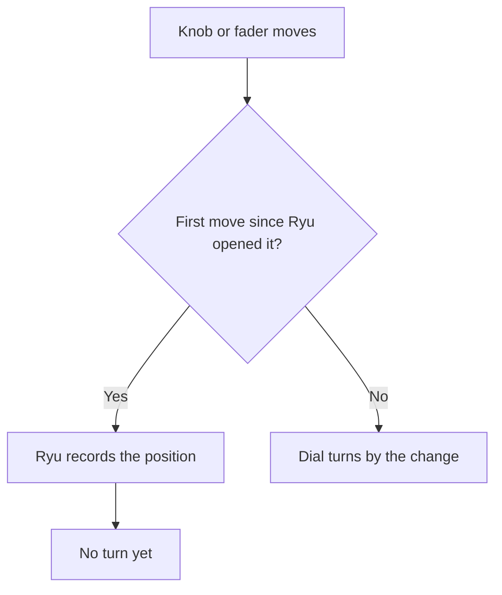

This page lists the decks in this family that Decks supports and how each one maps to Ryu keys, dials, and lights. To give keys labels, colours, and actions, start with [Decks](/docs/apps/decks). Before Ryu opens a deck, [close other deck software](/docs/apps/decks#close-other-deck-software), and on Linux add the [udev rules](/docs/apps/decks-linux).

## Supported models

| Maker | Models | Keys | What a key shows |
| --- | --- | --- | --- |
| Korg | nanoKONTROL2 (over USB MIDI) | 35 | The button's light, only on or off; the Track and Marker buttons have none |
| Korg | nanoKONTROL Studio (over USB MIDI, not Bluetooth) | 45 | The button's light, only on or off; the Scene button has none |
| Korg | padKONTROL (over USB MIDI) | 37 | The pad's or button's light, only on or off; touching the X-Y pad and the pedal have none. The wheel, knobs and X-Y pad are dials |
| Arturia | BeatStep (over USB MIDI) | 19 | Red, blue or both (pink), the nearest to the key's colour, as the pad's light; Shift, Stop and Play have none |
| Arturia | MiniLab 3 (over USB MIDI, DAW program) | 22 | The key's colour as the light of each pad (in bank A and bank B) and of Loop, Stop, Play, Record and Tap; Shift has none. The encoders, main encoder and faders are dials |
| Arturia | KeyLab Essential 49, 61 and 88 mk3 (over USB MIDI, DAW program) | 34 | The key's colour as the light of each pad (in bank A and bank B) and of Context 1-4, Save, Punch, Undo, Redo, the transport keys, Tap and Part; Bank has none. The knobs, display encoder and faders are dials |
| DJ TechTools | Midi Fighter Twister (over USB MIDI) | 4 | Nothing on its side buttons. Each knob's light takes the nearest colour on its colour wheel |
| DJ TechTools | Midi Fighter Spectra (over USB MIDI) | 16 | The nearest of its palette colours, as the button's light, dim below 50% brightness (white and grey stay bright). The deck light sets the white ground-effect lights to one level |
| DJ TechTools | Midi Fighter 64 (over USB MIDI) | 64 | The nearest colour of its 128-colour palette, as the button's light; the brightness sets each light's brightness |
| Intech Studio | Grid modules EN16, PO16, BU16, EF44, PBF4 and TEK2 (over USB MIDI) | 16 | Nothing: Ryu sets no colour, and each module's lights follow its own controls. Its knobs, encoders and faders work as dials |
| Faderfox | EC4 (over USB MIDI, firmware 2.0) | 21 | Each encoder push key's label (four characters) as that encoder's name on the display. No lights |
| Intuitive Instruments | Exquis (over USB MIDI, Developer Mode) | 75 | Every pad, button and slider portion lights in its colour; Ryu dims the colours for brightness. The 4 encoders turn and press 4 dials, each lit in its colour |
| Allen & Heath | Xone:K2 (over USB MIDI) | 34 | Red, amber or green (or off) as the light of each button, Layer included; Exit Setup's light is on or off; no brightness. The encoders, knobs and faders turn 22 dials |
| Livid Instruments | Base and Base II (over USB MIDI) | 48 | The nearest of its seven colours (or off) as the light of each touch button, pad and function button; no brightness. The 9 touch faders turn dials 1-9 (9 = master) |

<Callout type="warn">
None of the controllers on this page has been tested on the physical device yet. Decks drivers
are tested against recorded message formats, so treat a model as supported once it has been
checked on a real device.
</Callout>

## Before Ryu opens a controller

On Linux, Ryu reaches every controller on this page through ALSA, like the
[Novation Launchpads](/docs/apps/decks-novation). Close the apps that use the controller's MIDI
port first: on Windows only one app can hold it.

| Model | What Ryu needs or sets | Close first | When Ryu lets go |
| --- | --- | --- | --- |
| nanoKONTROL2, nanoKONTROL Studio | KORG native mode while Ryu drives it, so no KONTROL Editor setup is needed whatever scene, MIDI channel or LED mode is set | Other music apps | It returns to its scene |
| padKONTROL | KORG native mode, through its second MIDI port (Port 2: PORT A in, CTRL out) | KORG's padKONTROL Editor/Librarian, any music app on that port | It returns to its scene |
| BeatStep | Ryu's own mapping, in working memory | Ableton Live, Arturia's MIDI Control Center | The pads go dark |
| MiniLab 3 | Its DAW program, through the main MIDI port | Ableton Live, Analog Lab | Lights off; deck handed back |
| KeyLab Essential mk3 | Its DAW program, through the main MIDI port | Ableton Live, Bitwig Studio, Analog Lab | Lights off; deck handed back |
| Midi Fighter Twister, Spectra, 64 | Factory settings (restore them in the Midi Fighter Utility if you changed them) | The Utility, your DJ software | Twister: your own colours return. Spectra and 64: every light off |
| Intech Studio Grid | Its factory default profile (restore it in Grid Editor if you remapped it) | Grid Editor | - (Ryu sets no lights) |
| Faderfox EC4 | Firmware 2.0; Ryu never changes the loaded setup | Other apps on its port | Names go back to dashes |
| Livid Base, Base II | Live mode for the pads, local control off | Other apps on its port | Every light off; local control stays off |
| Xone:K2 | Latching Layers off (the factory default) | Other apps on its port | Every light off |
| Exquis | Developer Mode, so the pads play no notes | Other apps on its port | Lights off; it leaves Developer Mode |

### How faders and absolute knobs turn a dial

Many controllers report where a knob or fader sits, not how far it moved. Ryu turns the dial by
the change between two positions, so it needs a first position before it can count.

Each controller below says where this applies. Endless encoders turn step by step instead.

## KORG

### nanoKONTROL2

- **Keys.** Keys 1 to 24 are the S, M and R buttons of the eight channel strips (S1 to S8, then
  M1 to M8, then R1 to R8). Then come Track ◀ and ▶, Cycle, Marker Set, Marker ◀ and ▶, Rewind,
  Forward, Stop, Play and Record.
- **Lights.** Each button's light has one colour and is only on or off: any colour except black
  or near-black turns it on. The Track and Marker buttons have no light. There is no brightness
  setting.
- **Dials.** The knobs are dials 1 to 8 and the sliders dials 9 to 16, with no light. Each turns
  by how far it moved, from where it was first touched.

### nanoKONTROL Studio

It works the same way over USB (not Bluetooth), found by its MIDI port name.

- **Keys.** Keys 1 to 32 are the Solo, Mute, Rec and Select buttons of the eight strips. Then
  come Track ◀ and ▶, Cycle, Marker Set, Marker ◀ and ▶, Return to Zero, Rewind, Forward, Stop,
  Play and Record. Key 45 is the Scene button, which has no light and no longer changes scenes
  while Ryu drives the deck.
- **Dials.** The knobs are dials 1 to 8, the sliders dials 9 to 16 and the jog wheel dial 17.
- **Lights.** They use the nanoKONTROL2's commands, which KORG does not document for the Studio,
  so they are not yet confirmed on a real deck.

### padKONTROL

Ryu finds it by its port name.

- **Keys.** Keys 1 to 16 are the pads, pad 1 top left. Keys 17 to 35 are the buttons from Scene
  to Hold. Key 36 is touching the X-Y pad and key 37 a momentary pedal switch, such as the PS-1,
  in the PEDAL jack.
- **Lights.** Each pad and button light has one colour and is only on or off. The touch and the
  pedal have none, and there is no brightness setting.
- **Dials.** The data-entry wheel is dial 1, Knob 1 and 2 dials 2 and 3, and the X-Y pad's X and
  Y dials 4 and 5, with no light. A knob or the X-Y pad turns its dial by how far it moved, from
  where it was first touched (the X-Y pad again on each touch).
- **While Ryu drives it.** The display is blank, and the deck's scenes and Setting mode do
  nothing. It shows the native-mode lights only while Ryu runs.

To leave native mode by hand, hold Scene and Message/Exit and press Setting/Enter.

## Arturia

### BeatStep

The BeatStep Pro is not supported.

- **Keys.** Keys 1 to 16 are the pads, top row then bottom row. Keys 17 to 19 are Shift, Stop and
  Play, shown to the left of the pads.
- **Lights.** Each pad's light is red, blue or both (pink), with no other colours or dimming. Red,
  orange and yellow keys glow red; green, cyan and blue keys glow blue; purple, magenta, white
  and grey keys glow both. Black or near-black turns it off. Shift, Stop and Play have no light,
  and there is no brightness setting.
- **Dials.** The 16 encoders are dials 1 to 16, top row then bottom row. The large encoder is
  dial 17, which may stay a volume knob on some firmware.
- Holding Shift, Chan, Recall or Store and pressing a pad still runs the deck's own functions.

About a second after it connects, Ryu writes its own mapping into the deck's working memory,
never into a saved preset. When Ryu lets go, press Recall to bring back your own mapping. A
sharing app elsewhere changes its mapping or draws over Ryu's lights.

### MiniLab 3

Ryu never uses the MCU/HUI, DIN THRU or ALV ports. When it connects, the screen shows "Ryu" and
"Connected".

- **Keys.** Keys 1 to 8 are the eight pads in bank A and keys 9 to 16 the same pads in bank B; the
  deck's own bank button switches between the two rows. Key 17 is Shift, with no light, and keys
  18 to 22 are Loop, Stop, Play, Record and Tap.
- **Lights.** Every key but Shift shows its colour as its light, dimmed by the brightness
  setting.
- **Dials.** The eight encoders are dials 1 to 8. The main encoder is dial 9 (dial 10 while Shift
  is held; pushing it presses that dial). The four faders are dials 11 to 14, with no light.
- While another program is picked on the deck, Ryu ignores it. Going back to the DAW program
  sends every light again.

### KeyLab Essential mk3 (49, 61 or 88 keys)

When Ryu connects, the screen shows "Ryu" and "Connected".

| Keys | Control |
| --- | --- |
| 1 to 8 | The pads in bank A (top row, then bottom row) |
| 9 to 16 | The same pads in bank B (the deck's own Bank button switches between them) |
| 17 to 20 | Context 1 to 4 |
| 21 to 24 | Save, Punch, Undo and Redo |
| 25 to 32 | Loop, Rewind, Fast-forward, Metronome, Stop, Play, Record and Tap |
| 33, 34 | Part, and Bank, which has no light |

- **Lights.** Every other key shows its colour as its light, dimmed by the brightness setting.
- **Dials.** The nine knobs are dials 1 to 9 and the display encoder dial 10 (pushing it presses
  that dial). The nine faders are dials 11 to 19, with no light.
- While another program is picked on the deck, Ryu ignores it. Going back to the DAW program
  sends every light again.

## DJ TechTools

### Midi Fighter Twister

- **Dials.** The 16 knobs are dials 1 to 16, row by row from the top left, and pushing one
  presses its dial.
- **Keys.** Keys 1 to 4 are the side buttons at the left top, right top, left bottom and right
  bottom, with no light. The two middle side buttons still switch the deck's banks, and every
  bank works the same.
- **Lights.** Each dial light takes the nearest colour on the knob's colour wheel (white and grey
  show the knob's own active colour). The brightness dims both the light and the white ring.
- **Long turns.** Ryu puts a knob back to the middle of its ring once you stop turning it. Pause
  briefly during a long turn, since the knob stops at either end.

Ryu needs the factory settings for the knobs, side buttons, MIDI channels and palette. Holding both
bottom buttons can switch newer firmware to its native mode, and both middle buttons start the
step sequencer on four-bank firmware. On 2026 firmware the deck blanks its lights after an hour
untouched until you touch it, unless you change its sleep setting.

### Midi Fighter Spectra

Keys 1 to 16 are the arcade buttons, row by row from the top left. The six side buttons still
switch the deck's banks, and every bank works the same: Ryu lights each button in all four.

- **Lights.** Each light takes the nearest of the deck's palette colours (white and grey show
  white).
- **Brightness.** There is no brightness command. Below 50% the buttons use the palette's dim
  colours (white has none, so white and grey stay bright), and 0% turns them off.
- **Deck light.** It sets the white ground-effect lights under the case to one level from its
  brightness.
- Ryu needs the factory notes and MIDI channels.

### Midi Fighter 64

Keys 1 to 64 are the arcade buttons, row by row from the top left. Ryu finds it by a MIDI port
name containing "Fighter 64".

- **Lights.** Each light takes the nearest colour of the deck's 128-colour palette. The
  brightness sets the lights' own brightness in 16 steps.
- **Banks.** Ryu reads the buttons in both banks. Holding a corner button for 2 seconds switches
  bank, and that hold also counts as a key press. The lights assume the factory channel 3, the
  upper-left bank.
- Ryu needs the factory notes and MIDI channels.

## Intech Studio Grid

Every module type (EN16, PO16, BU16, EF44, PBF4 or TEK2) looks the same to Ryu. All of them share
one 4 x 4 layout of 16 keys and 16 dials, numbered by the module's own control order. A key is a
button or the push of an encoder or endless knob. A dial is an encoder, endless knob, knob or
fader.

| Module | Keys and dials |
| --- | --- |
| EN16 | Keys and dials 1 to 16 are its encoders, row by row from the top left |
| PO16 | Dials 1 to 16 are its knobs |
| BU16 | Keys 1 to 16 are its buttons |
| PBF4 | Dials 1 to 4 are the knobs, dials 5 to 8 the faders, keys 9 to 12 the buttons |
| EF44 | Keys and dials 1 to 4 are the encoders, dials 5 to 8 the faders |
| TEK2 | Keys 1 to 8 are the buttons, upper row first; keys and dials 9 and 10 the left and right endless knobs |

- Only the module plugged into USB is read, not modules chained to it.
- Each page its utility button selects keeps its own positions.
- Ryu sets no colours or brightness: each light follows its own control on the module.
- Each dial turns by how far its control moved. Each time Ryu opens the module, the first move of
  every encoder, knob and fader on each page only sets the starting point and is not counted.
- An encoder turned on past its end keeps turning its dial.

## Other controllers

### Faderfox EC4

The EC4 needs firmware 2.0 for Shift, the User keys and the encoder names. On older firmware Ryu
reads only the encoders and their pushes.

- **Setups.** Ryu reads the setup you loaded on the deck: factory setups 1 to 14 in any group, or
  the DrivenByMoss template. Sending DrivenByMoss's .syx file rewrites all 16 setups, with the
  template in setup 1 and the others back to factory. Setups 15 and 16 (Ableton's) are not read.
- **Keys and dials.** Keys 1 to 16 are the encoder pushes and dials 1 to 16 the encoders, as they
  sit on the deck. Keys 17 to 20 are User 1 to 4 (hold FUNC and press encoder 1, 5, 9 or 13).
  Key 21 is Shift, which the deck also uses for fine turning and in its menus.
- **Names.** The first four characters of each push key's label become its encoder's name on the
  display, only where the setup's own names are still `----`. This is expected to work in setups
  1 to 14.
- There are no lights or brightness setting.
- Under the deck's default routing, MIDI arriving at its DIN input is passed on to USB, so Ryu
  reads only the channel of the setup the deck is on.

### Livid Instruments Base and Base II

Ryu finds them by their MIDI port name: `Base8` for the Base, and `Base2`, `Base2 MIDI 1` or
`Base2 Base_Controls` for the Base II. Ryu uses only the first port and ignores the second.

- **Keys.** Keys 1 to 8 are the touch buttons across the top and keys 9 to 40 the 32 pads as they
  sit. Keys 41 to 48 are the eight function buttons, placed in the bottom row as a layout choice.
- **Dials.** The 9 touch faders turn dials 1 to 9 (9 is the master fader). Their own lights are
  left alone.
- **Lights.** Each key's light shows the nearest of the deck's seven colours (white, red, yellow,
  green, cyan, blue or magenta), or off for black, with no brightness setting.

Local control stays off after Ryu lets go until you power-cycle the deck or reset it in Livid's
editor.

### Allen & Heath Xone:K2

Ryu finds it by `XONE:K2` in its MIDI port name. The Xone:K1 and K3 are not recognised.

- **Keys.** Keys 1 to 4 are the top encoder pushes, keys 5 to 16 the three button rows under the
  knobs and keys 17 to 32 the bottom 4 x 4 matrix. Layer and Exit Setup sit at the ends of the
  last row.
- **Lights.** Each button's light shows red, amber or green, or off for black, near-black or pure
  blue, with no brightness setting. Exit Setup's is only on or off.
- **Dials.** The top encoders turn dials 1 to 4, the knobs dials 5 to 16, the faders dials 17 to
  20 and the bottom encoders dials 21 and 22 (their pushes press them). A knob or fader turns its
  dial from its second move, since the deck cannot report where it is.
- **MIDI channel.** Ryu uses the channel the deck was set to at power-on (15 by default), learnt
  from the first control you touch. On another channel the lights appear only after that.
- **Chained units.** With X-Link-chained units, touch the USB-attached K2 first. Ryu follows
  whichever unit it hears first and ignores the other channels.

### Intuitive Instruments Exquis

Ryu finds it by a MIDI port whose name contains `Exquis`.

- **Pads.** Keys 1 to 61 are the hexagonal pads, from the bottom left to the top right. They are
  shown row by row with the top row first (the half-pad offset of every other row is not shown).
- **Buttons.** Below them come Record, Loop, Clips, Play/Stop, Down and Up, then Undo and Redo,
  then the slider's six portions. These rows are a logical arrangement, not where the controls
  sit.
- **Lights.** Every key lights in its colour. The deck has no brightness of its own, so Ryu dims
  the colours.
- **Dials.** The four encoders turn and press dials 1 to 4, and each dial's colour lights its
  encoder.
- Settings and Sound stay the device's own, so its settings menu still works, and Ryu redraws the
  lights when you leave it.
