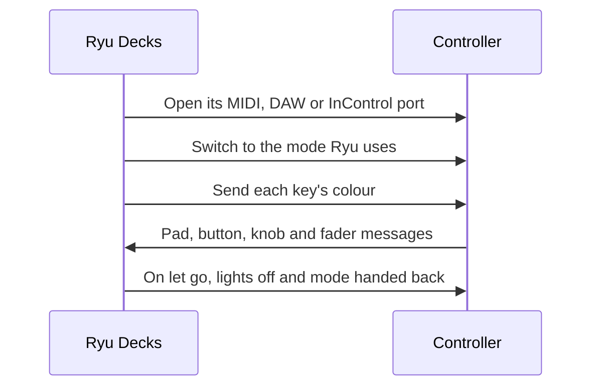

This page lists the decks in this family that Decks supports and how each one maps to Ryu keys, dials, and lights. To give keys labels, colours, and actions, start with [Decks](/docs/apps/decks). Before Ryu opens a deck, [close other deck software](/docs/apps/decks#close-other-deck-software), and on Linux add the [udev rules](/docs/apps/decks-linux).

## Supported models

| Maker | Models | Keys | What a key shows |
| --- | --- | --- | --- |
| Novation | Launchpad Mini MK3, Launchpad X, Launchpad Pro MK3 (over USB MIDI) | 80 / 80 / 105 | Its colour, as the pad's or button's light; the logo is the deck light |
| Novation | Launchpad MK2 (over USB MIDI) | 80 | Its colour, as the pad's or button's light |
| Novation | Launchpad Pro, the 2015 model before the MK3 (over USB MIDI) | 96 | Its colour, as the pad's or button's light; the logo is the deck light |
| Novation | Dicer, as a pair (over USB MIDI) | 10 | Its colour, as the button's green or orange light, dim or bright |
| Novation | Launchpad (original), Launchpad S, Launchpad Mini MK1/MK2 (over USB MIDI) | 80 | Its colour, as the key's red and green light |
| Novation | Launch Control XL, Launch Control (over USB MIDI) | 24 / 12 | Its colour, as the button's red and green light (the arrows and side buttons only on or off) |
| Novation | Launch Control XL 3, Launch Control 3 (over USB MIDI) | 26 / 9 | Its colour, as the button's light (Shift has none); the OLED is the info screen, in one colour |
| Novation | Launchkey Mini 25 / 37 MK4, Launchkey 25 / 37 / 49 / 61 MK4 (over USB MIDI) | 25 / 33 / 42 | Its colour, as the pad's light; the nearest of 128 colours on Scene Launch, Function and the fader buttons; the other buttons one colour at a brightness |
| Novation | SL MkIII 49 and 61 (over USB MIDI, in InControl view) | 61 | Its colour, as the pad's or button's light (Shift has none); Soft buttons 1-8 also show their label on the screen above them |
| Novation | Launchkey Mini, first generation (over USB MIDI) | 22 | Its colour, as the pad's or round button's light, mixed from red and green at four levels each; the arrows have no light |
| Novation | Launchkey 25 / 49 / 61 MK2 (over USB MIDI) | 26 / 35 / 35 | Its colour, as the pad's or round button's light (the nearest of 128 colours); the 49's and 61's fader buttons only on or off |
| Novation | Launchkey Mini MK3, Launchkey 25 / 37 / 49 / 61 MK3 (over USB MIDI) | 23 / 33 / 42 | Its colour, as the pad's or button's light (the nearest of 128 colours; some buttons only off, half or full) |

<Callout type="warn">
None of the Novation controllers on this page has been tested on the physical device yet. Decks drivers
are tested against recorded message formats, so treat a model as supported once it has been
checked on a real device.
</Callout>

## How Ryu drives a Novation controller

Every Novation controller works the same way over USB MIDI. On Linux, Ryu reaches it through
ALSA.

Before Ryu opens one, close the music apps that use the same port. On Windows only one app can
hold a MIDI port. Elsewhere an app sharing it draws over Ryu's lights (on a Launchkey, it
repaints the pads). Brightness dims the colours Ryu sends.

| Model | Port and mode Ryu uses | Close first | When Ryu lets go |
| --- | --- | --- | --- |
| Launchpad Mini MK3, X, Pro MK3 | Programmer mode, through its MIDI port | Ableton Live, Novation Components | Lights off; it returns to its usual mode |
| Launchpad MK2 | Session layout | Ableton Live | Lights off |
| Launchpad Pro (2015) | Programmer layout, through its Standalone MIDI port | Ableton Live | Lights off; it returns to its Session layout |
| Launchpad, Launchpad S, Mini MK1/MK2 | Its MIDI port | Ableton Live, Novation Automap | It resets and its lights go off |
| Dicer pair | Its MIDI port | Mixxx, Traktor | Ryu resets both Dicers |
| Launch Control XL, Launch Control | Factory template 1 | Ableton Live, Novation Components | Lights off |
| Launch Control XL 3, Launch Control 3 | DAW mode, through its DAW port | Ableton Live, Bitwig, Novation Components | It leaves DAW mode |
| Launchkey MK3, Launchkey MK4 | DAW mode, through its DAW port | Ableton Live, Bitwig, Novation Components | It leaves DAW mode |
| Launchkey Mini (first generation) | InControl mode, through its InControl port (the second one) | Ableton Live, Bitwig | Lights off; it leaves InControl mode |
| Launchkey MK2 | InControl mode, through its InControl port | Ableton Live, Bitwig | It leaves InControl mode |
| SL MkIII | Its InControl port | Ableton Live, Bitwig, Novation Components | Lights off; screens cleared |

On the keyboards (Launchkey and SL MkIII), the piano keys stay free for your music apps.

Where a knob or fader is absolute, moving it turns its dial by how far it moved, from where it
was first touched.

## Launchpads

### Launchpad Mini MK3, Launchpad X and Launchpad Pro MK3

- **Keys.** Keys 1 to 64 are the pads, row by row from the top left, followed by the buttons. On
  the Mini and X: the top row, then the right-hand column from the top. On the Pro: the top row
  (Shift first), the left-hand column, the right-hand column, then the two rows under the pads.
- **Lights.** Every pad and button glows in its key's colour, and the logo is the deck light.
  Brightness dims the colours Ryu sends without changing the Launchpad's own brightness setting.
- **Pads.** A pad presses on any hit, however soft.
- The Pro's Setup button sends nothing in Programmer mode, so it is not a key.

Ryu picks the Launchpad up once other apps let go of its port.

### Launchpad MK2

Keys 1 to 64 are the pads, row by row from the top left. Keys 65 to 72 are the round top row
from the left, and keys 73 to 80 the right-hand column from the top. Every pad and button glows
in its key's colour. The MK2 has no logo light.

### Launchpad Pro (2015)

| Keys | Control |
| --- | --- |
| 1 to 64 | The pads, row by row from the top left |
| 65 to 72 | The top row, from the left |
| 73 to 80 | The left-hand column, from the top |
| 81 to 88 | The right-hand column, from the top |
| 89 to 96 | The bottom row, from the left |

Every pad and button glows in its key's colour, and the logo is the deck light. A pad presses on
any hit, however soft. The Setup button is the Launchpad's own, so it is not a key.

### Launchpad, Launchpad S and Launchpad Mini MK1/MK2

Keys 1 to 64 are the grid, row by row from the top left. Keys 65 to 72 are the right-hand scene
buttons from the top, and keys 73 to 80 the top row from the left.

- **Lights.** Each light mixes red and green at four levels. A key shows the nearest of red,
  green, amber, orange, yellow or a dimmer one of them. Blue is dropped, and brightness steps
  the levels down.
- **Windows.** The original Launchpad and the Mini MK1 need Novation's USB driver before they
  show up.

### Dicer

On a pair of Dicers, keys A1 to A5 are buttons 1 to 5 of the Dicer set to deck A (MIDI channels
11 to 13). Keys B1 to B5 are those of the one set to deck B (channels 14 to 16). Which unit is
which is set on the hardware.

- A button is the same key in every mode and with or without shift.
- Each button glows green or orange, dim or bright, in every mode. Keys with more green than red
  glow green, other colours orange, and blue is dropped.
- Brightness picks the dim light or turns it off.

## Launch Controls

### Launch Control XL (MK1 or MK2) and Launch Control

On a Launch Control XL (MK1 or MK2):

- **Keys.** Keys 1 to 8 are the Track Focus buttons and keys 9 to 16 the Track Control buttons.
  Keys 17 to 20 are Up, Down, Left and Right, and keys 21 to 24 Device, Mute, Solo and Record
  Arm.
- **Dials.** The knob rows are dials 1 to 8, 9 to 16 and 17 to 24, top to bottom, and the faders
  dials 25 to 32. Each knob's light takes a dial colour, and the faders have none.

On a Launch Control, keys 1 to 8 are the pads and keys 9 to 12 the arrows. The top and bottom
knobs are dials 1 to 8 and 9 to 16, without lights.

The track buttons and pads mix red and green at four levels each (blue is dropped). The arrows
and side buttons are only on or off, and brightness steps the levels down. Ryu follows you to
another factory template. On a user template it reads nothing and leaves the lights alone.

### Launch Control XL 3 and Launch Control 3

Ryu uses the buttons, encoders (and the XL 3's faders) and screen in DAW mode.

- **XL 3 keys.** Keys 1 to 16 are the two button rows, top row first. Then come Solo/Arm,
  Mute/Select, the small logo button (Function), Page Up and Down, Track Left and Right, Record,
  Play and Shift.
- **XL 3 dials.** The encoder rows are dials 1 to 8, 9 to 16 and 17 to 24, top to bottom, and
  the faders dials 25 to 32.
- **Launch Control 3 keys.** Keys 1 to 8 are the buttons and key 9 is Shift. Its Page, Track,
  Function and Mode buttons are not keys.
- **Launch Control 3 dials.** The encoder rows are dials 1 to 8 and 9 to 16.
- **Lights.** Each button glows in its key's exact colour, and each encoder's light takes its
  dial colour. Shift and the XL 3's logo button have no light Ryu sets, and the faders none.
- **Screen.** The screen is the info screen, in one colour. 0% brightness blanks it.

The encoders turn step by step. Switching the deck to a custom mode pauses Ryu until you switch
back to a DAW mode.

## Launchkeys

### Launchkey MK3 (Mini, 25, 37, 49 or 61)

Ryu uses the pads, buttons, knobs and faders in DAW mode.

| Keys | Control |
| --- | --- |
| 1 to 16 | The pads, top row first |
| 17 to 23 (Mini) | Scene Launch, Stop/Solo/Mute, Track Left, Track Right, Shift, Play and Record |
| 17 to 33 (25 to 61) | Scene Launch, Stop/Solo/Mute, Up, Down, Track Left, Track Right, Shift, Play, Stop, Record, Loop, Capture MIDI, Quantise, Click, Undo, Device Select and Device Lock |
| 34 to 42 (49 and 61) | The eight fader buttons and Arm/Select |

- **Dials.** The knobs are dials 1 to 8. On the 49 and 61 the faders are dials 9 to 16 and the
  master fader dial 17.
- **Lights.** The pads and the scene, arrow and fader buttons show the nearest of the
  Launchkey's 128 colours. The other lit buttons are off, half or full. Shift and Device Select
  have no light.
- Ryu keeps the pads in their session layout and the knobs and faders in volume mode, and
  switches them back if you change them on the keyboard.
- On Windows every full-size Launchkey shows as the 25, so a 49's or 61's faders and fader
  buttons are not read there.

### Launchkey MK4 (Mini 25 or 37, 25, 37, 49 or 61)

Ryu uses the pads, buttons and knobs (and the 49's and 61's faders) in DAW mode. The Launchkey 88
MK4 is not supported.

- **Keys.** Keys 1 to 16 are the pads, top row first. Then come Pad Up and Down, Scene Launch,
  Function, Encoder Up and Down and Shift. The Minis end with Play and Record. The others end
  with Track Left and Right, Capture MIDI, Undo, Quantise, Metronome, Stop, Loop, Play and
  Record. The 49 and 61 add Fader Buttons 1 to 8 and Arm/Select.
- **Lights.** The pads glow in their key's exact colour. Scene Launch, Function, the fader
  buttons and Arm/Select show the nearest of the Launchkey's 128 colours. The other buttons have
  one colour whose brightness follows the key's, and Shift has no light.
- **Dials.** The knobs are dials 1 to 8 and turn step by step. The faders are dials 9 to 16 and
  the master fader dial 17.
- Ryu keeps the pads in their DAW layout and the faders in volume mode, switching back if you
  change them on the keyboard, and takes the knobs back from a custom mode.
- The screen keeps showing the keyboard's own parameters.

### Launchkey Mini (first generation)

Ryu uses the pads, buttons and knobs in InControl mode.

- **Keys.** Keys 1 to 16 are the pads, top row first. Keys 17 and 18 are the round Scene Launch
  and Stop All Clips buttons. Keys 19 to 22 are the Track Left and Right and Scene Up and Down
  arrows, which have no light.
- **Dials.** The knobs are dials 1 to 8.
- **Lights.** The pads and round buttons mix red and green at four levels each, so they show
  red, green, amber or yellow. Blue is dropped, and brightness steps the levels down.
- If the Launchkey leaves InControl mode, Ryu switches it back and repaints.

### Launchkey MK2 (25, 49 or 61)

Ryu uses the pads, buttons and knobs (and the 49's and 61's faders) in InControl mode.

- **Keys.** Keys 1 to 16 are the pads, top row first. Keys 17 and 18 are the round Scene Launch
  and Stop All Clips buttons. Keys 19 to 26 are Track Left and Right, Scene Up and Down, Stop,
  Play, Loop and Record. On the 49 and 61, keys 27 to 34 are the fader buttons and key 35 the
  master button.
- **Dials.** The knobs are dials 1 to 8. On the 49 and 61 the faders are dials 9 to 16 and the
  master fader dial 17.
- **Lights.** The pads and round buttons show the nearest of the Launchkey's 128 colours (the
  round buttons' colour may be approximate). The fader buttons are on or off, and the track,
  scene and transport buttons stay unlit.
- If you switch a section out of InControl with its InControl button, Ryu switches it back and
  repaints.

The port name rarely says the size, so a Launchkey MK2 usually shows as the 25, and a 49's or
61's faders and fader buttons are then not read. A first-generation Launchkey has a port of the
same name and shows as an MK2 too, but Ryu cannot drive it.

## SL MkIII (49 or 61)

The two sizes show as one model. Ryu uses the pads, buttons, knobs and faders. Press the
InControl button on the keyboard to use them with Ryu; until then it sends Ryu nothing and may
not show its lights.

- **Keys.** Keys 1 to 16 are the pads, top row first. Keys 17 to 61 are the buttons: Scene Launch
  top and bottom, Soft buttons 1 to 24, Screen Up and Down, Pads Up and Down, the right soft
  buttons' Up and Down, Grid, Options, Shift, Duplicate, Clear, Track Left and Right, then
  Rewind, Fast Forward, Stop, Play, Loop and Record.
- **Layout.** The grid is folded to fit, so the soft buttons right of the screens appear above
  the ones under them.
- **Lights.** Every key but Shift glows in its colour. Soft buttons 1 to 8 also show the first
  nine characters of their label on the screen above them.
- **Dials.** The knobs are dials 1 to 8, each lit as the knob colour on its screen. The faders
  are dials 9 to 16, lit by their LEDs.
