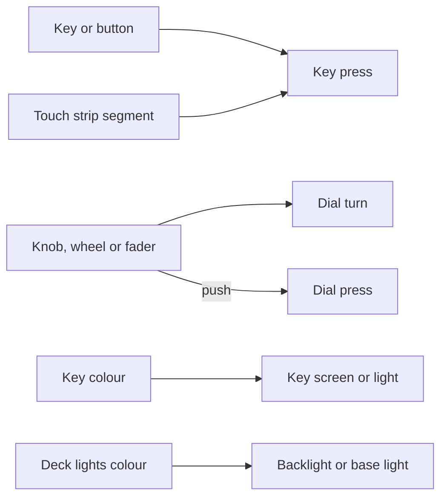

This page lists the decks in this family that Decks supports and how each one maps to Ryu keys, dials, and lights. To give keys labels, colours, and actions, start with [Decks](/docs/apps/decks). Before Ryu opens a deck, [close other deck software](/docs/apps/decks#close-other-deck-software), and on Linux add the [udev rules](/docs/apps/decks-linux).

## Supported models

| Maker | Models | Keys | What a key shows |
| --- | --- | --- | --- |
| Elgato | Stream Deck (all 15-key models, including MK.2 and scissor keys), Mini, XL, Neo, +, + XL, Studio, Pedal | 3 to 36 | Its label on its colour (the Pedal has no screens) |
| Corsair | Galleon 100 SD (the keyboard's Stream Deck panel) | 12 | Its label on its colour; the screen above the keys shows two more keys, one under each dial |
| Ulanzi | D200, D200H, D200X | 13 | Its label on its colour; the status window shows a clock |
| Work Louder | Creator Micro 2, OpenAI Codex Micro | 6 agent keys | Its colour, as the key's light |
| Loupedeck and Razer | Loupedeck Live, Live S, CT; Razer Stream Controller, Stream Controller X | 15 to 32 | Its label on its colour; round buttons light up in its colour |
| Mirabox and Ajazz | AKP153, AKP153E, AKP153R, HSV293S, AKP815, AKP03, AKP03E, AKP03R, N3, AKP05, AKP05E, AKP05E Pro, N4, N4 Pro, Stream Dock 293 V3, Stream Dock XL, M18, N1, and the same decks sold as Mars Gaming MSD-ONE, MSD-TWO and MSD-Pro, Soomfon, VSDInside, Redragon SS-551 and SS-552 and others | 9 to 32 | Its label on its colour |
| Redragon, Womier and MagTran | Redragon Streamcraft SS550, Womier DUO87 screen module, MagTran M3 | 12 or 15 | Its label on its colour |
| Infinitton | iDisplay | 15 | Its label on its colour |
| X-keys | XK-24, XK-24M-RGB, XK-80, XKE-128, XK-16 LCD, XK-12 Jog-Shuttle, X-blox XBK-4x6, XBK-3x6, XBK-16x6 and XBA-4x3 Jog-Shuttle | 12 to 128 | Its colour, as the key's backlight (blue, red or both on the older panels) |
| Contour | ShuttleXpress, ShuttlePro v1 and v2 | 5 to 15 | Nothing: it has no screens or lights. Its jog wheel and shuttle ring work as dials |
| VEC | Footpedal | 3 | Nothing: it has no screens or lights. Its three pedals work as keys |
| TourBox | Elite and Elite Plus (over USB-C), Neo | 11 | Nothing: it has no screens or lights. Its knob, scroll wheel and dial work as dials |
| Logitech | MX Creative Keypad (over USB), MX Creative Dialpad (over Bluetooth) | 4 to 11 | Keypad: its label on its colour (the page buttons have no screen). Dialpad: nothing; its roller and dial work as dials |
| Logitech G13 | G13 Advanced Gameboard | 38 | Its LCD shows one key's label in one colour. M1, M2, M3 and MR light on or off; the backlight is the deck light |
| Logitech G15 family | G-keys and LCD of the G15, G15 v2, G11, G510 and G110 | 28 / 16 / 23 / 31 / 17 | The G15, G15 v2 and G510 LCD shows one key's label in one colour. M1, M2, M3 and MR light on or off; brightness sets the backlight, and the G510's colour is the deck light |
| Logitech G RGB keyboards | G-keys and lights of the G915 (on its USB cable), G815 and G910 Orion Spark or Spectrum; the backlight of the G513 and G Pro keyboard | 5 / 5 / 9 / 0 / 0 | Each G-key lights in its colour, and the deck light colours the backlight; brightness scales them. The G513 and G Pro have no G-keys, so they are a deck light alone |
| Mountain | DisplayPad | 12 | Its label on its colour (it has no brightness setting) |
| Xencelabs | Quick Keys, wired or through its wireless dongle | 9 | Its label as text on the deck's display, up to 8 characters (no colour); the unlabelled button shows nothing |
| Blackmagic Design | DaVinci Resolve Speed Editor, DaVinci Resolve Replay Editor, ATEM Micro Panel, over USB | 43 to 73 | Its colour, as the key's light: on or off on the Resolve editors (only some keys have one), one of eight colours on the ATEM Micro Panel |
| 203 Systems | Mystrix, with the Companion app open in Matrix OS | 64 | Its colour, as the pad's light |
| Framework | Laptop 16 RGB Macropad, flashed with the Companion raw-HID firmware | 24 | Its colour, as the key's light |
| Adafruit | MacroPad RP2040, running the Companion CircuitPython HID firmware | 12 | Its colour, as the key's light |
| Haute42 | B16 leverless controller, flashed with SoundMinded's SurfaceCore firmware | 21 | Its colour, as the light under B01 to B16; the five function buttons have no light |
| Native Instruments | Maschine MK2, Maschine Mikro MK2, Maschine Jam | 44 to 115 | Its colour, as the pad's or button's light: the pads and group buttons (and the Jam's scene buttons) take a colour, the other buttons glow in one colour. The MK2's two displays and the Mikro's display show one key's label in one colour. Knobs, encoders and the Jam's touch strips work as dials |
| Native Instruments | Traktor Kontrol F1 | 28 | Its colour, as the pad's or button's light: the pads take a colour, the other buttons glow in one colour. The two-digit display stays dark. The encoder, knobs and faders work as dials |
| Native Instruments | Komplete Kontrol S25, S49, S61 and S88 (MK1) | 23 | Its colour, as the button's light, which glows in one colour. The deck light colours the light guide over the piano keys. The displays stay dark. The browse encoder and the eight encoders work as dials; the piano keys stay MIDI |
| Cooler Master | MasterHub modules, each listed as a deck of its own: Base, Keypad, Slider, Knob, Roller and 1xDial | 0 to 15 | Keypad: its label on its colour. 1xDial: its round screen shows one key. Knobs, faders, rollers and the 1xDial work as dials; the base has only a light |

<Callout type="warn">
Decks drivers are tested against recorded report formats, not against physical hardware in CI.

These models have not been tested on hardware yet: the Corsair Galleon 100 SD, VEC Footpedal,
TourBox, Logitech G13, G15 family and G RGB keyboards, Xencelabs Quick Keys, Blackmagic Design
panels, 203 Systems Mystrix, Framework macropad, Adafruit MacroPad, Haute42 B16, the Native
Instruments controllers and the Cooler Master MasterHub.
</Callout>

## Stream decks and touch panels

### Buttons without a screen

Some decks have buttons without a screen. Ryu numbers them after the screen keys:

- the Stream Deck Neo's two touch buttons (Touch 1 and 2);
- a Loupedeck's round buttons (Button 1 and up; on the CT, the labelled buttons follow);
- the Ajazz AKP03's and Mirabox M18's three lower buttons;
- the Logitech MX Creative Keypad's two page buttons (Page left and Page right).

On a Loupedeck, the round buttons glow in the key's colour. On the others only the action
matters. The Mirabox N1 is the exception: its two buttons and its knob each have a small
screen, so they show their label on their colour too (the knob as a key named Knob).

### Stream Deck Neo info screen

The small info screen on a Stream Deck Neo is one more key, Info screen. It shows its label on
its colour. It has no touch, so its action runs only from Test (or from a workflow that reacts
to another key).

### Loupedeck touchscreens

On a Loupedeck Live, Live S or CT, the keys are areas of one touchscreen. A touch presses the
key under your finger until you lift it.

- **Side strips.** On a Loupedeck Live (or Razer Stream Controller) and a Loupedeck CT, each
  side strip is split into three strip keys, one beside each knob. Decks names them Left strip
  1 to 3 and Right strip 1 to 3, top to bottom. They show their label on their colour and press
  like the other touch keys.
- **CT wheel screen.** The round screen in the middle of the CT's wheel is one more key, Wheel.
  It shows its label on its colour, and touching it presses it. Pushing or turning the wheel
  itself still works as a dial.

### Stream Deck + and AKP05 touch strips

The touch strip above the dials on a Stream Deck +, a Stream Deck + XL or an Ajazz AKP05 /
Mirabox N4 is split into strip keys, one above each dial (Strip 1 to 4 in Decks, or 1 to 6 on
the + XL). Each shows its label on its colour, and a tap presses it.

On a Stream Deck + or + XL, a swipe along the strip raises `@ryu/decks#strip.swiped`. The event
carries the strip keys under the start and the end of the swipe and its direction (`left` or
`right`).

### Corsair Galleon 100 SD

The Stream Deck panel on a Corsair Galleon 100 SD keyboard has 12 keys, two dials and a wide
screen between the dials and the keys. Ryu uses only the panel; the keyboard keeps typing as
usual.

- Decks splits the screen into two keys, Screen 1 and Screen 2, one under each dial. They show
  their label on their colour. It is not confirmed that the screen takes touch, so run their
  actions with Test.
- The ring of lights round each dial takes a colour under **Dial lights**.

## Macropads and keypads

### Work Louder

On the Work Louder boards, Ryu drives the keys mapped to the agent keycodes (`KV_OAI_AG00` to
`KV_OAI_AG05`).

- The Codex Micro ships with them.
- On a Creator Micro 2, assign those keycodes to the keys you want in Work Louder Input first.
  Its other keys keep sending whatever Input maps them to.

Boards that only send keystrokes, such as the original Creator Micro, can still trigger Ryu
through Ryu's keyboard shortcuts.

### Xencelabs Quick Keys

The Quick Keys has no key screens. Its display shows the first eight characters of each of Keys
1 to 8's labels as text, with no colour, and its ninth key, Button, shows nothing.

- Its wheel is a dial. Pushing the wheel is the dial press.
- With the wireless dongle, Ryu drives the first Quick Keys the dongle reports and ignores any
  other paired to it.

### Blackmagic Design panels

The Blackmagic Design panels have no screens. Decks shows each key under the name printed on
it, at its place on the panel.

- **Lights.** On the Speed Editor and Replay Editor only some keys have a light, which is on for
  any colour except black or near-black. On the ATEM Micro Panel every key lights in the
  nearest of eight colours.
- **Dials.** The jog wheel is Dial 1. The T-bar works as a dial too (Dial 2 on the Replay
  Editor, Dial 1 on the ATEM Micro Panel): moving it turns the dial by its travel. The jog and
  T-bar step sizes are estimates.
- **Limits.** These panels have no brightness setting. Ryu drives them over USB only, not
  Bluetooth.

### 203 Systems Mystrix

The Mystrix's 64 pads light in their key's colour, and brightness dims the colours.

- Open the Companion app in Matrix OS first. Ryu sees the pads and lights them only while it is
  open.
- The pads go dark while another app or the FN action menu is open, then come back.
- The FN key and the touch bars stay with Matrix OS.
- The Mystrix 2 is not supported yet.

### Framework Laptop 16 RGB Macropad

The macropad's 24 keys light in their key's colour, and brightness dims the colours. Ryu sees
the macropad only after you flash it with the custom QMK firmware made for Bitfocus Companion
(the macropad keymap of Julusian's framework_qmk_firmware). With Framework's stock firmware it
keeps typing keys as usual and Ryu does not detect it.

### Adafruit MacroPad RP2040

The MacroPad's 12 keys light in their key's colour. Ryu drives it only on the Companion
CircuitPython HID firmware from Maxim Kulkin's nodejs-macropad.

1. Copy its `boot.py`, `code.py`, `settings.py` and `lib/neopixel.mpy` onto the board's
   CIRCUITPY drive.
2. Press the reset button.

With other CircuitPython code, Ryu shows the MacroPad with a note on what to copy and leaves it
alone. The encoder, its button, the screen and the speaker are not used, and at most six held
keys are seen at once. Brightness dims the keys' colours; full brightness is about half the
LEDs' drive, to stay within what a USB port supplies.

### Haute42 B16

The B16 leverless controller works only after you flash it with SoundMinded's SurfaceCore
firmware. With its stock firmware it stays a game controller and Ryu does not detect it.

- Its sixteen round buttons, B01 to B16, light in their key's colour. The five function buttons
  (Fn1 to Fn5) are keys without a light. Brightness dims the colours.
- Decks places the keys after the SurfaceCore Companion layout, which is close to, but not
  exactly, where they sit on the controller.
- The firmware does not debounce its buttons. It can miss a press or release when several
  buttons change at once, so a key can stay held in Ryu until you press it again.

### Cooler Master MasterHub

Each MasterHub module is a deck of its own in Decks. Quit Cooler Master's MasterHub software
first.

- **Keypad.** Its 15 keys show their label on their colour.
- **Dials.** The Knob's three knobs, the Slider's five faders, the Roller's two rollers
  (numbered left to right) and the 1xDial work as dials. Moving a fader turns its dial by how
  far it moved. The rollers are not known to work on a Mac.
- **1xDial screen.** Its round screen is one more key that shows its label on its colour.
  Pushing the dial is a dial press, so run that key's action with Test.
- **Lights.** The knob and fader lights take a colour under **Dial lights**, and the base's
  light under **Deck lights**.

## Native Instruments controllers

<Callout type="info">
Quit the Native Instruments app (Maschine, Traktor or Komplete Kontrol) and its background
services, NIHardwareAgent and NIHostIntegrationAgent, first. Ryu cannot open the controller
while they hold it.
</Callout>

On every model, buttons without a colour light have a light of one fixed colour that glows
brighter for a brighter key colour, and brightness dims the lights.

### Maschine MK2, Mikro MK2 and Jam

The pads and buttons are keys, named as printed. The MK2 and Mikro pads use NI's numbers, with
Pad 1 at the bottom left. The original Maschine (MK1) is not supported.

- **Pads.** On the MK2 and Mikro MK2 a pad presses once you hit it firmly enough. The Jam's
  matrix pads are plain buttons that press as soon as you touch them.
- **Lights.** The pads and group buttons light in their key's colour. On the Jam that is the
  nearest of its own colours, which also goes for the matrix and scene buttons. The MK2's Main
  button has no light.
- **MK2 dials.** The eight knobs are dials 1 to 8 and the master encoder dial 9. Its two
  displays together are the info screen.
- **Mikro MK2 dials.** The encoder is dial 1, and pushing it presses the dial. Its display is
  the info screen.
- **Jam dials.** The eight touch strips are dials 1 to 8, turned by sliding a finger along them,
  and the encoder is dial 9.

The info screen shows its key's label in one colour and has no touch, so run its action with
Test.

### Traktor Kontrol F1

The 16 pads and 12 buttons are keys. The buttons are named as printed, and the pads are Pad 1 to
Pad 16, row by row. Ryu takes Pad 1 as the top-left pad, which has not been checked on an F1.

- **Lights.** The pads light in their key's colour. The two-digit display stays dark.
- **Dials.** The browse encoder is dial 1, and pushing it presses the dial. The four knobs are
  dials 2 to 5 and the four faders dials 6 to 9, each turned a step at a time as you move it.

### Komplete Kontrol S25, S49, S61 and S88 (MK1)

On the first-generation keyboards, the 23 buttons around the displays are keys, named as
printed. The MK2 and later keyboards are not supported.

- **Lights.** The deck light colours the light guide over the piano keys. The displays stay
  dark.
- **Dials.** The browse encoder is dial 1, and pushing it presses the dial. The eight encoders
  above the displays are dials 2 to 9 (touching one does nothing).
- **Piano keys.** The piano keys, wheels and touch strip stay MIDI, for your music software, and
  are not keys in Ryu.

## Logitech gaming keyboards

Quit Logitech G HUB or Logitech Gaming Software first if Ryu cannot open the keyboard. On the G
RGB keyboards, quit it in any case, or it takes the lights back.

### G13

The G-keys, M1 to MR, the round button and L1 to L4 under the screen, the two thumb buttons and
the stick click are keys, named as printed. The stick is four more keys, Stick up, down, left
and right.

- **LCD.** The LCD is the info screen. It shows that key's label in one colour, lighting the
  bright parts of its face, and has no touch, so run its action with Test.
- **Lights.** Any colour on M1, M2, M3 or MR turns its light on. The colour under **Deck
  lights** sets the backlight, which also lights the LCD; with none set it stays dark.
  Brightness dims the backlight.
- The backlight button stays with the G13.

### G15, G15 v2, G11, G510 and G110

Ryu takes only the G-keys, M1 to MR, the buttons under the LCD and the backlight button (Light).
The rest of the keyboard still types.

- **G510 extras.** The G510 adds its game-mode switch, which reads as held while it is on, and
  its headphone and mic mute keys.
- **G-keys.** On the G15, G15 v2, G11 and G510, Ryu also stops the G-keys typing F-keys or
  numbers.
- **LCD.** On the G15, G15 v2 and G510 the LCD is the info screen. It shows that key's label in
  one colour, with the bright parts of its face as dark pixels on the lit glass. It has no
  touch, so run its action with Test.
- **M-key lights.** Any colour on M1, M2, M3 or MR turns its light on.

Backlight behaviour differs by model:

| Model | Backlight |
| --- | --- |
| G15, G15 v2, G11 | Brightness steps the backlight between off, low and high |
| G110 | Brightness sets the backlight level |
| G510 | The colour under **Deck lights** sets the backlight of the keys and the LCD, and brightness dims it; with none set it goes back to the colour it had |

Pressing Light on the keyboard takes the backlight back until you change the brightness again.
Ryu puts the backlight back as it found it when it lets go.

### G915, G815, G910, G513 and G Pro

On a G915, G815 or G910, Ryu takes only the G-keys (G1 to G5, or G1 to G9 on the G910) and the
lights. The rest of the keyboard still types, and the G-keys stop doing their own actions while
Ryu has them. The G513 and G Pro have no G-keys, so Ryu sets only their backlight.

- **Colours.** A G-key's colour is its light, the colour under **Deck lights** colours the
  backlight, and brightness scales both.
- **When Ryu takes the lights.** Ryu leaves the lights alone until one of those colours is set.
  Every G-key you give an action has a colour (the default one unless you change it), so
  binding a G-key takes the lights too. The whole backlight then shows the **Deck lights**
  colour, and goes dark when none is set. Pick a backlight colour under **Deck lights** if you
  want it lit.
- **Handing back.** On the G915 and G815, once no colour is set any more (and when Ryu lets go),
  the keyboard goes back to its own effect. The G910, G513 and G Pro cannot be handed back, so
  they go dark until they are replugged or Logitech's software takes them.
- **Limits.** Only the G915 on its USB cable works, not over LIGHTSPEED or Bluetooth, and M1 to
  MR are not read.
