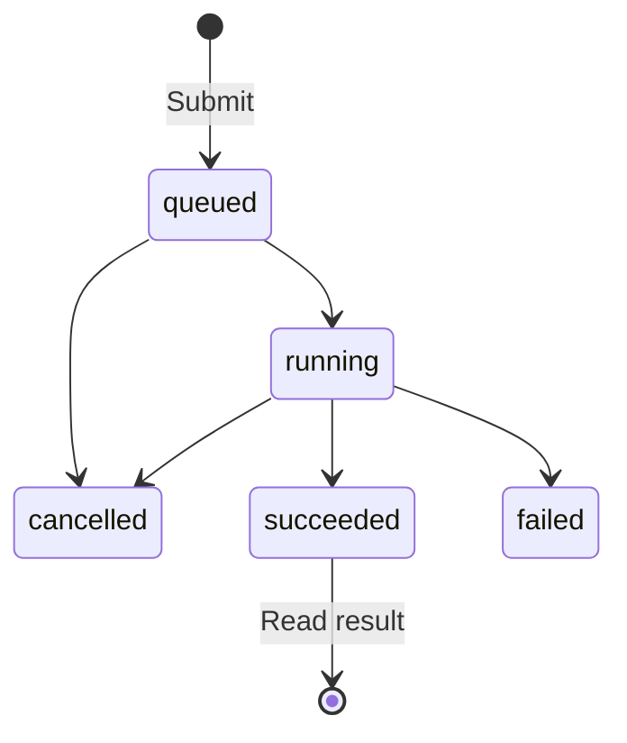

## What it does

Document parsing via IBM's MIT-licensed Docling - the highest-fidelity `document.parse` backend. Where a text extractor hands a model a stream of characters, Docling runs real layout analysis: a page-segmentation model finds the reading order, a table-structure model rebuilds merged cells and spanning headers, and the result is exported as markdown whose headings, lists and tables mirror the document's actual structure. That is what makes a multi-column paper or a financial statement survive chunking instead of interleaving into nonsense. The cost is weight: the first parse downloads its models (hundreds of MB) and can take minutes, and every parse after that is CPU-bound inference rather than a string copy. Everything runs locally - Docling explicitly supports air-gapped operation once the models are cached - and no document ever leaves the node.

Parses run as jobs: submit returns 202 + a job_id, the caller polls.

## Installation and first conversion

Docling requires Python 3.10 or newer. Installing the app includes its parser
dependencies; a standalone sidecar installation needs the `parse` extra:
`pip install -e ".[parse]"` from the sidecar directory. A sidecar can answer
liveness probes before the parser is installed, so check its capability's
`available` value before submitting a document.

HTML and Markdown conversion do not require PDF layout model downloads. PDF
layout analysis, table recognition and OCR can download model weights on their
first use. Allow time for those downloads, then reuse the cached models for later
conversions. For an offline node, download the models beforehand and configure
Docling's local artifacts directory.

For PDF conversion, `options.ocr` enables or disables OCR and
`options.table_structure` controls table reconstruction. `options.ocr_engine`
selects `easyocr`, `rapidocr`, `tesseract`, `tesserocr` or `ocrmac`; the selected
engine receives `options.ocr_languages`. Install that engine's dependencies and
use its supported language codes. Omitting the engine keeps Docling's default
local OCR selection.

For a standalone RapidOCR installation, install Docling's `rapidocr` extra
(`pip install 'docling[rapidocr]'`) as well. The ONNX Runtime backend needs its
detection, recognition and classification model assets. Keep those assets with
the local Docling models when preparing an offline node.

A successful submission means the job was accepted. Continue polling until it
succeeds, fails or is cancelled, and consume the document only from a successful
job's result.

If a first conversion times out while downloading models, retry after the
downloads finish. Missing dependencies produce a job error rather than an empty
successful document:

| Cause | Job error |
| --- | --- |
| Parser not installed | `library_missing` |
| Requested OCR engine's dependencies missing | `missing_dependency` |

This page is part of the [Apps catalog](/docs/apps), [app manifest lifecycle](/docs/core/app-manifest-lifecycle), [Plugins vs Apps](/docs/extend/develop/extensions/plugins-vs-apps), [Marketplace](/docs/extend/develop/extensions/marketplace), [Gateway governance](/docs/gateway/governance) documentation path. In the same category, compare [AnyDoc](/docs/apps/anydoc), [Convert](/docs/apps/convert), [MarkItDown](/docs/apps/markitdown), [MinerU](/docs/apps/mineru).

## What it exposes

### Capabilities

- **Document Parsing** - capability `document.parse`

## Engine requirement

Requires Ryu >=0.1.0.

## Sidecar

Runs an out-of-process sidecar: `docling`.
