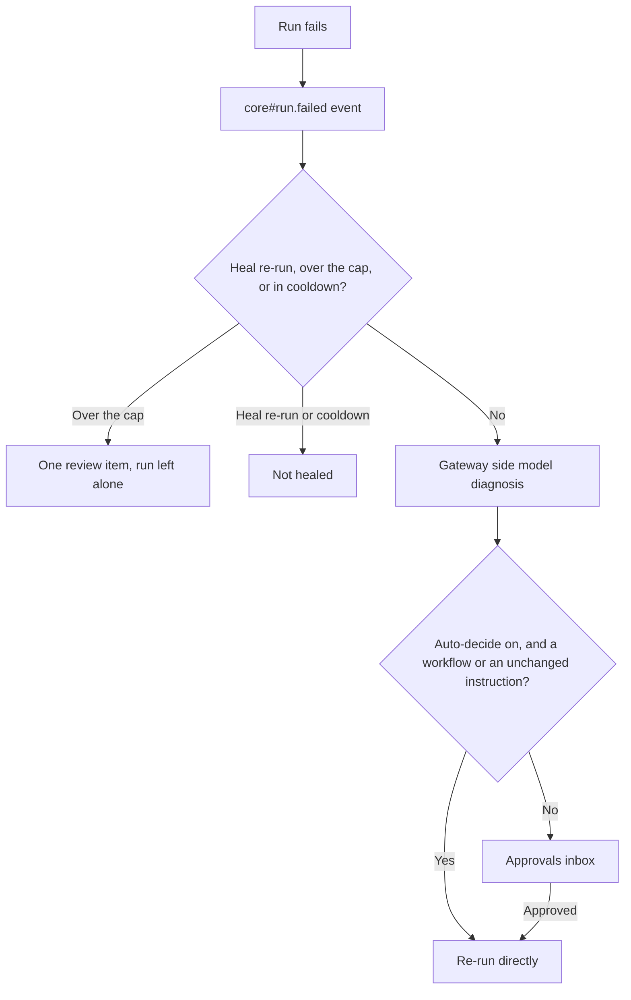

## What it does

Self-healing: failed runs are diagnosed by a Gateway side-model and proposed fixes are delivered to the approvals inbox for human review before they apply.

This page is part of the [Apps catalog](/docs/apps), [app manifest lifecycle](/docs/core/app-manifest-lifecycle), [Plugins vs Apps](/docs/extend/develop/extensions/plugins-vs-apps), [Marketplace](/docs/extend/develop/extensions/marketplace), [Gateway governance](/docs/gateway/governance) documentation path. In the same category, compare [Virtual Desktop](/docs/apps/desktop), [Fine-tuning](/docs/apps/finetune), [Monitors](/docs/apps/monitors), [Payments](/docs/apps/mpp).

## How it works

When a chat or agent run, a scheduled agent job, or a workflow run fails, Ryu raises the
[`core#run.failed`](/docs/extend/develop/sdk/plugin-sidecar-capabilities#sidecar-event-subscriptions) event.

Self-Healing receives it in its sidecar and decides whether the run should be healed. It never
heals a heal re-run, and it respects the attempt cap and cooldown. It then asks the Gateway side
model for a diagnosis and acts through Ryu:

- a proposed fix is queued in the Approvals inbox and runs only after you approve it;
- with auto-decide on, a failed workflow, or an agent run whose fix keeps your original
  instruction, is re-run directly (a rewritten instruction always waits for your approval);
- after the attempt cap, a single review item is queued and the run is left alone.

If Self-Healing is disabled, failed runs are not reported to it, and nothing about the failed
run changes.

## Permissions

**Grants:** `runs:failures`, `approvals:request`, `runs:rerun-agent`, `workflows:runstate`

| Grant | What it allows |
|---|---|
| `runs:failures` | Receive failed runs, including their instruction and error text. |
| `approvals:request` | Ask for your approval before a proposed fix runs. |
| `runs:rerun-agent` | Re-run a failed agent run. Ryu assigns the re-run id. |
| `workflows:runstate` | Re-run a failed workflow run. |

| Level | Description | Implies |
|---|---|---|
| **Can view diagnoses** | See proposed fixes for runs that failed on this node. |  |
| **Can approve fixes** | Apply a proposed fix, which changes how this node behaves. | `healing.view` |

## UI it contributes

### Hook events

- **Fix diagnosed** - A failed run was diagnosed by the side model and a fix was resolved. Fires once per heal attempt, BEFORE the fix is acted on, whether `auto_apply` is true (the run is about to be retried automatically) or false (the fix went to the approvals inbox instead). It does NOT fire when healing is off, when the attempt was suppressed by the cap/cooldown, or when the model returned nothing. `corrected_prompt` is null for a workflow, which is retried from scratch rather than with a rewritten instruction.
- **Auto-fix gave up** - Self-healing hit its per-source attempt cap and gave up on this run: no further fix is diagnosed or proposed for it, and a terminal review item is queued instead. Fires at most once per source - a later failure on the same source is dropped as 'already given up' - so this is the event to hang an escalation on.

## Dependencies

Requires these apps:
- `@ryu/approvals` (min `0.1.14`)

## Engine requirement

Requires Ryu >=0.1.0.

## Sidecar

Runs an out-of-process sidecar: `ryu-healing`.
