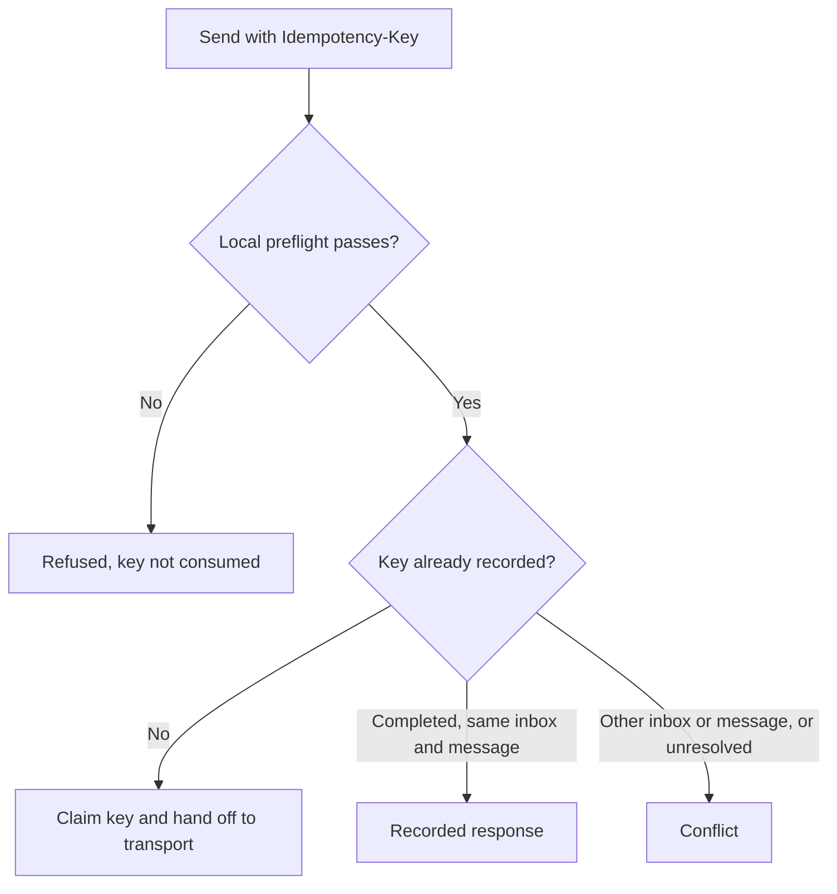

## What it does

Agent Inboxes - email as a service for agents. Runs the out-of-process ryu-mail sidecar; Core proxies /api/mail/* to it. Its sandboxed companion and developer clients cover inboxes, messages, threads, attachments, drafts, scheduling, labels, webhooks, delivery events, lists, pods, and domains through the mail:crud bridge/API.

This page is part of the [Apps catalog](/docs/apps), [app manifest lifecycle](/docs/core/app-manifest-lifecycle), [Plugins vs Apps](/docs/extend/develop/extensions/plugins-vs-apps), [Marketplace](/docs/extend/develop/extensions/marketplace), [Gateway governance](/docs/gateway/governance) documentation path. In the same category, compare [Help Center](/docs/apps/help-center), [Meetings](/docs/apps/meetings), [Rooms](/docs/apps/rooms).

## What it exposes

### Companion surfaces

- **Mail** (html)

Switching inboxes clears the current reading-pane message before displaying a message from the newly selected inbox.

The Messages view's **More message actions** menu marks the selected message as read or unread. The
Unread filter reflects the saved read state after the message list refreshes.

## Permissions

**Grants:** `mail:crud`, `ui:toast`

| Level | Description | Implies |
|---|---|---|
| **Can read** | List inboxes, messages, threads, attachments, drafts, webhooks, and delivery events. |  |
| **Can send** | Compose and edit drafts, reply, forward, schedule, and send mail from an agent inbox, which leaves this node and reaches real recipients. A draft with a send time is a scheduled send, so writing drafts needs this level. Grant it separately from read access. |  |
| **Can manage mail** | Create and configure inboxes, webhooks, labels, lists, pods, and domains, and delete drafts. Writing drafts needs send access, which is granted separately. |  |

## UI it contributes

### Apps shelf

When enabled, this app appears as one icon tile in the desktop sidebar's Apps shelf. Use sidebar sections for the app's record lists; feature navigation stays inside the Companion.

### Sidebar sections

- **Inboxes**

### Hook events

- **Email received** - An inbound message was accepted and stored. Fires once per accepted POST to the inbound webhook, after the per-inbox HMAC verified and the row was written. A forwarder retry with the same Message-ID or identical raw bytes is deduplicated and does not fire this again. The payload is metadata only; fetch the body with GET /api/mail/messages/:id.
- **Email sent** - An outbound message was handed to the SMTP transport and recorded against the sending inbox. Fires once per successful send; a send that the transport rejects fires nothing. Hand-off is not delivery - providerMessageId is the relay's id, and a later bounce is not visible here.

## Engine requirement

Requires Ryu >=0.1.0.

## Sidecar

Runs an out-of-process sidecar: `ryu-mail`.

## Safe retries for sends

Mail send API callers can provide an `Idempotency-Key` header of 1 to 256 printable ASCII characters, with at least one non-space character. Sending without a key preserves the normal send behavior.

| Retry with the same key | Result |
| --- | --- |
| Completed send, same inbox and message | The recorded response, with no second transport handoff, even if the transport is later unconfigured. |
| Different inbox or message | Conflict. |
| Request still in progress, or transport outcome unresolved | Conflict. |

Local preflight refusals, such as an unconfigured transport or invalid recipient address, do not consume a retry key. Correct the configuration or input before retrying.

<Callout type="warn">
If a transport acknowledgement cannot be recorded, reconcile the existing request before sending again. Creating a new key can send another message.
</Callout>

Unresolved keys are retained across restarts rather than automatically retried. Older retry records that cannot establish an inbox-bound outcome require reconciliation.

These responses describe transport acknowledgement and local records, not confirmed delivery to a recipient’s inbox.

## Data at rest

Mail encrypts message and draft content on disk with a key only this app receives from Ryu:

- subjects, bodies, previews, and headers;
- sender and recipient addresses;
- draft attachments and attachment file names;
- event payloads and saved send responses.

Attachments and raw messages are stored as encrypted files. Inbox names and addresses, allow and block lists, labels, read state, and timestamps stay unencrypted so lists, threads, and filters keep working. Search still finds words in decrypted messages.

Mail saved by an earlier version is encrypted the first time the updated app starts, and older attachment files are encrypted in the background.

If the app is updated before Ryu itself, new mail stays unencrypted until Ryu delivers its key, and the app's health status says it is waiting for a Ryu update.

A self-hosted Mail service without Ryu uses the key you provide or creates its own key file in its data folder. Keep that file with the data.
