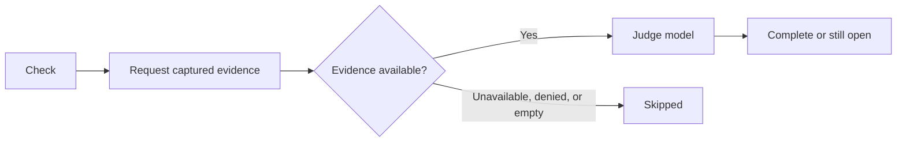

## What it does

Quests: auto-detecting todos surfaced from your chats and activity, tracked as a lightweight quest board with progress and completion.

Saved notes, prompts, and clips can include a text preview. Select the preview to expand it, then use **Copy** to copy the full saved body. Kept captures are not checked by the task-completion detector.

This page is part of the [Apps catalog](/docs/apps), [app manifest lifecycle](/docs/core/app-manifest-lifecycle), [Plugins vs Apps](/docs/extend/develop/extensions/plugins-vs-apps), [Marketplace](/docs/extend/develop/extensions/marketplace), [Gateway governance](/docs/gateway/governance) documentation path. In the same category, compare [Places](/docs/apps/places), [Projects](/docs/apps/projects), [Recursive Language Model](/docs/apps/rlm), [Outpost](/docs/apps/social).

## Check a task now

Choose **Check** on an open task to judge it now, using the active node's recent captured activity and history related to the task's completion condition. Desktop and mobile request that evidence through the authenticated node connection before invoking the judge.

Capture access is never granted by the task itself. If capture is unavailable, denied, or empty, the check stays skipped rather than guessing that the task is complete.

## Detection settings

Open the Quests **Tasks** settings tab to choose how completion is detected, which judge model and reasoning effort to use, and how often open tasks are checked.

### Check interval format

The default check interval is `2m`.

| Accepted | Example |
| --- | --- |
| Integer with a short unit | `30s`, `2m`, `1h` |
| Full unit names | `2 minutes` |
| Combined values | `1h 30m` |
| Milliseconds | `ms` or `millis` (not `milliseconds`) |

Units are case-sensitive. `m` is minutes and `M` is months, so `2H` is not a valid interval.

### Saving settings

An invalid interval shows a message beside the field and is not saved. Correct the value and leave the field to save it. If settings cannot be loaded, select **Retry**.

If a save fails because the node could not save it, timed out, or asked Ryu to slow down, your change stays visible and **Retry save** resends it. The other settings controls remain disabled until the save succeeds.

If the node refuses the value itself, for example an interval too large for it to store, the node's reason appears below the settings and the field is marked invalid. Every control stays editable and the refused value is not sent again.

Correct the field and leave it to save, or select **Discard change** to restore the value the node holds. Saving another setting keeps the reason on screen until the field is corrected.

## Data at rest

Quests encrypts your tasks, captures, the completion judge's evidence and reasoning, and the scratchpad on disk with a key only this app receives from Ryu. Ids, timestamps, and item kinds stay unencrypted so the board can sort and filter.

Data saved by an earlier version is encrypted the first time the updated app starts. If the app is updated before Ryu itself, it keeps working unencrypted until Ryu delivers its key. Its health status says it is waiting for a Ryu update.

Run without Ryu, the app creates its own key file in its data folder. Keep that file with the data.

## What it exposes

### Companion surfaces

- **Quests** (html)

### Capabilities

- **Quest list for scheduling** - capability `quests.list`
  - Grant: `quests:jobs`
- **Quest detection pass** - capability `quests.judge`
  - Grant: `quests:jobs`

## Permissions

**Grants:** `quests:crud`, `quests:capture`, `ui:toast`, `ui:declarative-http`

| Level | Description | Implies |
|---|---|---|
| **Can view** | See the quest board and the todos detected from chats and activity. |  |
| **Can edit** | Create, complete, and delete quests. | `quests.view` |
| **Can capture** | Keep selected text, links, and prompts from other apps onto the board, along with the app and page they came from. This is a wider reach than editing the board - it stores content the user selected elsewhere, and the `quests.capture` bridge verb is gated by its own `quests:capture` grant. | `quests.edit` |

## UI it contributes

### Apps shelf

When enabled, this app appears as one icon tile in the desktop sidebar's Apps shelf. Use sidebar sections for the app's record lists; feature navigation stays inside the Companion.

### chat widget templates

- **Quests widget** - Open Quests data in a host-rendered chat widget.

### Hook events

- **Quest created** - A new quest was added to the board, from the companion UI or the API. Fires as soon as the quest is persisted, exactly once per quest - reopening a finished quest does not re-fire it.
- **Item captured** - Something was kept from the capture gesture or the API - a selection, a link, a prompt to run next, a note. `kind` is what it was filed as; `source` is where it came from and is absent when the item was typed straight in. A captured task fires this AND `quest.created`.
- **Quest completion suggested** - The judge decided a quest looks done but not confidently enough to close it, so it is waiting on the user to confirm. Fires only on a NEW suggestion - an unchanged verdict on a later detection pass does not re-fire.
- **Quest completed** - A quest moved to done. `source` is how it was decided (`manual` = the user checked it off, `detected` = the judge did) and `auto` is whether the engine closed it without the user - accepting a suggestion is `detected` but not `auto`. Can fire more than once for the same quest, because a finished quest can be reopened and finished again.

### Settings tabs

- **Tasks**

### Views

- **Quest Board**

## Engine requirement

Requires Ryu >=0.1.0.

## Sidecar

Runs an out-of-process sidecar: `ryu-quests`.

## Related

<Cards>
  <DocCard href="/docs/core/quests" />
</Cards>
