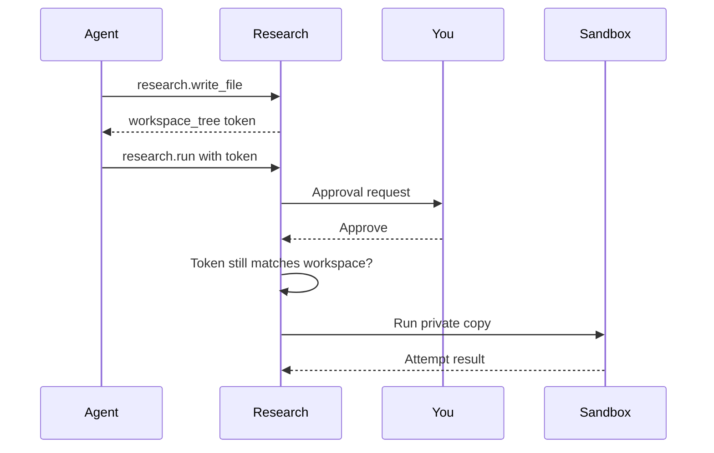

## What it does

Run durable autoresearch campaigns with one-shot proposals, direction-aware winners, bounded budgets, policy-based stopping, and automatic recursive analysis for oversized history.

## Who can see a campaign

Each campaign belongs to the person whose conversation or request created it.

- On a personal node, that is the node's owner, who sees every campaign.
- On a node shared by an organization, a person (and their agents) sees and drives
  only the campaigns they created. Listing returns only their own, and another
  person's campaign, workspace files, attempts and analyses behave as if they do
  not exist.
- Campaigns created before this ownership existed stay visible only to the node
  owner.

If Ryu cannot tell who is calling on a shared node (for example, a background job
with no signed-in person behind it), Research refuses the call.

## How a run is approved and isolated

Every `research.run` call names a `workspace_tree`, a token for the exact
workspace contents it will execute. `research.write_file`,
`research.init_workspace` and `research.get_campaign` return the current token.

Ryu always asks you to approve a run, and the approval covers that token. If the
workspace changes after the token was issued, for example because a file was
rewritten while the approval was pending, the run is refused and its proposal is
kept so you can review and approve the new contents. While an attempt runs, other
writes to the same workspace are refused until it finishes.

### What the sandbox allows

Each attempt executes a private copy of the approved contents inside an
operating-system sandbox.

The experiment can:

- read the language runtime and system libraries;
- write to its own temporary run directory and to its campaign's private runtime
  directory;
- open outgoing connections, only when its kind needs network access.

The experiment cannot:

- read Ryu's data directory (where node credentials and keys live), the Research
  engine's credentials or campaign database, or your home directory;
- write to shared package caches or tool folders such as `~/.cache/uv` or
  `~/.local/share/uv`, which other Ryu components run code from;
- open local (Unix domain) sockets, so the desktop session bus, keyring and other
  local services are out of reach;
- listen on a port or accept connections, so it cannot pose as a local Ryu service.

The campaign's private runtime directory is the experiment's home directory. It
holds its package caches, tools and downloaded Python versions. Nothing outside
the sandbox runs code from it.

Network access is off unless the experiment kind needs it. The bundled `nanochat`
experiment has network access so it can download its dependencies and corpus. Its
first attempt in a campaign downloads them into that campaign's private cache, and
later attempts reuse it.

An experiment cannot detach a process from its attempt. When the attempt ends,
every process it started is stopped. Experiment code that starts a new session or
process group (for example `setsid`) gets a permission error.

<Callout type="warn">
Experiments run on Linux only. The sandbox is required and needs Landlock
(kernel 5.13 or newer, with Landlock enabled, which is the default on current
major distributions) and seccomp on x86_64 or arm64. On macOS, on other
platforms, or when the sandbox cannot be set up, Research refuses to start the
attempt and keeps the proposal. It never runs agent-written code without the
sandbox.
</Callout>

This page is part of the [Apps catalog](/docs/apps), [app manifest lifecycle](/docs/core/app-manifest-lifecycle), [Plugins vs Apps](/docs/extend/develop/extensions/plugins-vs-apps), [Marketplace](/docs/extend/develop/extensions/marketplace), [Gateway governance](/docs/gateway/governance) documentation path.

## What it exposes

### Companion surfaces

- **Experiments** (html)

### MCP server

MCP (Model Context Protocol) is a standard way for an AI host to find and call tools. An MCP server provides those tools.

- **`research`** - Research - durable autoresearch campaigns over MCP. `next_variant` prepares a one-shot proposal and automatically verifies recursive RLM evidence when history is oversized; `run` consumes that proposal exactly once.

## Permissions

**Grants:** `app:http`, `rlm:query`, `mcp:research`

| Level | Description | Implies |
|---|---|---|
| **Can view** | Browse durable campaigns, attempts, scores, winner decisions, and recorded reasoning. |  |
| **Can run experiments** | Create and evaluate local experiment variants with bounded budgets, direction-aware winner selection, and automatic verified RLM proposals when history is oversized. | `research.view` |

## UI it contributes

### Apps shelf

When enabled, this app appears as one icon tile in the desktop sidebar's Apps shelf. Use sidebar sections for the app's record lists; feature navigation stays inside the Companion.

### Sidebar sections

- **Campaigns**

### Hook events

- **Research workspace created** - A fresh git-versioned workspace was initialised for an experiment kind and its initial commit made, so the autoresearch loop (read -> edit -> run -> keep/reset) can begin against it. Fires once per POST /api/research/workspace, whether the desktop or an agent asked for it. It says a workspace EXISTS, not that anything has been run in it - the attempts themselves go through the research.* MCP tools inside Core and are not visible here. `mutable_files` is the set of files a researcher is allowed to edit; the researcher instructions (program_md) are deliberately left out of the payload because they are a document, not a signal.

## Dependencies

Requires the abstract `rlm.query` capability, which Ryu resolves through the capability broker to an available provider. The selected provider must grant `rlm:query`.

Needs these grants: `rlm:query`

## Data at rest

Research encrypts campaign content on disk with a key only this app receives from Ryu:

- campaign goals;
- attempt hypotheses, descriptions and run logs;
- proposals and analyses;
- each campaign's history and results ledger files.

Campaign names, scores, statuses, and times stay unencrypted so lists and winner selection keep working. Experiment workspaces, including their code and version history, are not encrypted because experiments run that code directly.

Campaigns saved by an earlier version are encrypted the first time the updated app starts. If the app is updated before Ryu itself, new campaign content stays unencrypted until Ryu delivers its key, and the app reports that it is waiting for a Ryu update.

Ryu gives the key to the Research app itself, not to the Research tools agents call:

- When an agent starts Research before the app has run, the agent's campaign content is written unencrypted and is encrypted the next time the app opens.
- Once the data is encrypted, the agent tools work only while the Research app is running, and otherwise ask you to open it.

Research never restarts its engine while an experiment is running.

## Engine requirement

Requires Ryu >=0.1.0.

## Sidecar

Runs an out-of-process sidecar: `ryu-research`.
