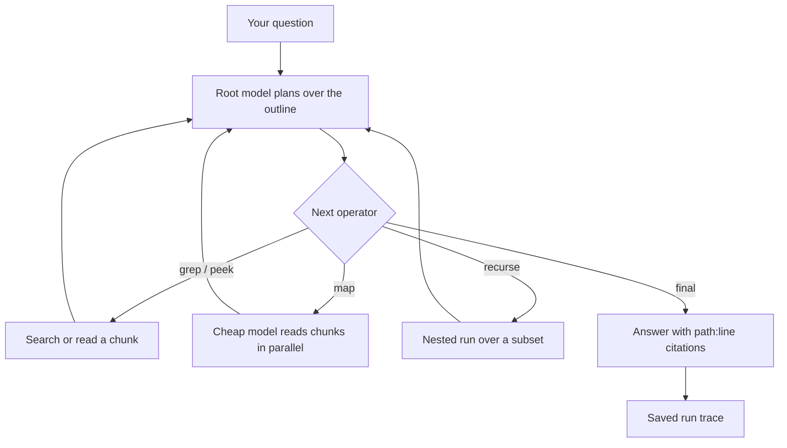

This page is part of the [Apps catalog](/docs/apps), [app manifest lifecycle](/docs/core/app-manifest-lifecycle), [Plugins vs Apps](/docs/extend/develop/extensions/plugins-vs-apps), [Marketplace](/docs/extend/develop/extensions/marketplace), [Gateway governance](/docs/gateway/governance) documentation path. In the same category, compare [Projects](/docs/apps/projects), [Quests](/docs/apps/quests), [Outpost](/docs/apps/social), [Timeline](/docs/apps/timeline).

## What it does

Recursive Language Model answers questions about document collections that are too large to fit in a model's context. A root model plans over an outline of the documents and reaches the text through search and recursive model calls, then answers with `path:line` citations and a replayable trace.

Use it when a document collection needs several search or analysis steps. Before you rely on an answer, check the selected model, document access, run budgets, citations, and trace. A larger input does not guarantee the same accuracy: retrieval and model choices can miss or misread relevant material.

## How a run works

The root model never reads the documents directly. Each step, it picks one operator and sees only that operator's short result.

| Operator | What it does | Extra model calls |
|---|---|---|
| `outline` | Shows the chunk ids, sources, line spans and headings | No |
| `grep` | Regex search across the whole collection | No |
| `peek` | Reads one chunk, or a window inside it | No |
| `map` | Asks a cheap model the same question about each named chunk and folds the answers | Yes |
| `recurse` | Runs a nested query over a sub-collection built from named chunks | Yes |
| `note` | Writes to the planner's scratchpad so findings survive later steps | No |
| `final` | Answers and stops | No |

Each run has hard budgets: 14 steps, 400 model calls, a recursion depth of 2 and 600 seconds by default. A run that hits a budget ends with a `budget_exhausted` status and returns what it had, instead of a quietly shortened answer.

<Callout type="warn">
The app does not encrypt what it stores yet. Each context keeps the full text of the documents you load (or an agent sends), and each run keeps its question and step-by-step trace, in the app's data folder. Delete contexts and runs you no longer need.
</Callout>

Loading files and sending excerpts to a model are separate data-sharing decisions. Review the app permissions and the configured provider. Keeping data on local storage does not by itself make a task offline: a cloud model still receives the excerpts it reads.

See [app lifecycle](/docs/core/app-manifest-lifecycle), [plugin isolation](/docs/security/plugin-isolation), and [local-model setup](/docs/learn/cookbook/chat-with-a-local-model).

## What it exposes

### Companion surfaces

- **Recursive Language Model** (html)

### Capabilities

- **rlm.query** - capability `rlm.query`
  - Grant: `rlm:query`

### MCP server

MCP (Model Context Protocol) is a standard way for an AI host to find and call tools. An MCP server provides those tools.

- **`rlm`** - Read more than fits in your context. `ask` takes paths and a question and returns an answer with `path:line` citations - the files never enter this conversation, so reach for it instead of reading a large directory yourself. `load` builds a reusable context, `query` asks follow-up questions against one, and `grep` and `peek` search and read it with NO model call at all, which makes them safe to branch a workflow on.

## Permissions

**Grants:** `rlm:query`, `hook:side-model`, `hook:run-agent`, `mcp:rlm`, `ui:declarative-http`

| Level | Description | Implies |
|---|---|---|
| **Can view** | See the contexts loaded on this node, their outlines, and the traces of past runs. |  |
| **Can edit** | Load and delete contexts, and run queries against them. Loading a context reads files from disk and running a query spends model calls, so this is the level that costs something. | `rlm.view` |

## UI it contributes

### Apps shelf

When enabled, this app appears as one icon tile in the desktop sidebar's Apps shelf. Use sidebar sections for the app's record lists; feature navigation stays inside the Companion.

### chat widget templates

- **Recursive Language Model widget** - Open Recursive Language Model data in a host-rendered chat widget.

### Sidebar sections

- **Contexts**

### Composer controls

- **Deep read the corpus** - After each answer, ask the same question of the selected context and append what the documents actually say, with citations. Use it when the answer should come from your files rather than from the model. (type: toggle)

### Settings tabs

- **Recursive Language Model** (fields: Context to read (text), Planner model (model_picker), Reader model (model_picker))

### Turn hooks

- **rlm.deep-read** (on: `post_assistant_turn`)

### Hook events

- **A corpus-grounded answer was produced** - A deep read finished and returned an answer read out of the loaded context, with at least one citation. Fires once per read, not once per citation. A read that could not run - no context selected, no reader tool available, budget exhausted before anything was read - does NOT fire this, because routing those to the same place trains people to ignore it.

### Data categories

- **Delete all loaded contexts**

### Views

- **Deep Read**

## Engine requirement

Requires Ryu >=0.1.0.

## Sidecar

Runs an out-of-process sidecar: `rlm`.
