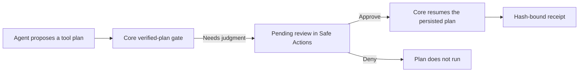

## What it does

Review and govern typed tool plans before they can touch the world. Safe Actions shows the exact sequence, parallel branches, conditions, effects, and resources a verified agent proposed; explains every deterministic policy finding and counterexample; lets an authorized reviewer approve or deny plans that require judgment; and preserves hash-bound execution receipts without exposing raw secrets. It is the control surface for Core's generic fail-closed verified-plan gate: approval resumes the persisted plan, while the Companion itself never invokes a tool or executes an action.

This page is part of the [Apps catalog](/docs/apps), [app manifest lifecycle](/docs/core/app-manifest-lifecycle), [Plugins vs Apps](/docs/extend/develop/extensions/plugins-vs-apps), [Marketplace](/docs/extend/develop/extensions/marketplace), [Gateway governance](/docs/gateway/governance) documentation path. In the same category, compare [Approvals](/docs/apps/approvals), [Automated Reasoning](/docs/apps/reasoning), [Security](/docs/apps/security).

## How a review flows

The Companion never runs a tool itself. Approving a plan is the human review, and Core resumes the plan it persisted.

## Who can review

Every call the Companion makes needs two things at once:

- the app's approved `safe-actions:manage` grant;
- your own role in the organization that owns the node.

| Node | Read plans, findings and receipts | Change a policy or contract, approve or deny a plan |
|---|---|---|
| Organization node | Viewer or higher | Admin |
| Node not bound to an organization (for example your own machine) | Its operator | Its operator |

Approvals, denials and contract attestations are recorded under your signed-in identity, never a name the app supplies. The grant alone never makes an app a reviewer.

## What it exposes

### Companion surfaces

- **Safe Actions** (html)

## Permissions

**Grants:** `safe-actions:manage`

| Level | Description | Implies |
|---|---|---|
| **Can manage** | Read execution evidence, create and change policies and contracts, approve or deny plans awaiting review, and download receipts. Approving a plan resumes its persisted Core execution. |  |

## UI it contributes

### Apps shelf

When enabled, this app appears as one icon tile in the desktop sidebar's Apps shelf. Use sidebar sections for the app's record lists; feature navigation stays inside the Companion.

## Engine requirement

Requires Ryu >=0.1.0.
