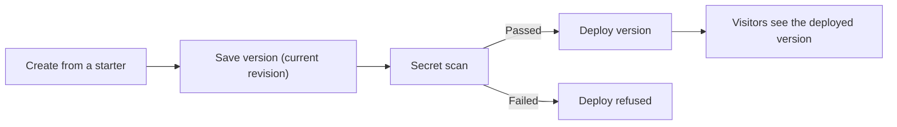

## What it does

Create, refine, save and deploy websites with private access, browser-local data, and visitor records backed by Ryu Spaces.

The step-by-step guide is the [Sites user guide](/docs/surfaces/desktop/user-guide/sites). Routes and limits for developers are in the [Sites API](/docs/standalone/sites-api).

## Published page branding

On the Free baseline, every published page carries a small [Powered by Ryu badge](/docs/billing/powered-by-ryu). Paid subscription plans remove it. The badge is added when the page is served, so it does not change the Site's saved source.

## Connected Site features

A Site in connected mode can turn on these features. The [Sites user guide](/docs/surfaces/desktop/user-guide/sites) shows how.

- **Shared visitor data** is off by default. It holds records that every permitted visitor sees together, with live updates, and you choose who can add records. See [Shared visitor data](/docs/surfaces/desktop/user-guide/sites#shared-visitor-data); access rules, revisions and routes are in the [Sites API](/docs/standalone/sites-api#shared-visitor-data).
- **AI for visitors** adds in-page AI. See [In-page AI](/docs/surfaces/desktop/user-guide/sites#in-page-ai).

**AI for visitors** has two modes:

- **Grounded answers** (the default) answers only from a bound knowledge Space.
- **General page AI** lets the page call the Ryu model for summaries, classification or a chat widget, with `RyuSite.ai.complete({ prompt, system, maxTokens })` or `RyuSite.ai.chat(messages)`.

General calls need visitor sign-in unless you allow anonymous use. They always apply your **Owner AI instructions** before the page's own, and share the Site's daily AI limit.

## Gallery, remix and duplicate

The **Gallery** lists the built-in starters with script-free previews, and the deployed Sites you can remix.

- A Site is remixable only when you can visit it and its owner turned on **Allow remixing** (off by default).
- **Remix** copies the deployed page into a new private Site you own.
- Owners and editors can **Duplicate** the latest saved version instead.
- Only the page, its starter and its data runtime choices are copied. Sharing, sign-in, AI instructions, knowledge, databases, records, files, shared data, connections, extensions, domains and analytics stay with the original.
- The copy shows which Site it came from.
- Each person can start 20 remixes or duplicates a day.

See [Gallery, remix, and duplicate](/docs/surfaces/desktop/user-guide/sites#gallery-remix-and-duplicate).

## Build Sites from chat

The bundled **Site Builder** agent uses the `sites` tools. It can list your Sites, create one from a starter, save generated or edited HTML as a new version, deploy a saved version, and change who can visit. Ask for something like "build me an incident dashboard and deploy it".

The tools follow the same rules as the app:

- HTML must be one complete, self-contained document of up to 2 MB.
- Every save needs the Site's current revision.
- Saving never changes what visitors see. A version deploys only after its secret scan passes.
- New Sites stay private until you choose another audience. Only the owner can change access or deploy a Site's first version.
- Sharing with invited people or a workspace needs platform sign-in to be configured, as it does in the app.
- If a step fails, the agent reports the error instead of claiming it worked.
- Changes made from chat appear in the Sites app after a reload.

On a personal desktop, the tools act as you, the node's owner. On a node registered to an organization, the tools act only for an identity Ryu can verify. When chat cannot provide one, they refuse, and you can use the Sites app instead.

## Reset-calendar account checks

Reset-calendar account checks run from the owner's **Settings** in the Sites Companion. Enable and save **Owner reset checks**, choose a provider, and confirm **Run account check**. Reports stay in Ryu. Generated websites and embedded Site views cannot run these checks. See [Run reset-calendar account checks](/docs/surfaces/desktop/user-guide/sites#run-reset-calendar-account-checks).

## Site MCP tools

Open a Site's **Extensions** section to configure MCP tools and visitor connections. Site tools can list, save or delete records in a named collection, or search the Site's approved knowledge source. Records keep the same per-visitor permissions as the website. Tools cannot run arbitrary code or SQL.

To publish tools:

1. Enable MCP, add tools, and save extensions.
2. Save a new version and deploy it. This publishes that exact tool configuration; draft edits do not change deployed tools.
3. Each client connects an account with access to the Site. Installation alone does not grant access.

Unpublishing the Site also takes its MCP endpoint offline. The operator must configure platform identity and an OAuth issuer.

### Show the Site in chat

Enable **Show Site UI in chat** to publish the saved website as a versioned MCP Apps resource. Supported hosts can show it beside chat or from an app entrypoint. Record and knowledge operations use the Site's published tools through the app bridge.

Connected apps, uploads and browser sign-in stay on the visitor website. The embedded view does not borrow the owner's account or browser session.

### Install the Site as a plugin

Choose **Install plugin** to send the generated native manifest to Ryu's plugin installer. It uses the normal validation and lifecycle permissions. Review and enable the installed plugin in Plugins, then connect your account. After publishing new tools, choose **Update installed plugin** to update the existing installation.

## Visitor connections

Visitor connections use specific plugin or MCP tools that the operator approved. The Site must use connected mode and a workspace-restricted audience.

- Each visitor signs in, reviews the connection permissions, and chooses whether to allow access.
- Consent is scoped to that visitor and Site, and visitors can revoke it independently.
- A change to the approved tool or its permissions requires a new review.
- Write calls require explicit confirmation. A failed call must be checked before retrying.
- Background jobs cannot reuse visitor sessions or consent.

### Owner connections

Owners and editors can also add their own connections in **Extensions** › **Owner connections**. Enter:

- a label;
- a description that visitors see when they review it;
- the Ryu tool ID, for example `slack.post_message`;
- read or read-and-write access.

Each visitor still signs in, reviews the connection, and runs it with their own connected account, never the owner's.

- Changing a connection, or choosing **Ask every visitor to allow it again**, asks every visitor to review it again.
- Removing a connection revokes visitor permissions.
- Your operator can turn owner connections off or limit them to specific tools. Connections outside that policy are refused and hidden from visitors.
- A Site holds up to 20 owner connections. Each signed-in visitor can make up to 200 connected tool calls per Site per day.

<Callout type="warn">
The runtime supports declarative Site tools, not arbitrary hosted server frameworks.
Public hosting, external identity setup, and provider connections are deployment
prerequisites that an operator configures.
</Callout>

## Data at rest

Sites encrypts what visitors leave behind and who may see a Site, with a key only this app receives from Ryu.

| Encrypted on disk | Stays unencrypted |
|---|---|
| Uploaded files and their names | Published pages and saved versions |
| Records, for Sites that keep their records on the node | Visitor ids and record keys |
| Each Site's settings, including viewer and editor email addresses | Sizes and analytics counts |

The unencrypted items keep pages, quotas and lookups working. Upload quotas count the original file size.

- Data saved by an earlier version is encrypted the first time the updated app starts.
- If the app is updated before Ryu itself, new data stays unencrypted until Ryu delivers its key. The app's status reports that it is waiting for a Ryu update.
- A Sites service run on its own uses the key you provide, or creates a key file in its data folder. Keep that file with the data.

## Errors and retries

- **Database panel.** It shows the selected Site's connection and SQL results. Switching Sites clears the previous query and results, and delayed responses from the previous selection cannot change the new panel or end its pending request. If a query or connection refresh fails, the panel shows the reason and lets you retry with **Run query** or **Refresh**.
- **Project list.** If it cannot be read, Sites keeps the error visible and offers **Reload**. It does not present a failed read as an empty account or suggest that your sites were deleted.
- **URL name conflicts.** If a URL name is already in use, the create dialog keeps your draft open, shows the conflict, and lets you correct the name and retry.

This page is part of the [Apps catalog](/docs/apps), [app manifest lifecycle](/docs/core/app-manifest-lifecycle), [Plugins vs Apps](/docs/extend/develop/extensions/plugins-vs-apps), [Marketplace](/docs/extend/develop/extensions/marketplace), [Gateway governance](/docs/gateway/governance) documentation path. In the same category, compare [Code Review](/docs/apps/pull-requests), [Simulators](/docs/apps/simulator), [Skill Editor](/docs/apps/skill-editor).

## What it exposes

### Companion surfaces

- **Sites** (html)

### Site Builder

Tools: `sites`

### MCP server

MCP (Model Context Protocol) is a standard way for an AI host to find and call tools. An MCP server provides those tools.

- **`sites`** - Sites tools for listing, creating, saving versions of, deploying and sharing the user's websites. Calls run through the running Sites service with the same owner and editor checks as the Sites app; Sites stay private until their owner shares them.

## Permissions

**Grants:** `app:http`, `hook:side-model`, `hook:run-agent`, `hook:run-agent:write`, `spaces:docs`, `spaces:database`, `identity:read`, `security:check`, `tools.invoke`, `plugins:install`, `mcp:sites`, `crypto:seal`

| Level | Description | Implies |
|---|---|---|
| **Manage sites** | Create and edit sites, configure their visitor access, save versions and change deployments. |  |

## UI it contributes

### Apps shelf

When enabled, this app appears as one icon tile in the desktop sidebar's Apps shelf. Use sidebar sections for the app's record lists; feature navigation stays inside the Companion.

### agents

- **sites-agent**

## Engine requirement

Requires Ryu >=0.1.0.

## Sidecar

Runs an out-of-process sidecar: `sites`.
