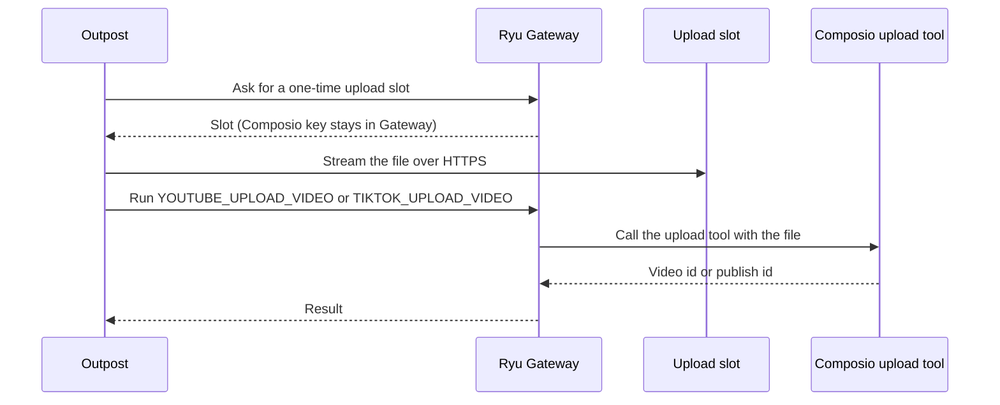

## What it does

A publishing command center for every social account you run: compose once, tailor per platform, queue it on a calendar, and let the node publish while you are away. Scheduled posts, a retrying publish queue, a unified reply inbox, engagement history, and reusable post templates - all in one local SQLite database the node owns.

This page is part of the [Apps catalog](/docs/apps), [app manifest lifecycle](/docs/core/app-manifest-lifecycle), [Plugins vs Apps](/docs/extend/develop/extensions/plugins-vs-apps), [Marketplace](/docs/extend/develop/extensions/marketplace), [Gateway governance](/docs/gateway/governance) documentation path. In the same category, compare [Quests](/docs/apps/quests), [Recursive Language Model](/docs/apps/rlm), [Timeline](/docs/apps/timeline), [Tuition](/docs/apps/tuition).

## Using Outpost

### Inbox read state

Opening an unread item marks it read. Its detail stays selected and reflects the saved read state, even when **Unread only** filters its row out of the list.

If the initial inbox read fails, Outpost shows the read error with a **Try again** action. It does not present the failure as an empty inbox.

### Media import from other apps

An app with the `social:crud` grant can hand Outpost a finished file, such as a Video Studio render.

1. The app opens an upload session.
2. It sends the file in chunks of up to 1 MiB.
3. It finishes the session. Outpost checks the declared size (and SHA-256 when given), files the result under its own media folder, and adds it to the workspace media library.

An optional metadata text (title, description, chapters) is saved beside the file.

| Limit | Value |
|---|---|
| Accepted types | MP4, QuickTime, WebM, PNG, JPEG, GIF, WebP |
| Size per file | 2 GiB |
| Idle session expiry | 15 minutes without a chunk; the partial file is deleted |
| Open sessions | 8 at once |
| All imported files together | 10 GiB |

Deleting an imported file from the media library also deletes the file once no other library entry or draft uses it. Files you picked yourself are never deleted.

### Publish an imported file

Imported files are local files. Outpost's hosted publishing provider (Composio, used for YouTube, TikTok, Instagram, LinkedIn, and X) cannot read your computer, so the result depends on the platform.

| Platform | Local file behavior |
|---|---|
| YouTube, TikTok | Outpost uploads the file when the post goes out. The post takes exactly one video of up to 2 GiB from Outpost's media folder. |
| Instagram, LinkedIn, X | The post fails with "cannot publish the local file". Use a public media URL, or upload the file on the platform yourself. |

- **YouTube.** The post's first line becomes the title (up to 100 characters) and the rest the description. The category is "People & Blogs" and visibility is public.
- **TikTok.** The post goes out publicly with the post text as the caption. TikTok refuses public posts from an app that has not passed its review, and Outpost shows that refusal as the publish error instead of posting privately. The post is recorded with its publish id, not a link, because TikTok finishes processing after the upload.
- If the upload to the slot fails, the post fails with the reason and nothing is published.

#### Timeouts and retries

Large files can take several minutes, and the platform upload runs as one long call. Outpost allows about 4 seconds per MiB for the slot upload, which needs a sustained uplink of roughly 2 Mbit/s.

Outpost retries a failed post automatically only when nothing can have been published: a refused upload slot, or a refusal before the platform call starts.

When the platform call times out, fails partway, or answers without a video or publish id, the video may already be live. Outpost marks the post failed with "upload outcome is unknown" and does not retry it. Check YouTube or TikTok before you retry such a post, or it may be published twice.

A slot upload that times out is not retried automatically either, because a retry would resend the whole file over the same connection.

<Callout type="warn">
YouTube and TikTok local-file publishing has not yet been verified against a live YouTube or TikTok account. Treat the titles, category, visibility, and ids described above as what Outpost requests, and check the first posts on the platform.
</Callout>

### How agents post

Agents use Outpost through its app API tools, which Ryu builds from the API Outpost serves. Agents can:

- write and edit drafts;
- check text against each platform's limits;
- schedule a post, or post it right away;
- move a post to another time, publish it now, retry the accounts it failed on, or cancel it.

These tools are not in an agent's tool list until the agent searches for them. An agent whose tools are limited needs them on its list.

Every call except a plain read, including the limits check, waits for your [approval](/docs/core/approvals) unless approvals are off. App API tools are turned off on a node that belongs to an organization, so agents there cannot post through Outpost. Ryu tells Outpost which agent made each call, which is how the checks below know whose access to apply.

### Posts an agent schedules

When an agent creates, reschedules, publishes or retries a post, or edits the text of a scheduled post, Outpost remembers that agent with the post. When you reschedule, publish now or retry the post yourself, it goes out as yours.

When the post goes out, Ryu checks that agent's [account access](/docs/surfaces/desktop/user-guide/agent-account-access#choose-which-accounts-an-agent-can-use) at that moment:

- An agent whose **Treg** switch is off cannot publish through Treg.
- A Composio-backed post must use an account the agent may use.
- If the check fails, that account's leg of the post fails with a message saying what the agent isn't allowed to use.

If this device's sign-in to Ryu changes after an agent scheduled a post (for example, the device joins an organization), a post from an agent with limited account access fails and asks for the work to be started again. Posts from agents with unrestricted access go out as before.

The same check applies when an agent replies to an inbox item, refreshes the inbox, refreshes a post's engagement, or connects an account:

- A reply, inbox refresh or engagement refresh through Composio uses the account the item or post belongs to. An agent limited to some accounts can do these only on accounts it may use.
- Connecting an account needs an agent with unrestricted account access.
- The Bluesky sign-in saved in Outpost's settings is yours. Outpost uses it for an agent only after Ryu confirms that the agent is **Acts as you** with **Limit to selected accounts** off. For any other agent, the Bluesky leg of the post, or the connection, fails without contacting Bluesky.

### Node settings

Some settings apply to every workspace on the node: inbox polling, engagement refresh, quiet hours, the analytics time offset, default platforms, and the stored Bluesky and Threads account credentials. Changing them needs the **Can manage node settings** level.

**Can publish** still covers each workspace's own scheduling and retry settings. It cannot change node-wide settings or replace stored credentials. On a shared node, a publisher who changes only workspace settings can save them; changing a node-wide field without the node level is refused.

## What it exposes

### Companion surfaces

- **Outpost** (html)

## Permissions

**Grants:** `social:crud`, `tools.invoke`, `hook:side-model`, `shell:integrate`, `core:list_agents`, `ui:toast`, `ui:declarative-http`

| Level | Description | Implies |
|---|---|---|
| **Can view** | Read the posting calendar, the publish queue, past posts and their engagement numbers, and the replies and mentions collected in the inbox. |  |
| **Can publish** | Schedule, publish, and cancel posts, and reply from the inbox - everything here goes out publicly under the connected accounts, in this workspace's name. | `social.view` |
| **Can manage node settings** | Change Outpost settings shared by every workspace on this node - inbox polling, engagement refresh, quiet hours, the analytics time offset, default platforms - and replace the stored direct-account credentials. | `social.publish` |

## UI it contributes

### Apps shelf

When enabled, this app appears as one icon tile in the desktop sidebar's Apps shelf. Use sidebar sections for the app's record lists; feature navigation stays inside the Companion.

### chat widget templates

- **Outpost widget** - Open Outpost data in a host-rendered chat widget.

### Data categories

- **Delete all Outpost data**

### Hook events

- **Post scheduled** - A post was queued for a future time, with its per-account fan-out legs already written. Fires once per POST /posts, at the moment the row commits - before any provider is contacted, so it says nothing about whether the post will succeed. It does NOT fire for a publish-now (that path skips the queue), nor when a scheduled post is later cancelled, rescheduled, or retried.
- **Post published** - Every leg of a post finished and all of them succeeded. Fires once, when the last target settles - so a three-account post produces one event, not three, and the remote ids and permalinks for all of them are in `targets`. A post whose legs are still in flight does not settle, so this never fires early; a post that partly failed raises post.failed instead.
- **Post failed or partly failed** - A post settled with at least one leg that did not publish. `status` distinguishes the two cases - `partial` (some accounts went out, some did not) from `failed` (none did) - and the per-leg `error` says why. Fires once per settle, AFTER the retry budget for those legs is spent, not on each failed attempt; a leg that fails and then succeeds on retry never reaches here. Retrying a failed post can make it settle again, so the same post id can appear twice.
- **Inbox item received** - One NEW reply, mention, or comment landed in the inbox, emitted per item once it is durable - so a refresh that pulls twelve new comments raises twelve events, and a crash mid-refresh can never announce an item it then loses. Only ever fires for items the dedupe did not already know, so re-polling the same thread is silent. Marking an item read or replying to it raises nothing.

### Store tabs

- **Post Templates**

### Sidebar sections

- **Up next**

### Views

- **Outpost**

## Engine requirement

Requires Ryu >=0.1.0.

## Sidecar

Runs an out-of-process sidecar: `ryu-social`.
