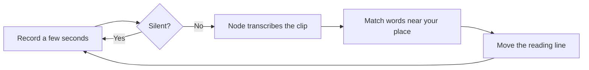

This page is part of the [Apps catalog](/docs/apps), [app manifest lifecycle](/docs/core/app-manifest-lifecycle), [Plugins vs Apps](/docs/extend/develop/extensions/plugins-vs-apps), [Marketplace](/docs/extend/develop/extensions/marketplace), [Gateway governance](/docs/gateway/governance) documentation path. In the same category, compare [Dictation](/docs/apps/dictation), [Subtitles](/docs/apps/subtitles), [Voice Studio](/docs/apps/voice).

## Read a script aloud

Teleprompter shows your script in large type and keeps the next words on a
reading line while you speak. Write or paste a script in the editor, choose
**Start prompter**, then **Start**, and read. The words you have already said
are dimmed, and the current word is highlighted.

### How voice following works

Voice following uses the speech-to-text engine you choose in Ryu's Voice
Recognition settings: Parakeet, Whisper, audio.cpp, or Gateway. It is the same
engine that voice input in chat uses, and changing it applies to the next clip.

- If you haven't chosen one, the Voice Recognition default (Parakeet) is used, as
  in chat.
- If Ryu can't read your settings, your node's default engine is used.
- Teleprompter does not use your browser's speech recognizer or a model that runs
  inside the page.
- The Voice app must be turned on.

Ryu records a few seconds of audio at a time. Teleprompter skips silent clips
and sends the rest to your node for transcription. It then matches the end of
each transcript against the words near your current place, so it follows you
when you pause, skip a phrase, or repeat a line.

Because it matches words rather than timings, it works with engines that return
only text. The script moves a moment after you speak, not instantly.

Text in `[square brackets]` is shown as a cue, such as `[pause]` or `[smile]`,
and is never matched against speech.

### Desktop and Island

On desktop, open Teleprompter from the app sidebar. Use **Open in new window** to
place it next to your camera and resize it. **Display** opens a side panel of
settings.

In Island, Teleprompter appears as a companion tab in the expanded panel near the
top of your screen. The layout adapts to the narrow panel. Voice following works
in Island as it does on desktop, with the same engine. Keep the expanded panel
open while you read; closing it or switching tabs stops recording.

### Auto-scroll and controls

If voice following is unavailable, or you prefer a fixed pace, switch to
**Auto** and set the words per minute. Under **Display**, you can change the text
size, line width, reading-line position, and auto-scroll speed. Turn on **Mirror
text for teleprompter glass** to flip the text horizontally.

While the prompter has focus:

- **Space** starts or pauses.
- **Left** and **Right** move five words.
- **Up** and **Down** move fifteen words.
- **Home** returns to the start.
- **Esc** returns to the editor.

Click any word to continue from there.

### Scripts and privacy

Write scripts in plain text, or turn on **Format headings, lists, and
emphasis** to read Markdown. Saved scripts, the current draft, and display
settings are kept in the app's private storage on your Ryu node. If Ryu can't
load or save them, the editor shows an error and your text stays in the editor
so you can try again.

Audio goes to your Ryu node. With Parakeet, Whisper, or audio.cpp, it is
transcribed on your node and stays there. With Gateway, your node sends the audio
to the speech-to-text provider configured for your Gateway. Teleprompter keeps
transcripts only in memory to follow your place, and it does not save your
recordings.

## What it exposes

### Companion surfaces

- **Teleprompter** (html)

## Permissions

**Grants:** `storage:kv`, `media:record`, `media:transcribe`

| Level | Description | Implies |
|---|---|---|
| **Can follow your voice** | Record short microphone windows while the prompter is running, transcribe them with Ryu's speech-to-text engine, and keep saved scripts in this app's private storage. |  |

## UI it contributes

### Apps shelf

When enabled, this app appears as one icon tile in the desktop sidebar's Apps shelf. Use sidebar sections for the app's record lists; feature navigation stays inside the Companion.

## Engine requirement

Requires Ryu >=0.3.1.
