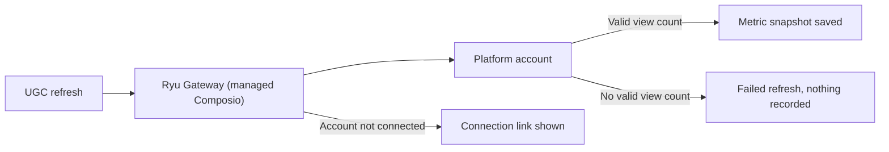

## What it does

Creator-marketing campaign tracker: briefs, a creator roster, post submissions with review, per-post metric snapshots refreshed through a curated Composio action map, and CPM/flat payout accrual against a campaign budget.

This page is part of the [Apps catalog](/docs/apps), [app manifest lifecycle](/docs/core/app-manifest-lifecycle), [Plugins vs Apps](/docs/extend/develop/extensions/plugins-vs-apps), [Marketplace](/docs/extend/develop/extensions/marketplace), [Gateway governance](/docs/gateway/governance) documentation path. In the same category, compare [Timeline](/docs/apps/timeline), [Tuition](/docs/apps/tuition).

## Metric refresh

Automated metric refresh uses the node's managed Composio provider. Configure its credential in **Gateway → Keys**; UGC does not store a separate Composio key.

- If a platform account is not connected, the refresh reports that account and offers the connection link returned by Composio.
- A refresh whose response has no valid view count is reported as failed and records nothing, so it never lowers a payout.
- You can always record metric snapshots by hand, for example when a platform keeps returning incomplete data.

## Submission links

UGC refreshes YouTube, TikTok, Instagram, X and LinkedIn automatically. A submission labelled with one of these platforms must link to that platform's own site.

- A link on any other site is refused for that label. Record it under another label, such as `other`, and enter its metrics by hand.
- Each post can be submitted once per campaign, whatever label it is sent under.
- Different spellings of one post count as the same post. Examples are a `youtu.be` link and a `youtube.com/watch` link to one video, or a link that differs only by a percent-encoded character or a doubled slash.

## Data at rest

The creator roster (names, contact emails, platform handles, payout handles and notes) is encrypted with a key only this app receives from Ryu. The roster is searched after it is decrypted. Campaigns, submitted post links, view counts and payout amounts are not encrypted.

- Creators saved by an earlier version are encrypted when the updated app starts.
- If the app is updated before Ryu itself, it keeps working unencrypted until Ryu delivers its key. Its health status says it is waiting for a Ryu update.

## Permissions

**Grants:** `tools.invoke`, `ui:declarative-http`

| Level | Description | Implies |
|---|---|---|
| **Can view** | See campaigns, the creator roster, submissions and their metric history, and what each payout is worth. |  |
| **Can manage** | Create and edit campaigns and creators, approve or reject submissions, and refresh post metrics - which decides what this node fetches and what each creator accrues. | `ugc.view` |
| **Can settle payouts** | Approve accrued payouts and mark them paid. Marking a payout paid freezes its amount - it is never re-priced afterwards, even if the post keeps gaining views - and is the record this campaign's spend is reconciled against. A paid payout is never deleted: deleting its campaign, creator (even with force) or submission is refused. | `ugc.view` |

## UI it contributes

### Desktop shell

This app contributes the declared desktop shell surfaces below; the host owns navigation, focus, authentication, and theme behavior.

### chat widget templates

- **UGC widget** - Open UGC data in a host-rendered chat widget.

### Dock panels

- **UGC** (placement: both)

### Hook events

- **Submission received** - A creator's post was recorded against a campaign - once per `submissions` row actually CREATED. Re-submitting the same post to a campaign is refused (409) whatever platform label it is sent under, so a duplicate never re-emits: posts are matched by the post their URL names (the platform the URL's host belongs to plus that platform's post id, so `youtu.be/<id>` and `youtube.com/watch?v=<id>` are one post), or by their normalized URL when it names no recognised post. `external_post_id` is empty in that case: the submission is still reviewable by hand, it just cannot auto-refresh.
- **Submission approved** - A submission passed review and its payout row was created or re-priced. TRANSITION-GATED: fires once per pending → approved move. Approving an already-approved submission is a 200 no-op that emits nothing, so a double-click in the panel never doubles a consumer's work.
- **Submission rejected** - A submission was turned down and any accrued (not yet paid) payout for it was removed. TRANSITION-GATED like the approval: re-rejecting an already-rejected submission is a 200 no-op that emits nothing. `reason` is the free text the reviewer typed and is what a consumer should relay to the creator.
- **Post metrics refreshed** - A metric snapshot came back from the curated Composio action for this submission's platform and was appended. NOT transition-gated: this fires on EVERY successful refresh, including one where every counter is unchanged, because "we looked and nothing moved" is itself the answer a nightly report wants. The payload carries both the new sample and the delta against the previous snapshot, so a consumer that only cares about movement can gate on `delta.views`. A refresh that failed upstream emits nothing - the API reports it per-submission instead, and one platform being down never fails the batch.
- **Payout amount changed** - A payout row's `amount_cents` CHANGED - either the row was created on approval, or the accrual pass re-priced it in place as views grew. Accrual is idempotent re-pricing, not appending, so there is exactly one row per submission and a refresh that leaves the amount equal emits NOTHING: a nightly refresh of a finished campaign is silent. Rows already at status `paid` are never re-priced and therefore never emit. `reason` is the human sentence the pass wrote for the amount.
- **Campaign budget reached** - Total accrued payouts for a campaign first crossed its `budget_cents`, so further accrual is clamped and new approvals will pay nothing. TRANSITION-GATED: fires ONCE on the crossing and does not re-fire while the campaign stays over. It re-arms only if the budget is raised back above the accrued total - which is exactly the moment an operator wants to be told again if it is crossed a second time. A campaign with `budget_cents` 0 is uncapped and never emits this.

### Views

- **UGC campaigns**

## Engine requirement

Requires Ryu >=0.1.0.

## Sidecar

Runs an out-of-process sidecar: `ugc`.
