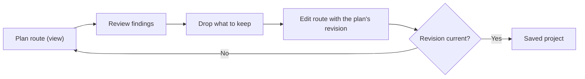
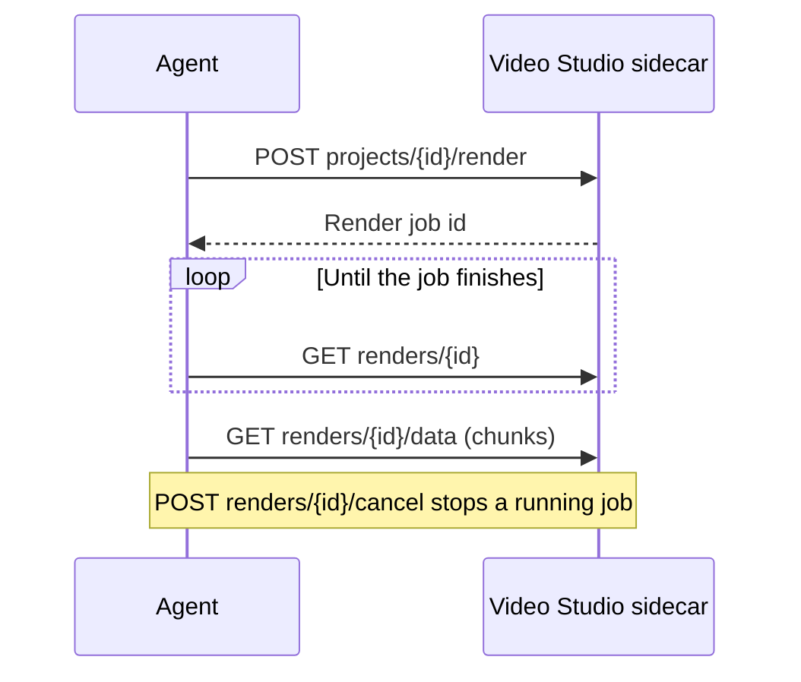

This reference lists the media, caption, assisted-edit, and export routes and
tool names that agents use on a [Video Studio](/docs/apps/video-studio) project.
Every route is under `/api/video-studio`. On this page, `…` stands for that
prefix. Permissions, timeline operations, and the Gateway budget boundary are in
[agent access](/docs/apps/video-studio-agents).

## Import and inspect media

| Route | Purpose |
| --- | --- |
| `POST …/assets/import` | Import one local absolute file path, HTTPS URL, or bounded base64 payload. |
| `GET …/assets/{id}/inspect` | Return one asset's source metadata, saved transcript, completed analysis, and generated thumbnail. Pass `thumbnail=0` to skip the thumbnail. |
| `GET …/assets/{id}/scopes?time=...` | Measure a source frame's normalized luma, chroma, saturation, hue, and black and white clipping. Add `detail=full` for histogram, RGB parade, and vectorscope arrays. |

An import probes the source, copies it into app-owned storage, and returns its
validated metadata before timeline placement. URL imports reject local and
private hosts and follow only a small number of validated HTTPS redirects.

The source scopes route gives the same read as **Inspect color** in the
library. It does not alter the asset or the timeline.

## Media, analysis, and search

| Tool | Route | Purpose |
| --- | --- | --- |
| `video_studio_media_filmstrip` | `GET …/assets/{id}/filmstrip` | Up to 60 thumbnails of a source as one image. |
| `video_studio_media_skim_frame` | `GET …/assets/{id}/skim-frame` | One frame at a source time. |
| `video_studio_delete_media_many` | `POST …/assets-delete-many` | Delete up to 500 items; used media is refused and named. |
| `video_studio_create_proxy`, `video_studio_list_proxies`, `video_studio_sweep_proxies` | `POST …/assets/{id}/proxy`, `GET …/assets/{id}/proxies`, `POST …/proxies` | Make, list, and sweep preview proxies. `GET`/`PUT …/proxy-settings` turns automatic proxies on or off. |
| `video_studio_stabilize_media` | `POST …/assets/{id}/stabilize` | Make a stabilized copy (`level`). |
| `video_studio_interpolate_media` | `POST …/assets/{id}/interpolate` | Resample to `fps` by optical flow or blending. |
| `video_studio_smooth_slow_motion` | `POST …/projects/{id}/smooth-slow-motion` | Render smooth slow motion for a slowed clip. |
| `video_studio_upscale_media` | `POST …/assets/{id}/upscale` | Make a new derivative at `factor` `2` or `4` (optional `name`), capped at 3840 pixels on the long edge; the source is unchanged. `enhance: true` adds denoise and sharpening and raises the cap to 8192 pixels. |
| `video_studio_create_matte` | `POST …/matte` | Make a solid-color image. |
| `video_studio_upload_lottie_frames`, `video_studio_finish_lottie_frames` | `POST …/lottie-frames`, `POST …/lottie-frames-finish` | Upload rendered Lottie frames and encode them with transparency. |
| `video_studio_list_offline_media` | `GET …/offline-assets` | List missing or damaged media (`probe=1` re-checks). |
| `video_studio_relink_media`, `video_studio_relink_media_batch` | `POST …/assets/{id}/relink`, `POST …/relink` | Relink one file or a batch; `dryRun` previews the matches. |
| `video_studio_analyze_shots`, `video_studio_get_shots` | `POST`, `GET …/assets/{id}/shots` | Measure and read a video's shot index. |
| `video_studio_search_shots` | `GET …/shot-search?q=` | Find shots by look; returns `labels`, `excluded`, `ignored`, and `results`. |

`…/assets/{id}/shots/index` and `…/shot-indexes` project shot descriptions into
a Space the same way transcript indexes do.

## Captions and speakers

| Tool | Route | Purpose |
| --- | --- | --- |
| `video_studio_caption_style` | `POST …/projects/{id}/caption-style` | Set the caption style (`merge` or `replace`), including `customFont` or `systemFont`. |
| `video_studio_caption_rechunk` | `POST …/projects/{id}/caption-rechunk` | Regroup captions, with optional profanity words. |
| `video_studio_caption_import` | `POST …/projects/{id}/caption-import` | Import SRT, WebVTT, or ASS text, with `lenient` skipping; returns `skipped`. |
| `video_studio_caption_glossary` | `POST …/projects/{id}/caption-glossary` | Save `glossary` pairs (`from`, `to`) and replace them in captions, optionally every track (`allTracks`), and transcripts. |
| `video_studio_detect_speakers` | `POST …/projects/{id}/speakers/detect` | Label speakers by `mic-dominance` or `cluster` (with `k`). |
| `video_studio_edit_speakers` | `POST …/projects/{id}/speakers` | Rename, recolor, or merge speakers. |

## Assisted edits for agents

The editing tools in [timeline editing](/docs/apps/video-studio-editing) are
also available as Video Studio operations. The tables mark each one as an edit
or a plan:

- **Edit** operations need the editing permission and the current project
  `revision`. They return the saved project and reject a stale revision, so the
  agent can reload and try again.
- **Plan** operations need only the viewing permission. They are read-only:
  they return the current `revision` with their findings and never change the
  project.

| Tool | Route | Kind | Purpose |
| --- | --- | --- | --- |
| `video_studio_extract_audio` | `POST …/assets/{id}/extract-audio` | Edit | Extract a video's audio into a derived audio asset; repeat calls return the same asset. Reversed media and nested sequences are refused. |
| `video_studio_detach_audio` | `POST …/projects/{id}/detach-audio` | Edit | Move `clipIds`' embedded audio to linked audio clips and mute the video. |
| `video_studio_split_edit` | `POST …/projects/{id}/split-edit` | Edit | Apply a J-cut, L-cut, or straight cut (`kind` `j`, `l`, or `none`) by `cutKey`, or by `clipId` with an optional `nearTime`. Returns `appliedOffset`. |
| `video_studio_plan_split_edits` | `POST …/projects/{id}/split-edit-plan` | Plan | Propose split edits from word timings, then waveforms. Returns `proposals` and `skipped`. |
| `video_studio_apply_split_edits` | `POST …/projects/{id}/split-edits` | Edit | Apply accepted `{ key, offset }` proposals (negative is J, positive is L). Returns `applied` and `skipped`. |
| `video_studio_plan_filler_words` | `POST …/projects/{id}/filler-plan` | Plan | Find fillers, repeats, and stutters. Returns `hits` and `ranges`. |
| `video_studio_plan_dead_air` | `POST …/projects/{id}/dead-air-plan` | Plan | Find long pauses. Send `vad`, `threshold`, and `minSpeech` to confirm pauses with voice activity. Returns `ranges` and `removedSeconds`. |
| `video_studio_freeze_frame` | `POST …/projects/{id}/freeze-frame` | Edit | Insert or hold a source still (`mode` `insert` or `hold-end`). |
| `video_studio_reverse_clips` | `POST …/projects/{id}/reverse` | Edit | Reverse `clipIds` and their linked partners, or restore reversed clips. |
| `video_studio_speed_curve` | `POST …/projects/{id}/speed-curve` | Edit | Give `clipId` a smooth speed curve that keeps one clip: a `preset`, or `custom` with 2 to 12 `points` (`t` 0 to 1, `speed` 0.1 to 10). `ripple` moves later clips. `preservePitch: false` plays the curve's audio tape-style; omitted keeps the clip's current choice. |
| `video_studio_remove_speed_curve` | `POST …/projects/{id}/speed-curve/remove` | Edit | Return a curved clip to one constant speed, keeping its length unless `speed` is given. |
| `video_studio_bake_speed_curve` | `POST …/projects/{id}/speed-curve/bake` | Edit | Bake a curved clip into 4 to 24 constant-speed clips with the same length. |
| `video_studio_speed_ramp` | `POST …/projects/{id}/speed-ramp` | Edit | Cut a clip into 4 to 24 constant-speed steps along a curve `preset`, or `custom` with 2 to 12 `points` (0.1× to 10×). |
| `video_studio_reset_speed_ramp` | `POST …/projects/{id}/speed-ramp/reset` | Edit | Merge a ramp back into one constant-speed clip. |
| `video_studio_beat_cuts` | `POST …/projects/{id}/beat-cuts` | Edit | Snap edits to beats or fill a track one clip per beat, from `beats` or an analyzed `musicClipId` (which uses its detected beats and bar starts). `snap` is `beat`, `downbeat`, or `every-n`. |
| `video_studio_highlights` | `POST …/projects/{id}/highlights` | Plan | Rank up to `count` non-overlapping `candidates` within a `target` length. |

Nesting, templates, AutoCut, and script assembly are available the same way:

| Tool | Route | Kind | Purpose |
| --- | --- | --- | --- |
| `video_studio_nest_clips` | `POST …/projects/{id}/nest` | Edit | Move `clipIds` (and overlays inside their span) into a new nested project and replace them with one sequence clip. |
| `video_studio_decompose_sequence` | `POST …/projects/{id}/decompose` | Edit | Expand a sequence clip back into its nested clips, titles, and graphics, trimmed to the clip's range, keeping the nested tracks' mute, hide, gain, and pan. |
| `video_studio_save_template` | `POST …/projects/{id}/save-template` | Edit | Save a copy of the project as a template whose `slots` are replaceable clips. |
| `video_studio_list_templates` | `GET …/templates` | Read | List built-in and saved templates with their slots. |
| `video_studio_instantiate_template` | `POST …/template-instances` | Edit | Create a project from `templateId`, filling slots from `assetIds` in order. |
| `video_studio_gap_fill` | `POST …/projects/{id}/gap-fill` | Edit | Place a bridging still between `afterClipId` and the next picture clip and dissolve through it. |
| `video_studio_auto_edit` | `POST …/auto-edit` | Edit | Create an AutoCut project from `assetIds`, optionally cut to `musicAssetId`. Captions come only from source clips you can hear. |
| `video_studio_shorts` | `POST …/projects/{id}/shorts` | Edit | Create one vertical short project per highlight, optionally queuing exports. |
| `video_studio_script_assemble` | `POST …/projects/{id}/script-assemble` | Edit | Place narrated script scenes, their visuals, and captions; narration goes on a free, audible track. Optional `music` adds a ducked local soundtrack bed and `avatar` a lip-synced presenter per scene. |

### Plan, then edit

Call a plan before the matching edit. Each plan returns the `revision` it read.

1. **J/L cuts.** Call the split-edit plan and review each proposal's `kind`,
   `offset`, `reason`, and `confidence`. Send the accepted keys and offsets,
   with the plan's `revision`, to the batch split-edit route. Offsets are
   clamped to source media, so compare `applied` with what you sent.
2. **J/L cuts on camera audio.** The plan covers only cuts between linked audio
   and video, and detaching creates new link groups (and so new cut keys). For
   camera clips with embedded audio, detach first with the detach-audio route
   (or the batch route with `detachAudio` and no proposals). Then plan, and
   apply with the plan's revision.
3. **Fillers and dead air.** Call the filler or dead-air plan and drop any range
   you want to keep. Send the rest as `ranges`, with the current `revision`, to
   `POST …/projects/{id}/remove-words`.
4. **Highlights.** Call the highlights plan. Then add a range marker through
   `POST …/projects/{id}/markers`, or duplicate the project and remove the time
   outside the chosen candidate with `remove-words`.

Trim and split-edit requests are frame-quantized. They stop at source limits and
neighboring clips instead of failing, so check the returned `applied` or
`appliedOffset` value. Snapping to beats skips edits that cannot reach a beat.

Freeze frames and reverse render media on your node and share the same
media-operation limits as other renders.

## Export and delivery

`POST …/projects/{id}/render` exports the saved timeline. An empty body exports
the whole timeline with the project's settings. Otherwise send any of these
fields:

| Field | Meaning |
| --- | --- |
| `revision` | Refuse the export unless this is the current revision. |
| `range` | `start` and `end` of the part to export, in timeline seconds. |
| `audioOnly` | Export audio only (WAV, MP3, or AAC). |
| `codec` | The export codec. |
| `overrides` | Any export setting, such as the format, rate control, output size, transparency, or publish preset. |
| `outputResolution` | `720p`, `1080p`, `2k`, or `4k`. Scales the canvas's short side to that height and keeps its aspect. Cannot be combined with an explicit output width and height. |
| `saveAsAsset` | Add the result to the media library. |

Exports that need an encoder the node lacks are refused before any work starts,
and scene approval gates are enforced. See [export](/docs/apps/video-studio-export) for the formats and limits.

| Route | Purpose |
| --- | --- |
| `GET …/renders/{id}` | Poll the render job. |
| `GET …/renders/{id}/data` | Read the finished file in chunks. |
| `POST …/renders/{id}/cancel` | Cancel the render. |

### Handoff files and packages

| Route | Returns |
| --- | --- |
| `GET …/projects/{id}/interchange?format=fcpxml` | Final Cut XML. Use `format=xmeml` for Premiere XML or `format=otio` for OpenTimelineIO JSON. |
| `GET …/projects/{id}/package` | The production package. |
| `GET …/projects/{id}/credits` | The project's credits. |
| `GET …/projects/{id}/package-archive` (or `package?media=1`) | A self-contained ZIP with the package and every referenced media file. |
| `GET …/package-archive-data?id=…&offset=…` | The archive, read in chunks. |

The package's credits list media sources and the licenses of any online fonts
the project uses. The credits route and the archive carry the same list.

To import an archive:

1. `POST …/package-archive-imports` with its size.
2. Send base64 chunks with `POST …/package-archive-import-chunks`.
3. Finish with `POST …/package-archive-import-finish`.
