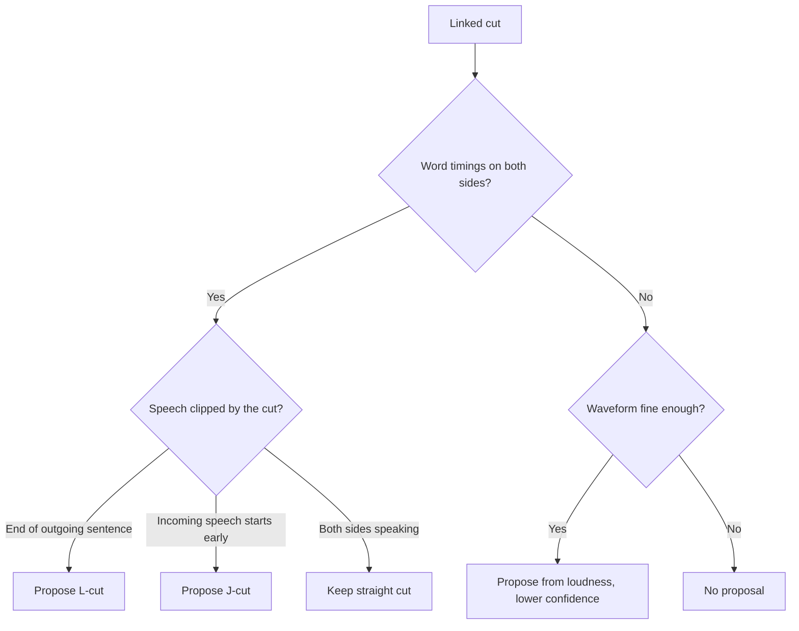
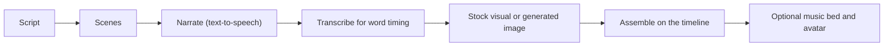

These tools analyze your media and propose or make larger edits. Start with the
[Video Studio overview](/docs/apps/video-studio) and
[timeline editing](/docs/apps/video-studio-editing). The agent routes behind
each tool are listed in [agent media and export](/docs/apps/video-studio-agents-media#assisted-edits-for-agents).

Analysis results (beats, voice activity, speakers, shots, highlights, drift,
and subject tracking) are measurements and heuristics. Treat them as cues to
review, not guarantees. Every edit these tools make is one undoable step.

Some assisted tools can also use a cloud model you choose:

- Shot descriptions for
  [finding footage](/docs/apps/video-studio-media-workflows#find-footage-by-look).
- Video-to-video edits, subject mattes, motion gap fills, generated music, and
  photoreal lip-sync in [generation](/docs/apps/video-studio-generation).

The measured and local versions stay the defaults, and every cloud request names
the model it used.

## Automatic J/L cuts

Open **J/L cuts** in the side panel, or press Shift+Alt+J, and choose
**Analyze cuts**. For each linked cut, Video Studio proposes a J-cut, an L-cut,
or no change.

- **Measured word timings come first.** This needs a saved transcript with word
  timings on both sides. A sentence that the picture cut clips at the end of the
  outgoing shot suggests an L-cut. Speech that starts in the incoming shot's
  unused media just before its picture suggests a J-cut.
- **Quiet audio is required.** The audio being shortened must stay quiet over
  the proposed offset. If both sides are speaking, the cut stays straight.
- **The waveform is the fallback.** Without transcripts, completed source
  analysis supplies a loudness envelope, at lower confidence. When the measured
  waveform is too coarse for the offset range, no edit is proposed.
- **Nothing is fabricated.** Offsets are clamped to available source media.
  Cuts that continue the same take, already have a split edit, or lack spare
  media are skipped with a reason.

Each row shows the cut time, J or L, the offset, the reason, and a confidence
score. Rows at 0.6 or above are preselected. Edit an offset, use **Seek** to
review the cut, and choose **Apply N split edits**.

Two options change the analysis:

- **Detach camera audio when analyzing** first detaches embedded audio from
  unlinked video clips, as a separate undoable edit. Proposals only cover cuts
  between linked audio and video.
- **Replace existing split edits** re-plans cuts that already have one.

## Freeze, reverse, and speed curves

**Freeze frame** works on video clips:

- **Insert at playhead** holds the source frame under the playhead for 0.1 to 30
  seconds and shifts later layers right.
- **Hold the last frame** appends the final frame.

The still comes from the source media, so overlays are not baked into it. It
keeps the clip's crop, grade, effects, and framing, and plays silently. Freeze
frame is not available on multicam clips.

**Reverse** plays a video or audio clip backwards. Video Studio renders a
reversed copy of the source on your node once, in short chunks, and reuses it.

- Sources up to 10 minutes long can be reversed.
- Linked partners reverse with the clip.
- A clip with a J-cut or L-cut against a neighbour must be returned to a
  straight cut first.
- **Restore forward** returns to the original.

### Speed curves

**Speed curves** in **Speed & beat** change a clip's speed along a curve between
0.1× and 10×. Choose a preset (**Montage**, **Hero**, **Bullet time**,
**Flash in**, **Flash out**, or **Jump cut**) or **Custom**. **Jump cut** plays
fast, then slow, then fast with hard changes.

**Custom** opens a curve editor that starts from the curve on screen:

- Drag a point. Left to right is the position in the clip; bottom to top is the
  speed on a 0.1× to 10× scale.
- Or select a point and type its position and speed.
- **Add point** and **Remove point** keep 2 to 12 points. The first and last
  points stay at the start and end of the clip.

Choose how the curve is applied:

- **Smooth** (the default) keeps one clip and remaps its time continuously.
  Every point plays at its own speed and the speed glides between points in the
  preview and the export, with no steps. The clip becomes as long as the curve
  needs, and later clips move as **Later clips** says.
- **Steps** replaces the clip with 4 to 24 constant-speed pieces, each starting
  exactly where the previous one ended in the source.

On a **Smooth** curve, audio follows the curve and keeps the clip's exact
length. Tape-style audio lands within a sample of the curve, and pitch-kept
audio within about 5 ms, the small leeway that keeps it seamless.

- With **Preserve pitch** on (the default), the tempo follows the curve and the
  pitch stays the same.
- Turn **Preserve pitch** off in the Speed curve section to play the curve
  tape-style. The audio rises in pitch as it speeds up and falls as it slows
  down, in the preview and the export alike.
- The clip inspector's own **Preserve pitch** applies to constant speeds.

Keyframes stay on the moments of the source they animated. Splitting a curved
clip gives each part its piece of the curve, so the parts play exactly as the
whole clip did.

### Bake or reset a curve

- **Bake to clips** turns a curve into **Ramp steps** constant-speed clips. Each
  plays at the curve's average speed over its piece, so the length stays the
  same.
- **Reset to constant** returns a curved clip to one constant speed with the
  same length. On stepped pieces, it merges them back.
- Choosing a speed in the inspector also replaces the curve.

Linked audio follows the picture in every mode. A curve or ramp is refused when:

- a linked partner is offset (after a J-cut or L-cut);
- a fade is longer than the first or last step;
- the clip is a still or multicam clip.

Premiere XML and Final Cut XML carry the curve itself. OpenTimelineIO keeps only
the average speed (see [handoff files](/docs/apps/video-studio-export#handoff-files)).

## Beats and cutting to music

Choose **Detect beats** on an analyzed music source to measure its tempo (60 to
180 BPM), beats, and bar starts with a confidence score.

- Detection covers up to 10 minutes of the part of the source a clip plays.
- Sources with no steady pulse fall back to a loudness estimate, and the panel
  says which was used.
- **Add N beat markers** and **Add N bar markers** turn the results into
  timeline markers (up to 500).

In **Speed & beat**, choose an analyzed music clip, the track to cut, and
**Cut on**: **Every beat**, **Every 2 beats**, **Every 4 beats**, or **Bar
starts (downbeats)**.

- **Snap existing edits to the nearest beat** rolls each edit point on the track
  to a beat within the **Snap tolerance**; edits without spare media stay put.
- **Lay clips one per beat** places the chosen clips back to back, one per beat
  slot, using the middle of each clip or its loudest part. A clip shorter than
  one slot is refused, and the target span must be empty.

If you re-trim the music clip while its beats load, the panel asks you to **Cut
to beat again**.

## Remove filler words and pauses

Open **Cleanup** after transcribing the sources:

- **Filler words** lists fillers (such as "um", "uh", "you know", and "I mean"),
  immediate repeats, and stutters. "Like" counts only between pauses. Edit the
  word list if needed, and review repeats, since some doubles are intentional.
- **Dead air** lists pauses longer than **Shortest pause to remove** (0.6
  seconds to start). It keeps **Pause to keep** as breathing room and **Padding
  beside speech** around each word.
- **Confirm pauses with voice activity** checks each pause against the measured
  audio, using **Speech threshold above noise floor** and **Shortest speech**.
- **Show non-speech on clips** draws the detected non-speech spans in red on
  clips with audio.

Only clips you can hear count: muted, hidden, and zero-volume clips, muted
tracks, and tracks silenced by solo are ignored. Clear any row you want to keep,
then choose **Remove** to cut the selected ranges.

Every track ripples by default. Turn off a track's sync lock (for a music bed,
say) to keep it in place.

## Find highlights

Open **Highlights** to rank moments for short clips. Choose how many, the
shortest and longest length, and optional keywords.

Candidates follow sentence boundaries and are scored on:

- speech density;
- loudness changes and peaks;
- opening questions or exclamations;
- keyword matches;
- scene cuts at their edges.

Without a usable transcript, analyzed loudness is used instead. Only clips you
can hear count. Use **Seek** to review a candidate, **Mark** to add a range
marker, or **Make short** to create an alternate cut that keeps only that
highlight.

## AutoCut and vertical shorts

**AutoCut** in **Highlights** builds a new project from 1 to 20 video or image
sources. Choose optional music, a length from 5 to 600 seconds, a style, an
aspect (16:9, 9:16, 1:1, or 4:5), and optional captions. Your current project
is not changed.

| Style | Cuts on |
| --- | --- |
| Energetic | Every beat |
| Smooth, Minimal | Bar starts |
| Cinematic | Every other bar |

- Cuts land on detected beats when **Detect beats** has run on the music,
  otherwise on the loudness estimate, or on a steady grid without music.
- Source audio is muted under the music, which fades out over the last two
  seconds.
- Clips play at normal speed when the source is long enough. Shorter sources
  are slowed (never below 0.25×), and nothing is sped up.

**Vertical shorts** turns this project's best highlights into separate short
projects: 1 to 10 of them, 15 to 60 seconds and 9:16 by default. Each is
captioned one word at a time in the Punch style and stores a matching publish
preset. Turn on **Export each short** to queue their exports. Track locks are
kept.

In both, a clip whose aspect differs from the target pans to keep its subject
(detected from motion and detail) in frame. A clip that cannot be tracked, or
one with its own crop or animated framing, keeps a centred crop. Created
projects get **Open** buttons.

## Script to video

**Script to video** in **Plan** turns a pasted script into an edit.

### Get a script

- Paste a script into **Script**.
- Or describe the video in **Topic**, set **Script length**, and choose
  **Write script with Ryu**. Ryu's language model writes plain narration of
  about that length, using the project title and brief, and fills **Script**
  for you to edit.
- Or choose **Use storyboard scripts** to join the per-scene scripts that
  **Draft scenes with Ryu** wrote in the Plan tab, in scene order.

### Plan the scenes

Plan scenes with Ryu's language model, or choose **Split into scenes** to split
locally without a model. Then set:

- each scene's narration, stock search words, and image prompt;
- open stock media or generated images;
- an optional narration voice and a caption style;
- a pause between scenes (0 to 2 seconds).

### Produce each scene

Production narrates each scene with Ryu's text-to-speech, transcribes the
narration for word timing, then finds a stock visual or generates an image.
Every narration and image counts against the project budget and goes through
Ryu's approval prompts.

- Use **Stop after this scene**, retry a failed scene (only the failed step is
  redone), or remove it.
- Without speech or image generation, the scene shows why it failed and
  assembly stays disabled.
- Without transcription, the scene reads **Ready · estimated caption timing**.

### Assemble

Assembly places the narration back to back on the first free track you can
hear, by default after the current edit, and sizes each visual to its
narration.

- Stills get a gentle zoom and drift.
- Long videos are trimmed, and shorter ones slowed (to half speed at most) or
  repeated.
- Captions overlapping the assembled span are replaced.
- Stock media keeps its attribution. Review its rights before publishing.

Two optional extras are added in the same step:

- **Music bed** scores a local soundtrack over the assembled span and places it
  on a free audio track, faded in and out and set to duck under the narration.
  Choose a style, or **Match the description** to pick one from words such as
  calm, epic, lo-fi, or upbeat.
- **Presenter avatar** adds a 2.5D avatar for each scene (on the right, on the
  left, or small in the bottom-right corner) for the length of that scene's
  narration, with its mouth lip-synced to the narration. Edit or restyle each
  avatar afterwards in **Avatars**.

When Ryu's language model is available, a music description goes to the
soundtrack planner. It picks the style, tempo, instrument layers, and how the
energy changes at the scene cuts; a style you chose still wins. Without a
model, the local plan changes intensity at each scene and builds towards the
end. A long score keeps composing in the background before it is placed.

## Sync clips and correct drift

Open **Sync** to align audio-bearing clips from cameras and recorders. Choose a
reference clip and targets, then an **Alignment method**:

- embedded SMPTE timecode;
- **Audio correlation** (after source analysis on both), which reports a
  confidence score and moves targets on frame boundaries;
- a manual offset in seconds.

With **Correct clock drift** on, Video Studio also measures drift between the
start and end of the shared audio (at least 20 seconds of overlap). Drift up to
±0.5% is corrected with a tiny speed change; larger drift is reported and left
alone. **Measure drift** reports drift without changing anything.

## Multicam

Open **Multicam** to create a named session from two or more camera angles, a
program audio source, and optional **More microphones**.

**Switch camera over range** replaces the selected range with one of:

- another angle;
- another program microphone;
- a split-screen layout (fit or fill) showing several angles.

Extra angles go on the lowest free unlocked tracks above the session, and a
layout is refused when none are free. Press 1 to 9 to cut to an angle, or Alt+1
to 9 to switch the microphone, from the playhead to the end of the current
switch. **Ungroup session** keeps the clips and removes the session.

## Auto reframe

**Auto reframe** in **Layouts** converts the project to 9:16, 1:1, 4:5, 16:9,
4:3, 3:4, 2.35:1, or 21:9, keeping the short edge. Choose a method:

- **Track subject** (with **Smoothing**);
- **Center crop**;
- **Fit with blur fill**.

Optionally choose **Selected clips only**. By default only video and image clips
that cover the whole canvas change. Picture-in-picture insets, split-screen
cells, and clips on locked tracks are left alone.

### How tracking frames the subject

Tracking follows motion and detail, not object recognition.

- At a scene cut, the framing jumps with the cut.
- It trails a fast subject slightly to avoid jitter.
- The frame can pan across the whole source width, so a subject near the edge
  of a 16:9 shot stays in a 9:16 frame. Clip position (**Horizontal position**
  and **Vertical position**) reaches ±3 to allow this.
- Nothing is generated outside the picture. Blur fill is the way to keep the
  whole frame.
- A clip that cannot be tracked keeps a centred crop, and the result says so.

### Image stabilization

**Image stabilization** (Off, Low, Medium, or High) steadies shaky footage
before the reframe. Each video clip moves onto a stabilized copy of its media,
the same copy **Stabilize** in Media tools makes and reuses. The subject
tracking and the crop then follow the subject instead of the camera shake.

Stabilizing zooms in slightly (4 to 8% per edge, depending on the level). These
clips keep their media, and the result lists them: stills, nested sequences,
preview proxies, media longer than 10 minutes, multicam clips, and clips already
on stabilized media.

## Motion tracking

1. Open **Motion tracking** in the Vector graphics area and select a video
   clip.
2. Park the playhead on a frame showing the subject.
3. Set the region in percent of the canvas, or choose **Draw region on
   preview** and drag a box. Drag the dashed box or use the arrow keys to move
   it.
4. Pick a **Follower**: a title (position and scale), a graphic (position),
   another clip such as a sticker (position and scale), or a new blur or mosaic
   region, which becomes an adjustment layer.
5. Choose **Track motion**.

Tracking runs from the playhead to the clip's end, for at most 120 seconds, and
needs a textured region.

- A lost subject keeps its last position. The status line reports lost frames
  and the match percentage.
- Tracking replaces the follower's existing position and scale keyframes.
- Clips on locked tracks cannot be followers.

Continue with [transcripts and captions](/docs/apps/video-studio-transcription)
or the [Video Studio overview](/docs/apps/video-studio).
