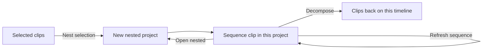

This guide covers building a [Video Studio](/docs/apps/video-studio) timeline.
Related guides:

- [Workspace](/docs/apps/video-studio-workspace) covers projects, the preview,
  and the library.
- [Assisted editing](/docs/apps/video-studio-assisted-editing) covers the tools
  that propose edits for you.
- [Keyboard shortcuts](/docs/apps/video-studio-shortcuts) lists every key.

## Place clips

Create a project and bring media in:

- Choose **Import media** for a local file.
- Or paste an HTTPS URL into **Import media URL** and choose **Import URL**.
- Or drop files on the window (see
  [bring media in](/docs/apps/video-studio-workspace#bring-media-in)).

Imported media is probed and copied to your Ryu node before it appears in the
library. Add items from the library or drag them onto a lane. Higher tracks draw
above lower tracks.

Select a clip to edit its source in and out points, start, track, speed,
volume, framing, color, and fades in the inspector. Projects hold up to 5000
clips on 32 tracks and run for up to two hours. Titles and graphics are limited
to 1000 each.

## Select, copy, and paste

- Click a clip to select it, or Shift-click to add clips.
- Drag on empty lane space to draw a selection box. Hold Shift or Ctrl to add to
  the selection. A plain click clears it, and Escape restores the selection you
  started with.
- A selects every clip from the playhead forward on the selected track, Shift+A
  forward on every track, and Cmd/Ctrl+A everything. **Select all on track** is
  in the clip menu.

Cmd/Ctrl+C, X, and V copy, cut, and paste clips with their linked partners.

- Paste lands at the playhead on the same tracks when they are free, otherwise
  on the next free track.
- Cmd/Ctrl+Shift+V pastes and ripples later content right. Cut ripples when
  ripple mode is on.
- D duplicates the selection right after its end.
- Each paste, cut, or duplicate is one undo step.

### Copy and paste settings

**Copy settings** in the inspector's **Clip settings** group copies a clip's
treatment. Tick the groups to paste (transform, color, effects, audio, masks,
and animation). Then choose **Paste settings**, or press Cmd/Ctrl+Alt+V with the
target clips selected.

Pasting never copies the clip's label and color, mute, hide, pitch
preservation, speaker, timing, or multicam grouping. A reveal transition is
dropped when the target has no clip before it to cover.

## Cut, trim, and ripple

- **Split:** S or Cmd/Ctrl+K splits the selected clips at the playhead, or every
  unlocked clip under it when nothing is selected. The **Razor** tool (C) cuts
  where you click; Shift-click cuts every unlocked track.
- **Trim to the playhead:** Q and W ripple-trim the start or end of those clips
  to the playhead, closing the gap. Alt+Q and Alt+W trim and leave a gap.
  Alt+[ and Alt+] trim only the selected clip.
- **Ripple delete:** Shift+Delete deletes the selection and closes the gap.
  Right-click empty lane space and choose **Ripple delete gap** to close a gap
  on that track.
- **Ripple mode** in the timeline toolbar makes Delete, Alt+[ / Alt+], and
  pointer edits ripple.

A ripple trim moves every sync-locked track, plus titles, captions, and markers,
by the same amount. A clip still inside the trimmed span on a moving track
limits the ripple, and the status line says a gap was left.

**Ripple delete gap** is refused when the track is locked, there is no gap, the
gap is shorter than 0.04 seconds, or another sync-locked track has clips in the
gap. Deleting the clip a reveal transition plays over, with Delete or ripple
delete, removes that reveal from the next clip, which then starts with a hard
cut.

With **Ripple mode** on:

- Dragging a clip edge works like the Ripple tool. Later clips on the track (and
  on sync-locked tracks) move with the edge, so no gap opens and the edge can
  extend into the next clip's place.
- Dragging a clip closes the gap it leaves and inserts it at the nearest edit
  point on the track it lands on, pushing later clips right. Dropped past the
  track's last clip, it lands right after it.
- Each drag is one undo step.

Splitting keeps a clip's entry transition on the first piece and its exit
transition on the last, each shortened to fit. Linked partners are always cut
and trimmed together.

### Drag and trim on the timeline

- Dragging any selected clip moves the whole selection. Linked audio and video
  stay together in time, and only the clips you drag change track.
- Dragging an edge trims every selected clip, each stopping at its neighbor and
  at its source media. Hold Alt while trimming to leave the linked partner alone
  (a split edit by hand).
- Alt-drag a clip body to drop a copy. A copy that would overlap the originals
  is refused.
- Shift turns snapping off during a drag, and Escape cancels it.
- Trims remove animation keyframes that fall outside the shortened clip.

The handles at a clip's top corners set its fade in and fade out and show the
length in seconds. Focus one to adjust it with the arrow keys (one frame, ten
with Shift) or Home and End.

### Edit tools

| Tool | Key | What a drag does |
| --- | --- | --- |
| Pointer | V | Moves clips with their linked partners; dragging an edge trims. |
| Ripple | B | Trims an edge and shifts later clips on the track by the same amount. |
| Roll | R | Moves the shared edit point between two touching clips. |
| Slip | Y | Changes which part of the source plays without moving the clip. |
| Slide | U | Moves a clip between its neighbors; their touching edges follow. |
| Razor | C | Cuts the clip where you click. |

Every trim snaps to whole frames, respects playback speed, and stops at the
source's limits, the 0.04-second shortest clip, and any clip it would run into.
Ripple trims also shift later markers, captions, titles, and other timed layers.
Slip is not available on multicam clips or still images. During a slip, roll, or
ripple drag the preview shows the frames on both sides of the edit.

### Snapping

Dragged clips and edges snap to:

- clip edges on every track;
- the playhead, which wins over other targets;
- the marked range, and markers (both ends of a range marker);
- the selected clip's keyframes;
- title and graphic bounds.

Otherwise they snap to the nearest frame. A highlighted line shows the snap. N
or the magnet button in the timeline toolbar turns snapping off and on; holding
Shift skips it for one drag.

## Zoom and navigate

- Zoom with Ctrl+wheel, Alt+wheel, or a pinch around the pointer, with `+`,
  `=`, and `-`, or with the zoom slider (5 to 600 pixels per second). Shift+Z
  fits the whole timeline.
- Shift+wheel or Cmd/Ctrl+wheel pans.
- Drag on the ruler to scrub frame by frame, or click empty lane space to move
  the playhead there.
- With the playhead handle focused, arrows step one frame (Shift one second),
  Page Up and Page Down five seconds, and Home and End jump to the ends.

The timecode field accepts `HH:MM:SS:FF`, `MM:SS:FF`, `;` for drop-frame, a
frame count (`120` or `120f`), seconds (`4.5s`), and relative `+` and `-`
offsets. Up and Down jump between edit points; Shift+Up and Shift+Down between
markers.

Cmd/Ctrl+L cycles loop playback between off, the marked range, and the whole
timeline. `/` plays from two seconds before the playhead to two seconds after,
then returns; J, K, L, or seeking cancel it. Pressing J or L again speeds the
shuttle up to 2×, 4×, and 8×; K stops and resets it.

## Tracks

Each track header has:

- a name;
- **Hide** (picture and audio, in the preview and the export), **Mute**,
  **Solo**, **Lock**, and **Sync lock**;
- a height (**Small**, **Medium**, or **Large**), and gain and pan controls;
- up and down arrows to reorder tracks.

**Track options** adds a track above or below, or removes the track. Removing a
track that has clips asks first, and a locked track must be unlocked before it
can be removed. Shift+M mutes the selected clip and Shift+H hides it.

Lock prevents selecting, moving, trimming, and inspector edits on a track.
**Sync lock** decides whether a ripple edit on another track shifts this one,
and it is on by default. Turn it off on a music bed so range deletes, inserts,
transcript removals, filler and dead-air cleanup, and ripple trims leave it in
place. The edited track always ripples.

Hidden, muted, and zero-volume clips, and clips faster than 16× without **Keep
audio above 16x**, count as silent everywhere the editor listens. Dead-air
detection, speaker detection, highlights, and lip-sync sources skip them.

Select an overlapping audio and visual clip and choose **Link overlapping
audio/video** to keep them together; **Unlink audio/video** separates them.

### Clips on the timeline

Video and still clips show filmstrip thumbnails. Clips with sound show a
waveform that follows trim, speed, and volume and dims when muted. Give a clip a
label and a color tag from the inspector's **Label** section or the clip menu.
Clips whose media is missing show an **Offline** badge (see
[relink offline media](/docs/apps/video-studio-media-workflows#offline-media-and-relink)).

Right-click a clip, long-press it, or press Shift+F10 on a focused clip for its
menu. Unavailable items say why. The menu offers:

- split at the playhead (or **Split here** at the pointer), clipboard actions,
  and **Select all on track**;
- mute and hide, **Rename…**, and **Color** (with **No color**);
- **Detach audio** or **Recover audio**, freeze frame, reverse, and **Speed and
  ramps…**;
- **Reveal in library**, and **Replace media** (keeping trims, transform, and
  grade);
- **Move to new track**, **Duplicate to new track**, **Nest**, and **Ask
  agent**.

New tracks for moved or duplicated clips are the first free tracks above that
hold the same kind of media.

### Titles, graphics, and caption lanes

Titles, graphics, captions, adjustment layers, and avatars have collapsible
lanes above the clip tracks.

- Drag an item to move it or change lane, and drag its edges to trim it. Snapping
  works as with clips.
- Delete removes it, Cmd/Ctrl+D duplicates it, and Alt+Left/Right nudges it by a
  frame (Shift for one second).
- Every item keeps at least one frame, and trims keep fades, keyframes, and
  caption word timing consistent.

## Detach and recover audio

Select a video clip with sound and choose **Detach audio**. Video Studio:

1. extracts the source's audio once into an app-owned audio file;
2. places a linked audio clip with the same position, trim, speed, volume, pan,
   audio cleanup, ducking, and volume and pan animation, on the first free
   unlocked track without visual clips;
3. mutes the video clip.

Reversed clips and nested sequences keep their audio embedded.

On either clip of a detached pair, the inspector offers **Recover audio**. It
removes the extracted audio clip, restores its settings to the video clip
(moving keyframes with it if the audio was moved), and removes the link. The
extracted file stays in the library. Both tracks must be unlocked.

## J-cuts and L-cuts

A J-cut starts the next shot's audio before its picture. An L-cut lets the
previous shot's audio continue after the picture changes. Both need linked
audio and video pairs back to back on the same video track, so link or detach
each clip's audio first.

Use the inspector's **Split edit** group:

- **J-cut** and **L-cut** roll the audio edit point by the **Split offset** (up
  to four seconds, in whole frames) while the picture cut stays put.
- **Straight cut** puts it back.
- **Audio crossfade** (0 to 0.5 seconds, 0.08 by default) overlaps the two audio
  clips around the new edit point where media allows. Otherwise a 0.01-second
  fade removes clicks.
- Alt+J and Alt+L apply the same edit at the selected clip's cut, or the cut
  nearest the playhead.

Offsets never invent audio. When a clip has less spare media than you ask for,
Video Studio applies the largest offset that fits and reports it. Audio that
would overlap another clip moves to a free unlocked audio track and stays
linked.

An offset badge on the audio clip shows how far its edit point is from
the picture cut. For proposals across a whole edit, see
[automatic J/L cuts](/docs/apps/video-studio-assisted-editing#automatic-jl-cuts).

## Markers

Press M to add a marker at the playhead, or to remove the one there; Alt+M turns
the marked range into a range marker. Drag a ruler marker to move it.
Double-click, right-click, or press Shift+Enter on it to edit its label, color,
status, range length, and comment. `[` and `]` jump between markers.

The **Markers** panel in the Exports area lists every marker:

- A status filter offers **All**, **Unresolved**, and **Resolved**.
- Each marker has a comment field that saves when you leave it. Undo and agent
  edits do not overwrite what you are typing.
- **Ask agent** on a marker row (or **Ask agent about this marker** in the ruler
  marker's editor) hands that marker, with its status and comment, to the agent.
- A ripple-markers switch decides whether ripple edits move markers. When off,
  markers stay in place.
- A switch shows marker labels over the preview.

Markers never change the exported length.

## Range edits and inserts

Press I and O to mark a range, or hold Shift and drag across the ruler. The
marked range is shaded across the ruler and every track. Drag its In or Out edge
on the ruler to adjust it. Edges snap to clip edges, markers, and the playhead;
hold Alt to place an edge without snapping. You can also focus an edge and use
the arrow keys (Shift moves a second). **Clear range** (Alt+X) hides it.

The range bar offers actions on the marked range:

- **Ripple delete range** removes it. Later clips shift left on every
  sync-locked track, captions and timed layers keep their relative timing, and
  markers inside the cut are removed.
- **Export range** opens the export settings with **Only the marked range**
  on; **Save range to library** also turns on saving the result to the media
  library.
- **Ask agent** hands the range (and any selected clips) to the agent.
- **Score this range** creates music for the range (see
  [local soundtracks](/docs/apps/video-studio-audio#local-soundtracks)).

**Insert at playhead** splices a copy of the selected clip into its track at the
playhead. It splits a crossing clip and shifts later clips, captions, titles,
graphics, avatars, meshes, and markers right.

## Nested sequences

A nested sequence renders another project as one clip on this timeline.

The **Nested sequences** section of the Media tab renders another project as a
sequence clip; **Refresh sequence** re-renders it after source edits. A sequence
clip always renders as H.264 MP4 with picture and audio, at the nested project's
full length and canvas size, whatever that project's own export settings are.
Cycles are refused.

### Nest a selection

Select clips and press Cmd/Ctrl+Alt+G, or choose **Nest selection**. The clips,
with titles and graphics fully inside their span, move into a new project with
this project's canvas, frame rate, and codec. One sequence clip replaces them.
**Open nested** opens the child project in a tab.

Nesting never changes the output: the nested project keeps each source track's
hide, mute, solo, gain, and pan result. Nesting is refused when:

- other pictures sit below or between the selected clips;
- an adjustment layer sits between their tracks;
- audible clips would land on a muted track;
- the selection has multicam clips, template slots, lip-sync sources, locked
  tracks, or only audio.

### Decompose a sequence clip

Select a sequence clip and press Cmd/Ctrl+Alt+Shift+G, or choose **Decompose**,
to put its clips back. Reset the sequence clip's speed to 100% and unlock its
track first.

- Only the part inside the clip's trimmed range returns, moving up to free
  tracks when needed.
- Restored clips take the parent tracks' settings. Clips from muted or hidden
  nested tracks come back muted or hidden.
- Speed, transform, effects, and keyframes set on the sequence clip itself are
  not carried over, and transitions on a trimmed-away edge are dropped.

## Templates

Open **Templates** in the Recipes area. Select clips and choose **Save N
selected clips as template**. Those clips become replaceable slots, ordered by
start and track and labeled by kind ("Video 1", "Image 2"). Titles, effects,
timing, and other clips stay fixed.

Eight original templates are built in: vlog intro, product promo, recap
montage, quote card, podcast clip, slideshow, event highlight, and tutorial
step. Their slots are whole bars of a locally generated music bed, which you
can replace.

To use one, choose **Use template**, pick media in order, add an optional title,
and create the project. For a built-in, also turn **Generate music** on or off.
The new project opens and reports how many slots were filled.

- Visual slots take video or stills, and audio slots take audio.
- Stills hold for the slot. Longer video is trimmed, and shorter video slowed to
  fill a fixed slot (never below 0.1×).
- Audio is trimmed but never retimed.
- Unfilled slots keep their placeholder, and extra media is reported as unused.

## Project settings

Project settings set:

- the canvas;
- the frame rate (23.976, 24, 25, 29.97, 30, 48, 50, 59.94, 60, or 120);
- the export codec;
- a **Visual style** (**Clean professional**, **Flat motion**, **Minimalist
  diagram**, or **Cinematic**) that sets the canvas color and the default
  accent for new shapes.

When the first video you add differs from the project in size or frame rate, a
banner offers **Match project to media**. It keeps the aspect with even edges
and changes the rate only to a supported project rate.

**Format** lists canvas presets: 16:9 at 720p, 1080p, 1440p, 4K UHD, and 8K
UHD; 9:16 vertical; 1:1 square; 4:5 portrait; 4:3 classic; 21:9 ultrawide;
1.85:1 flat and full 2K DCI; DCI 4K; and a 360p preview size.

Choose **Custom size…** to type **Canvas width** and **Canvas height** in
pixels. Each edge is rounded to an even number between 128 and 8192, and the
shorter edge grows if needed to keep the aspect between 1:10 and 10:1. A project
whose canvas matches no preset shows its size as **Custom**.

Choose **Duplicate project** to make an independent alternate cut that shares
the same media. Edits use revision checks: if another editor or agent saved a
newer revision, Video Studio pauses and offers to reload.

The [agent access guide](/docs/apps/video-studio-agents) lists the matching routes,
and the [workspace guide](/docs/apps/video-studio-workspace#save-autosave-and-history)
covers autosave and history.

Continue with [color, effects, and motion](/docs/apps/video-studio-color-and-effects).
