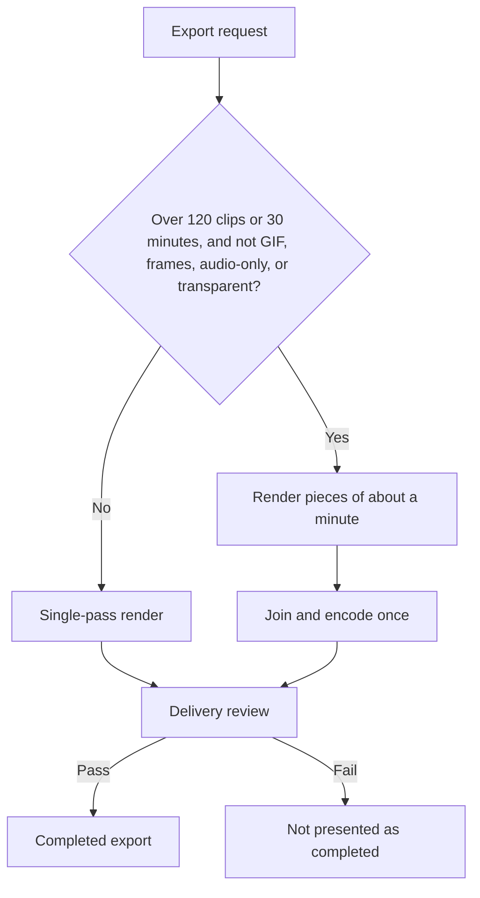

This guide covers delivering a Video Studio project: formats and codecs, export
options, publish presets, long timelines, export history, and handoff files.
Finish the edit with [production review](/docs/apps/video-studio-finishing)
first. Agents start the same exports through the routes in
[agent media and export](/docs/apps/video-studio-agents-media#export-and-delivery).

Exports run on your Ryu node with FFmpeg and ffprobe, and always use the
original media, never preview proxies. Burning in titles and captions needs an
FFmpeg build with the subtitles filter (libass). Plain footage and still-image
timelines export without it.

## Formats and codecs

Open the export panel in the **Exports** area. Choose a format:

| Format | Contents |
| --- | --- |
| MP4 | H.264 or H.265, including H.265 10-bit |
| MOV | ProRes 422 HQ or ProRes 4444 |
| WebM | VP9 video with Opus audio |
| GIF | Animated GIF with its own frame rate and width |
| WAV, MP3, AAC (M4A) | Audio only |
| PNG frames (ZIP), JPEG frames (ZIP) | One image per frame |

- With H.265 10-bit, turn on **HDR metadata** to tag the export as HDR when a
  source clip is PQ or HLG.
- Formats that need an encoder your FFmpeg build lacks (libvpx-vp9 and libopus,
  libmp3lame, 10-bit libx265, or prores_ks) are disabled with the reason.
- Image sequences are limited to 3600 frames and 4 GB of frames.

**Transparent background** is available for MOV (ProRes 4444), WebM (VP9 with
alpha), and PNG frames. It replaces the project canvas with transparency,
including a project blur fill around bottom-track clips. A clip's own **Clip
background** is still drawn.

## Export options

- **Export the I/O range only** renders just the marked range. The timeline
  toolbar's **Export range** does the same in one step.
- **Include audio** keeps or drops the soundtrack.
- **Quality** chooses CRF (constant quality), CBR, or VBR with a bitrate, and
  **Encoder speed** trades encode time for compression.
- **Output resolution** exports at **Match timeline** (the canvas size), 720p,
  1080p, 2K (1440p), or 4K (2160p). See [output resolution](#output-resolution).
- **Custom size** sets any width and height. A size with a different aspect is
  fitted and letterboxed, never stretched; GIFs follow the same rule.
- **Save the export to the library** adds the finished video or audio file to
  the media library.

### Output resolution

A resolution sets the canvas's short side to that height and keeps its aspect.
For example, a 4:5 project at 2K exports at 1440 × 1800, and a 9:16 project at
4K at 2160 × 3840.

- Sizes are rounded to even numbers, and each option shows the size it
  produces.
- A resolution that would pass the 8192-pixel frame limit is disabled.
- A resolution replaces the size a publish preset would set. A 4:5 project with
  the TikTok preset at 720p exports at 720 × 900 without bars.

### Project default

The panel starts from the project's saved export settings, shown as **Project
default** until you change them. **Save as project default** stores only the
fields you changed. Stored settings that do not apply to the chosen format are
ignored for that export. Any codec can be the project default.

## Publish presets

A **Publish preset** sets the export for a destination: YouTube 1080p, YouTube
4K, YouTube Shorts, Instagram Reels, TikTok, X, LinkedIn, or Podcast audio. It
also writes a `metadata.txt` file with the title, description, and chapters
taken from your markers.

The Shorts, Reels, and TikTok presets warn when the export is longer than 60
seconds. Presets prepare files; they do not publish to any service by
themselves.

## Send to Outpost

With [Outpost](/docs/apps/social) installed and Video Studio's optional Outpost
access approved, **Send to Outpost** under **Finished exports** hands an export
to Outpost:

1. Video Studio copies the file into Outpost's media library with its
   `metadata.txt`.
2. It creates a draft for each platform you check (YouTube, TikTok, Instagram,
   X, LinkedIn). With none checked, it uses the platform of the export's publish
   preset.
3. It opens Outpost.

Drafts carry the title and description, and YouTube drafts also carry the
chapters. Without Outpost access, the section explains what is missing instead
of showing the button.

Nothing is posted from Video Studio. Outpost owns your connected accounts,
checks each platform's limits, and publishes only when you schedule the post
there. If a platform has no connected account yet, the status line says so.

When you schedule a YouTube or TikTok draft, Outpost uploads the export through
its Composio connection as the post goes out, so the draft publishes with the
file attached. See [media import](/docs/apps/social#media-import-from-other-apps)
for how titles, captions, and visibility are set.

Large exports can take several minutes to upload. If Outpost reports that an
upload's outcome is unknown, the video may already be live: check YouTube or
TikTok before you publish it again. Outpost does not retry those posts
automatically.

<Callout type="warn">
Publishing a local export to YouTube or TikTok has not been verified against a
live account, so check your first posts on the platform.

Instagram, LinkedIn and X drafts cannot publish a handed-off export yet.
Outpost has no upload path for those platforms, so scheduling such a draft
fails with "cannot publish the local file". Upload the export on those
platforms yourself, using the draft's title and description.
</Callout>

## Long timelines

Timelines with more than 120 clips or more than 30 minutes of output export in
pieces of about a minute. The pieces are joined and encoded once, with the audio
mixed in groups and then summed.

- The frames and the audio match a single-pass export, including ranges and
  footage whose frame rate differs from the project's.
- Long edits export faster without running into system limits.
- The pieces stay lossless until the final encode and may use up to 64 GB of
  the node's disk (less when the disk has less free space). An export that needs
  more stops with a message to export a shorter range or a smaller size.
- GIF, image sequence, audio-only, and transparent exports always render in one
  pass.

Before the encode starts, every export prepares the audio of speed-curved clips
and the frames of animated shapes. These working files count toward the same
disk allowance.

- An export checks the curve audio's size before writing it.
- A range export prepares curve audio only for the clips it can hear.
- Preparation stops with a clear message if the export is canceled or runs past
  its time limit.
- The editor stays responsive while a long shape animation is drawn.

## Export history and delivery review

The export history shows running, completed, failed, and canceled jobs. Each
job names the saved project version it rendered. Completed jobs list the checked
dimensions, frame rate, duration, audio presence, and file size.

- **Download** saves the file with a name that includes the format and, for a
  range, the range.
- **Retry export** starts a failed or canceled job again for the current saved
  version, keeping its settings and its library option.
- An export interrupted by a restart is marked failed.

Every completed export also gets a delivery review. Video Studio samples four
rendered frames for visible picture and checks the encoded dimensions, frame
rate, duration, file size, and expected audio stream. An all-black render or a
missing audio stream fails the review and is not presented as a completed
export. Expand a job to read every check before downloading.

Missing dependencies or unsupported media produce an error that names the
missing filter when the node reports it. Video Studio never falls back to
downloading the original footage instead of an export.

## Handoff files

Project settings include **Download FCPXML**, **Download Premiere XML**, and
**Download OpenTimelineIO**. Use them with Final Cut Pro, DaVinci Resolve,
Premiere Pro, or any tool that reads OpenTimelineIO (`.otio`).

All three keep the frame rate (including exact 23.976, 29.97, and 59.94
timebases), clip timing, source trims, and track lanes. They refer to media by
stable Video Studio references, so it can be relinked during an authorized
handoff.

| Carried | Premiere XML | Final Cut XML | OpenTimelineIO |
| --- | --- | --- | --- |
| Canvas size | Yes | Yes | Only in Video Studio metadata (no canvas field) |
| Reveal transitions | Cross dissolve | Cross dissolve | Dissolve |
| Clip fades | Yes | Yes | No |
| Constant speed | Time remapping | Time map | Linear time warp |
| Speed curve | Variable-speed time remapping | Time map | Average speed plus a custom effect |
| Audio volume and keyframes | Audio levels | Volume adjustments in decibels | No |

Other transition types, effects, color, titles, and captions are not part of
these files. Export the video or a project archive to keep them.

### Premiere and Final Cut XML details

- Clip fades become a dissolve from or to black for video, and a cross fade
  from or to silence for audio.
- Reveal transitions become a centred cross dissolve at the cut. Video Studio
  overlaps the two clips for the whole transition; in the XML the clips meet in
  the middle of the overlap and each keeps half of it as a handle.
- A speed curve gets a keyframe (Premiere) or time-map point (Final Cut) every
  few frames and at every curve point. A curved clip that a reveal transition
  trims at the cut keeps its curve: the time remap starts at the source moment
  the curve reaches at the cut.
- In FCPXML, track 0 is the primary storyline (with gaps where it is empty).
  Clips on other tracks are connected to the storyline clip or gap they start
  over: video above it, audio below it.

### OpenTimelineIO details

The OpenTimelineIO file carries timing, trims, gaps, dissolves, and speed only.
It has one track per Video Studio track for video and for audio, with gaps
between clips and reveal transitions as dissolves. Use the Premiere or Final Cut
XML to keep clip fades, audio volume, and volume keyframes.

OpenTimelineIO has no variable-speed effect in its core schema. A speed curve is
written as:

- the clip's average speed, as a linear time warp;
- a `Ryu.SpeedCurve.1` effect that lists the curve's keyframes: each point's
  position in the clip, its speed, and the source frame it lands on;
- the full curve in the clip's `metadata.ryu.speedCurve`.

Editors that open the `.otio` file do not apply the custom effect. At most they
play the average speed, so the clip keeps its length but plays at one constant
speed. Video Studio does not import `.otio` files, so the curve in an `.otio`
file is for export only.

### Production package and project archive

**Download production package** writes a validated JSON bundle with the
editable project, referenced media metadata, and source credits. Media files
stay on the node; the package is a handoff manifest, not a copy of the media.

**Download project archive** writes a self-contained ZIP
(`.ryu-video-project.zip`) of up to 4 GB. It holds the same package plus:

- every media file the project uses, including backgrounds, lip-sync audio, and
  other referenced media;
- every imported `.cube` LUT the project grades with;
- every imported font its titles use.

A graded, titled project therefore exports the same picture on another node.
Preview proxies are left out. Offline media, and LUTs or fonts that were deleted
from the library, are listed in the status line.

**Import package or archive** accepts either file:

- A JSON package creates a new project once every referenced file is available
  locally.
- An archive brings its media, LUTs, and fonts with it. Files the library does
  not have are added (LUTs and fonts are checked like a normal import and appear
  in the LUT and font lists), files it already has are reused, and the project
  opens as a new copy.

Transcripts and analyses are not part of the archive; run them again on the new
node. **Download credits** in **Credits** writes the source attribution for the
media you used.

Continue with the [Video Studio overview](/docs/apps/video-studio).
